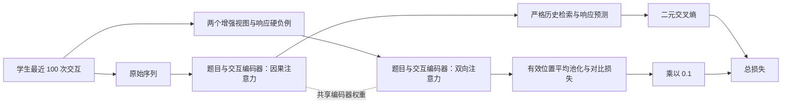

# CL4KT 论文精读与实现对照

本文对应 Lee 等的 *Contrastive Learning for Knowledge Tracing*（WWW 2022，DOI：[10.1145/3485447.3512105](https://doi.org/10.1145/3485447.3512105)）。阅读依据是工作区 `论文/` 中的完整正文；实现依据是 [UpstageAI/cl4kt](https://github.com/UpstageAI/cl4kt)，固定上游版本为 `f08aa4b5adb8eabfa4306b64e43bf3ac92ff06a2`。

`upstream/` 保存下载的原始上游代码，根目录是适配当前环境并修复问题的工作版。下文分别标明论文定义、上游实现细节与工作版差异，不能将工作版修复说成作者原始实现。本文只记录方法与比较目标，不记录本次实验成绩。

## 1. 任务与论文动机

知识追踪根据一名学生的历史作答，预测下一题能否答对。令第 \(t\) 次交互为 \(s_t=(q_t,r_t)\)，其中 \(r_t\in\{0,1\}\)，模型估计

\[
\hat r_{t+1}=P(r_{t+1}=1\mid s_1,\ldots,s_t,q_{t+1}).
\]

预测时可以知道下一题的身份，不能读取下一题的真实回答。学生通常只练习题库中的很少一部分题，容易导致表示过拟合。CL4KT 在响应预测以外增加对比学习：同一历史经过合理扰动后仍应接近，其他历史及反转响应后的历史应远离。

论文的模型叙述使用“question”。**官方 CL4KT 实际从 `batch["skills"]` 取输入，`question_embed` 的大小也由 `num_skills` 决定，不能因变量名中出现 question 就改成 `item_id`。** `item_id` 虽被数据集返回，CL4KT 主模型不使用它来进行上述嵌入。这里的有效 token 因而是预处理后的技能组合，区别于实际题库题目。

## 2. 共享架构与两条训练路径

### 2.1 嵌入与编码器

论文定义两个嵌入表：题目表 \(E^Q\in\mathbb R^{M\times d}\)，交互表 \(E^S\in\mathbb R^{2M\times d}\)。题目嵌入为 \(E^Q[q_t]\)，交互嵌入为 \(E^S[q_t+Mr_t]\)，用来区分“某题答对”和“同题答错”。两个 Transformer 分别编码题目序列和交互序列，并采用 AKT 的距离感知注意力。

在代码中，`models/cl4kt.py` 的 `question_encoder` 和 `interaction_encoder` 同时供响应预测 RP 与对比学习 CL 使用，不是两套独立参数。`models/modules.py` 实现注意力与 Transformer 层。

工作版的交互索引步长覆盖完整 token 词表，包括 padding 和 mask。上游原索引步长可能使“答错的 mask token”与“答对的真实技能”落到同一索引；工作版修复了该碰撞。这是明确的实现修复，不属于论文公布的新设计。

### 2.2 响应预测 RP：只能读取历史响应

题目与交互 encoder 使用包含自身的下三角注意力掩码，代码为 `mask=1`。随后 knowledge retriever 使用严格下三角掩码 `mask=0`：当前位置的题目表示为 query，历史题目表示为 key，历史交互表示为 value。由此，预测当前题的表示可以参考之前的回答，不能读取当前回答。

最终将 retriever 输出与当前位置的原始题目嵌入拼接，再经全连接网络和 sigmoid 得到答对概率。官方实现是两层带 GELU/dropout 的隐藏层，加一层标量输出；不要把论文“two-layer fully-connected network”的简写误当成输出层总数。

RP 损失为有效位置上的二元交叉熵：

\[
\mathcal L_{RP}=-\sum_t\left[r_t\log\hat r_t+(1-r_t)\log(1-\hat r_t)\right].
\]

公式写为求和；官方 `BCELoss` 用均值，与对比损失权重共同决定实际尺度。输出截取 `[:,1:]`，评分时再排除响应为 `-1` 的 padding；左侧补齐的序列需按这一实际代码口径统计有效预测数。

### 2.3 对比学习 CL：概括整个历史

同一历史独立生成两个正视图。共享的题目与交互 encoder 改用全可见的双向掩码 `mask=2`，然后仅对有效位置平均池化，得到四个向量：\(z^{Q,+1},z^{Q,+2},z^{S,+1},z^{S,+2}\)。双向上下文只用于训练时的 CL，评估分支不会使用该表示预测回答。

代码的 `apply_pos=False` 也用于 CL encoder。在当前官方层实现中，这个开关还会跳过逐位置前馈网络，不能仅凭参数名把它解释为“关闭位置编码”。RP 调用 `apply_pos=True`。这一点是官方实现细节，论文没有单独展开。

## 3. 四种正样本增强与硬负样本

所有正增强都应尽量维持学生能力的语义，响应与技能的对应关系必须同步保存。

| 模块 | 论文定义 | 官方实现细节 |
| --- | --- | --- |
| Question mask | 按 \(\gamma_{mask}\) 选择题目，用 mask 代替，保留响应 | 采用类似 BERT 的 80% mask、10% 随机 token、10% 原 token；实际用于技能输入 |
| Interaction crop | 随机起点，保留连续 \(\lfloor\gamma_{crop}T\rfloor\) 次交互 | 参数为保留比例；极短时至少保留 1 次，随后左侧补齐 |
| Interaction permute | 随机选择连续 \(\lfloor\gamma_{perm}T\rfloor\) 次交互，并重排窗口 | 题目、技能、响应使用相同排列 |
| Question replace | 按训练数据正确率建立从易到难的链；答对换更易题、答错换更难题，响应不变 | 按技能正确率排序，只换难度链中的相邻技能；边界保持自身 |

增强代码位于 `utils/augment_seq.py`。实际组合顺序为 mask、replace、permute、crop；硬负响应在 mask 阶段根据原响应生成。`data_loaders.py` 对同一个样本分别用 `seed=index` 和 `seed=index+1` 创建两个视图，所以官方实现的两视图在不同 epoch 间固定。论文称随机增强，但没有公开这一随机数策略；工作版保留该实现行为以便与官方比较。

硬负样本不是另一个正增强：按概率 \(\gamma_{neg}\) 翻转响应 \(\tilde r_t=1-r_t\)，题目身份保持原样。它使相同题目历史的作答含义发生变化，负例只加入交互级对比项，不加入题目级对比项。默认 `negative_prob=1.0` 表示翻转所有有效响应。

难度统计应仅来自当前折的训练学生。工作版训练视图的难度链由训练数据集构建，且与官方一样基于保留下来的末 100 次交互。不要用整份数据的正确率构建训练增强，否则会引入测试标签信息。

## 4. 对比损失与整体目标

令 \(\operatorname{sim}(u,v)=\cos(u,v)/\tau\)。对于一个正对，第一个视图为 anchor，第二个视图的同一学生为正例，同批其他学生为负例。题目级损失可写为

\[
\mathcal L_{CL}^{Q}
=-\log\frac{\exp(\operatorname{sim}(z^{Q,+1},z^{Q,+2}))}
{\exp(\operatorname{sim}(z^{Q,+1},z^{Q,+2}))+
\sum_{z^{Q,-}}\exp(\operatorname{sim}(z^{Q,+1},z^{Q,-}))}.
\]

交互级项 \(\mathcal L_{CL}^{S}\) 形式相同，分母额外包括硬负样本。代码通过 cosine 相似度矩阵与 `CrossEntropyLoss` 实现；正样本标签为矩阵对角线。它是从第一视图到第二视图的单向交叉熵，并非自动加入反方向的两倍 SimCLR 损失。

上游还对每个 anchor 自己的硬负样本 logit 加 `hard_negative_weight`。默认值为 `1.0`，作用于温度缩放后的 logit；不要解释成将硬负损失乘 1，或将 cosine 乘 1。

整体优化目标为

\[
\mathcal L=\mathcal L_{RP}+\lambda
\left(\mathcal L_{CL}^{Q}+\mathcal L_{CL}^{S}\right),\qquad\lambda=0.1.
\]

论文的主要结论是恰当增强、双向 CL 与硬负例共同改善表示；过大的 \(\lambda\) 会使对比目标压过预测目标，并非越大越好。

## 5. 数据处理与评测协议

论文 §4.1 给出的统一原则：删除少于 5 次交互的学生，删除缺失具名知识点的交互，将每一种知识点组合映射为新技能。每名学生只保留**最近 100 次**交互，不能替换成全历史切成多个窗口。

ASSIST09 的官方预处理还有重要次序：先删缺失技能，再按此时行数过滤短序列，构建题目到技能的 Q 矩阵，之后按 `order_id` 去重，再把不同 Q 矩阵行映射为组合技能。论文表中的 **112 与官方去重后打印的原子技能数一致，模型实际使用 149 种技能组合**；作者未解释两者差异。先去重再过滤会改变学生群体；将 149 强行压成 112 会改变模型输入。数据版本、完整处理顺序和统计见 [DATA.md](DATA.md)。

评估必须按学生做 5 折交叉验证，每折测试约 20% 学生，剩余约 80% 中再分出 10% 作为验证集，即总体约 72%/8%/20%。验证集决定超参数和最佳 epoch，最终使用所选 checkpoint 在测试集评分。AUC 是 ROC 曲线下面积；RMSE 为 \(\sqrt{N^{-1}\sum_i(\hat r_i-r_i)^2}\)。逐折计算，再对五个折的指标取平均；将全部预测混在一起算一个总 AUC 是另一种统计量。

根目录 `main.py` 将学生划分保存下来，并在验证选择完成后才评分测试集。这是工作版对实验可审计性的完善。工作版逐折种子、模型恢复等行为以保存的配置和环境清单为准，不应声称论文公开了这些细节。

本项目已完成 **六数据集 CL4KT 主模型的学生级五折实验**：ASSIST09 为上轮 GPU4 结果，其余五个数据集为本轮 GPU7 的 25 折。完整成绩、数据版本限制和产物核验见 [RESULTS_ALL.md](RESULTS_ALL.md)。全部基线、增强/λ 消融、AKT 校准对照和 uniformity 尚未复现；本次固定配置实验也未重建作者未公开的逐数据集调参过程。

## 6. 已公开与未公开的参数

| 参数 | 论文 §4.1.4 | 官方公开配置或本项目选择 |
| --- | --- | --- |
| embedding/hidden dimension | 64 | 64 |
| 每学生序列长度 | 末 100 次 | `sequence_option=recent`，100 |
| 优化器/初始学习率 | Adam / 0.001 | 相同 |
| batch size | 512 | 512；改变它也改变批内负例数量 |
| 对比权重 \(\lambda\) | 0.1 | `reg_cl=0.1` |
| 早停 | validation AUC 10 epoch 不提升 | 工作版 `patience=10` |
| 四种正增强比例 | 分别在 `{0.3,0.5,0.7}` 内调参 | 本项目 mask/crop/permute/replace 为 `0.5/0.3/0.5/0.5`，来自 README 示例 |
| 硬负响应翻转率 | 在 `{0.1,0.5,1.0}` 内调参 | 1.0 |
| Transformer 层数/头数 | 未给出 | 官方示例 2 层 / 8 头 |
| FFN dimension | 未给出 | 官方示例 1024 |
| prediction hidden sizes | 未给出具体值 | 官方示例 512、256 |
| dropout | 未给出 | CL4KT 官方示例 0.2 |
| 温度 \(\tau\) | 未给出 | 官方示例 0.05 |
| hard negative logit bias | 未给出 | 官方示例 1.0 |
| 最大 epoch / 梯度裁剪 | 未给出 | 官方示例 300 / 2.0 |
| 随机种子 | 未给出 | 官方示例基础种子 12405；工作版逐折细节见运行清单 |

论文没有逐数据集的最终最优增强组合。上游 `configs/example.yaml` 的 mask/permute/replace 是 `0.2/0.3/0.3`，也与 README 命令不同；不能将该 YAML 当作六个数据集统一的论文最优配置。本项目的固定配置是可重复的起点，未经验证集搜索不能说已经重建作者的调参过程。

## 7. 论文表 1 与表 2 的比较目标

以下全部是**论文公布值**，不代表当前工作区已经取得这些结果。学生、题目、技能与交互数为截断末 100 次之前的表 1 口径；AUC/RMSE 为表 2 的 CL4KT 五折平均。

| 论文数据集 | 学生数 | 题目数 | 技能数 | 交互数 | CL4KT AUC ↑ | CL4KT RMSE ↓ |
| --- | ---: | ---: | ---: | ---: | ---: | ---: |
| algebra05 | 571 | 173,113 | 112 | 607,014 | 0.7891 | 0.3815 |
| algebra06 | 1,138 | 129,263 | 493 | 1,817,450 | 0.7733 | 0.3791 |
| assist09 | 3,695 | 17,728 | 112 | 282,071 | 0.7624 | 0.4333 |
| slepemapy | 5,000 | 2,723 | 1,391 | 625,523 | 0.7218 | 0.3926 |
| spanish | 182 | 409 | 221 | 578,726 | 0.8289 | 0.4049 |
| statics | 333 | — | 1,223 | 189,297 | 0.7943 | 0.3945 |

论文 algebra06 指 Bridge to Algebra 2006–2007，官方预处理名称为 `bridge_algebra06`。slepemapy 使用随机抽取的 5,000 名学生，但未公开论文样本列表或抽样种子，精确复原该批 625,523 次交互存在限制。其他数据集同样应先核验来源版本与表 1，避免把不同预处理的结果直接并列比较。

Table 2 同时比较 IRT、PFA、DKT、DKVMN、SAKT、AKT。论文报告 CL4KT 在六个数据集上均改善 AUC 和 RMSE，并相对最佳 baseline 给出显著性标记。本次单个固定配置的五折运行不能替代对全部 baseline 及显著性分析的重新验证。

## 8. 消融与进一步分析的含义

论文还研究：单个增强及其比例、\(\lambda\) 敏感性、向 DKT/SAKT 添加 CL；去除双向编码、分别去除四种增强、去除硬负例；以及校准与表示 uniformity。复现这些实验时，应保持同一套学生划分与模型选择规则，仅改变被研究因素。

去除 crop 可令其不触发，不能随意把保留比例设为 0 再依赖某个边界分支。去除 hard negatives 需 `negative_prob=0` 并确认该分支关闭。评估 uniformity 时须核对归一化、取样单位、表示层和聚合方式；论文只给结果与引用，没有提供完整可直接执行的分析协议，不能把任意相似的绘图当作精确复原。

已补查原始 PDF 第 5 页的脚注 1（两份 Markdown 遗漏了正文）：作者将 question replace 与此前按相同技能替换题目的策略区分开来，强调本方法使用响应信息，并且不依赖预定义的技能与题目关系。这条脚注没有说明将问题 token 等同于技能 token；两者的表述差异仍以可核验的官方代码行为为准。论文 §3.6 将硬负例加入交互对比集合时写作“Eq. (7)”，实际交互损失位于式 (8)，这是公式编号笔误，不应因此把硬负例加入题目对比项。
