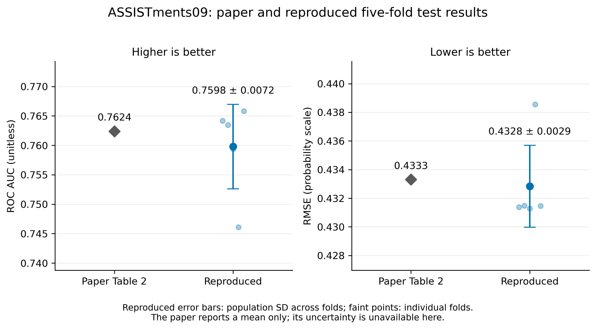
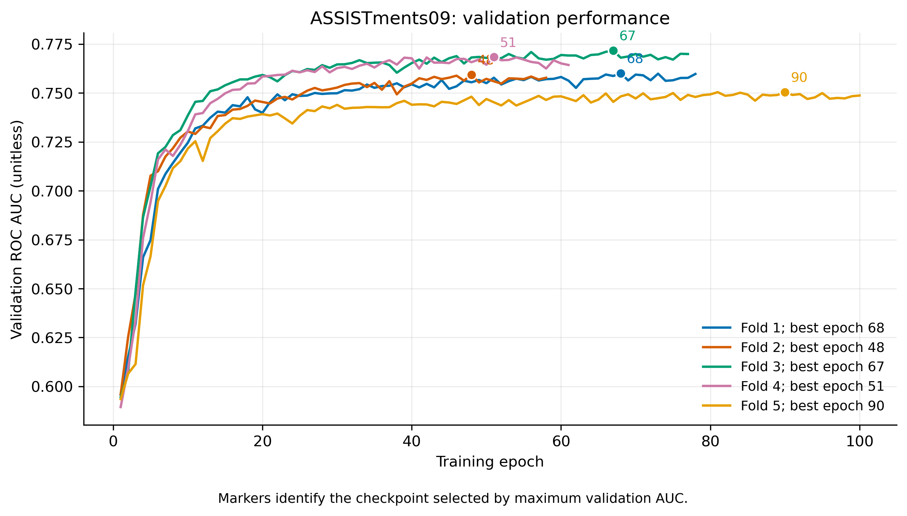
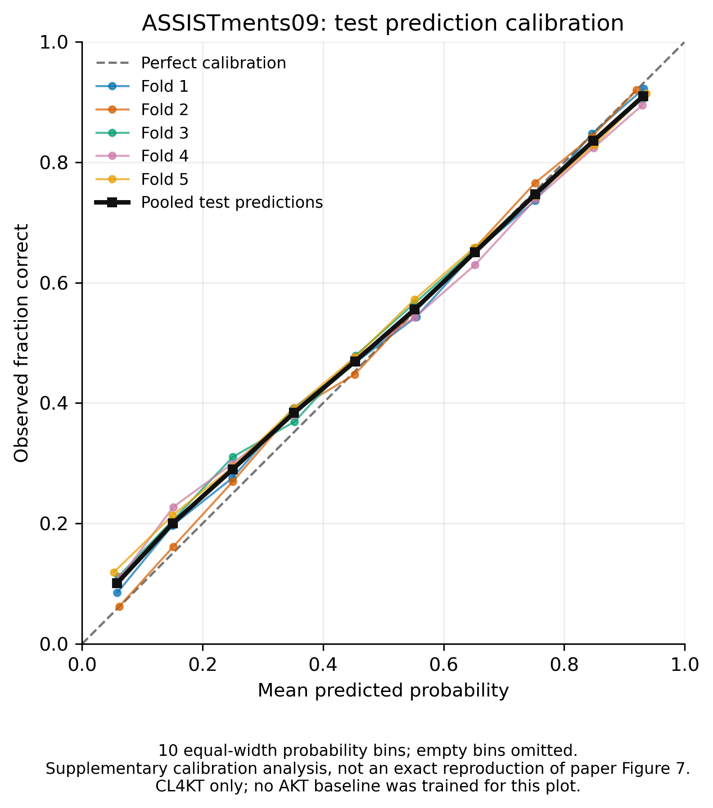

# ASSISTments09 完整五折复现实验报告

2026-11-05 追加实验：其余五个数据集已在物理显卡 7 上完成全部 25 折并通过独立核验。完整成绩、图表和可比性说明见 [六数据集报告](RESULTS_ALL.md)，运行协议见 [GPU7_EXPERIMENTS.md](GPU7_EXPERIMENTS.md)，完成状态见 [suite.json](../results/gpu7/suite.json)。下文保留 2026-11-04 的 ASSISTments09 历史结果。

2026 年 11 月 4 日（Asia/Shanghai），已完成用户优先指定的 **CL4KT / ASSISTments09 学生级五折交叉验证**。模型、预处理、环境配置与实验记录均保存在当前工作区。这里报告的是对官方实现修复后的运行结果；本页仅记录首轮 ASSIST09 实验。

## 五折平均与论文对比

| 指标 | 本次五折均值 | 折间总体标准差 | 论文 Table 2 | 本次减论文 |
| --- | ---: | ---: | ---: | ---: |
| AUC ↑ | **0.759788** | 0.007178 | 0.7624 | −0.002612 |
| RMSE ↓ | **0.432830** | 0.002863 | 0.4333 | −0.000470 |
| ACC ↑ | 0.720108 | 0.004931 | 未报告 | — |

AUC 比论文低约 **0.261 个百分点**，RMSE 低约 0.000470。均值按各折指标等权平均；不是合并预测后重新计算的 pooled AUC。标准差使用 `ddof=0`，仅描述折间波动，不是置信区间。上述差异是这一固定配置与划分的观测值，未做显著性检验。



## 每折实测结果

表中的折编号从 1 开始，文件夹编号从 0 开始。每折训练/验证/测试学生数均为 **2,660 / 296 / 739**。

| 折 / 文件夹 | seed | 最佳 epoch | 实际训练 epoch | 最佳验证 AUC | 测试 AUC | 测试 RMSE | 有效测试预测数 |
| --- | ---: | ---: | ---: | ---: | ---: | ---: | ---: |
| 1 / `fold_0` | 12405 | 68 | 78 | 0.760067 | 0.764188 | 0.431372 | 28,455 |
| 2 / `fold_1` | 12406 | 48 | 58 | 0.759397 | 0.763479 | 0.431473 | 28,874 |
| 3 / `fold_2` | 12407 | 67 | 77 | 0.771621 | 0.759373 | 0.431287 | 30,990 |
| 4 / `fold_3` | 12408 | 51 | 61 | 0.768481 | 0.746075 | 0.438555 | 29,796 |
| 5 / `fold_4` | 12409 | 90 | 100 | 0.750486 | 0.765825 | 0.431463 | 31,372 |

全部折均因验证 AUC 连续 10 次未提升而早停，使用验证集最优检查点对测试集评分。第四折测试分数较低，已纳入平均与标准差。五折训练与测试计时合计 **2,378.005 秒，约 39.6 分钟**，不含环境准备和文档整理。



## 数据与配置

输入来自本机已有的 ASSISTments09 原始 corrected.csv 展开版本，经固定官方预处理得到 **3,695 名学生、17,728 道题、282,071 次交互**。保留每名学生末 100 次后共 150,189 次交互；沿用官方左 padding 和 `[:,1:]` 评分规则，最终五折测试共 **149,487 个有效预测**。

官方预处理实际得到 **149 种技能组合**；论文的 112 与官方去重后打印的原子技能数一致，作者未解释这个差异。官方 CL4KT 将技能组合 ID 用作模型的 question token。先过滤短序列再去重的官方顺序还保留了 51 名最终不足 5 次交互的学生。详细来源、逐步统计与哈希见 [DATA.md](DATA.md) 和 [数据清单](../dataset/assistments09/manifest.json)。

| 配置项 | 本次运行 |
| --- | --- |
| 共享题目/交互编码器 | hidden 64、2 层、8 头、FFN 1024、dropout 0.2 |
| 预测隐藏层 | 512、256，GELU |
| 序列 | 每学生末 100 次，左 padding |
| 优化 | Adam、lr 0.001、batch 512、weight decay 0、梯度裁剪 2 |
| 对比目标 | λ=0.1、温度 0.05、硬负 logit 偏置 1 |
| mask / crop / permute / replace | 0.5 / 0.3 / 0.5 / 0.5 |
| 硬负响应翻转率 | 1.0 |
| 早停 | 最多 300 轮；验证 AUC 连续 10 轮未提升 |
| 随机性 | 基础 seed 12405；每折 seed+fold；独立保存学生划分 |
| 环境 | Python 3.12.12、PyTorch 2.6.0+cu124、NumPy 1.26.4、pandas 2.3.3、scikit-learn 1.8.0 |
| 设备 | 单张 NVIDIA GeForce RTX 4090，物理 GPU 4；FP32 |
| 官方来源 | `f08aa4b5adb8eabfa4306b64e43bf3ac92ff06a2`，2022-04-29 |

增强组合来自官方 README 示例，不是作者公布的 ASSIST09 最优值；论文没有给出该逐数据集组合。本次未执行全部 243 个增强/反转比例组合的搜索。训练入口、实际配置和环境均有快照。

## 实现差异与验证

工作版修复了官方注意力全遮挡行导致的未来答案泄漏、硬负例逐层传递、mask 交互嵌入索引碰撞、CPU/单样本兼容，以及增强窗口边界和全局 NumPy 随机状态污染。训练流程增加逐折检查点、固定划分和完整记录。所有差异见 [CHANGES.md](CHANGES.md)；原始 `upstream/` 未修改。

独立的同权重因果性对照中，反转当前及未来响应使原始模型较早预测的最大变化为 `0.00018259882926940918`；只修复注意力遮罩后为 **0**。证据见 [audit-causality.json](../results/audit-causality.json)。工作版仍保留官方以技能作输入、每学生固定两个增强视图、单向对比 CE 及 attention 的 padding 处理等细节；它是有明确差异说明的复现，不能当成作者原始程序的逐位重现。

验证结果：

- **8 项回归测试全部通过**：因果性、全遮挡注意力、交互嵌入互异、CPU 梯度、单学生推理、增强边界、局部随机数与学生划分。见 [unit-tests.txt](../results/assistments09-fivefold/unit-tests.txt)。
- **完整产物独立核验通过**：3,695 名学生测试覆盖恰好一次，各折训练/验证/测试互斥；保存标签与原数据顺序一致；全部预测重算 AUC/RMSE/ACC 与记录一致；最佳 epoch、checkpoint 元数据/哈希、源码快照/哈希和数据哈希一致；五折均值/标准差一致。见 [verification.txt](../results/assistments09-fivefold/verification.txt)。
- 论文指标对比、验证曲线和补充校准图已导出 PNG/PDF。校准图只有本次 CL4KT，未训练 AKT，不是论文 Figure 7 的精确复现。



## 复跑与文件位置

```sh
CUDA_VISIBLE_DEVICES=7 sh scripts/train_assistments09.sh \
  --device cuda:0 --output-dir results/new-assistments09-fivefold
```

新实验使用新目录。完整五折已保存在 `results/assistments09-fivefold/`，每折有 `best.pt`、`history.csv`、`predictions.npz`、`metrics.json`、`split.json` 和 `data_stats.json`。汇总见 [summary.json](../results/assistments09-fivefold/summary.json)，表格导出见 [fold_metrics.csv](../results/assistments09-fivefold/fold_metrics.csv)。完整终端日志为 [assistments09-fivefold.log](../results/assistments09-fivefold.log)。

```sh
CUDA_VISIBLE_DEVICES='' .venv/bin/python -m unittest discover -s tests -v
CUDA_VISIBLE_DEVICES='' .venv/bin/python scripts/verify_run.py \
  --run-dir results/assistments09-fivefold
MPLCONFIGDIR=/tmp/cl4kt-matplotlib .venv/bin/python scripts/plot_results.py \
  --run-dir results/assistments09-fivefold
```

其余五个数据集已于 2026-11-05 完成，见 [六数据集报告](RESULTS_ALL.md)。全部基线、增强/λ 消融和 uniformity 分析未计入完成范围。论文方法与后续扩展所需核对点见 [PAPER.md](PAPER.md)。
