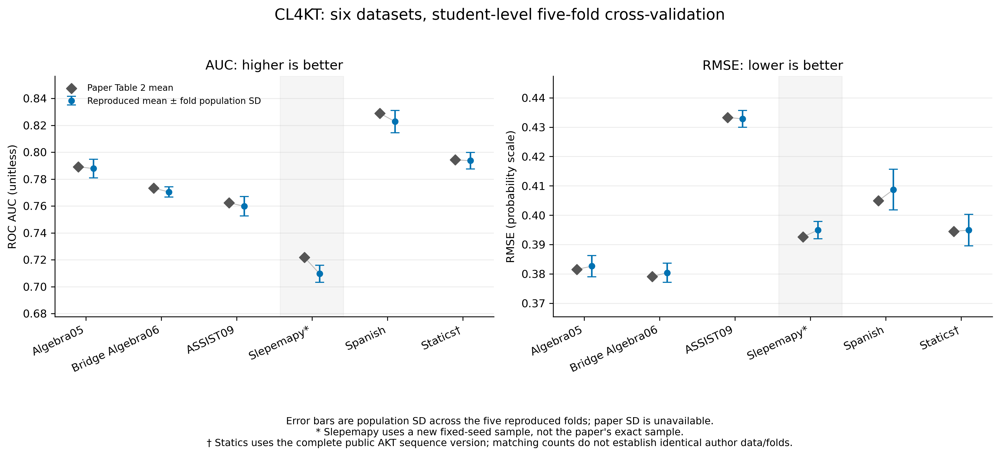

# CL4KT 六数据集完整五折主实验报告

本轮训练于 **2026 年 11 月 5 日 11:12（Asia/Shanghai）** 全部结束。Spanish、Statics、Algebra05、Bridge Algebra06、Slepemapy 均已在物理 GPU7 完成五折训练、独立产物核验和图表导出，新增实验共 **25 折**。连同上轮 ASSIST09，六数据集主模型实验共 30 折均通过统一核验。

上轮 ASSIST09 已完成的 GPU4 五折结果作为历史比较单列；本轮新增 25 折全部绑定物理 GPU7。历史 GPU4 结果未在本轮重跑，旧 GPU0/1 的中断结果不计入正式汇总。完成状态见 [suite.json](../results/gpu7/suite.json) 和 [套件日志](../results/gpu7/suite.log)；机器可读结果见 [CSV](../results/gpu7/all_datasets.csv) / [JSON](../results/gpu7/all_datasets.json)。

复现对象为 Lee 等的 [*Contrastive Learning for Knowledge Tracing*](https://doi.org/10.1145/3485447.3512105)（WWW 2022）中的 **CL4KT 主模型**。本文不宣称已复现全部 baseline、增强/λ 消融、uniformity 分析或统计显著性检验。

## 1. 已完成的五折成绩与论文参考

每个均值由五个测试折等权平均，`±` 为折间总体标准差（`ddof=0`），不是置信区间；未用合并预测后的 pooled AUC 替换折平均。论文表 2 仅给均值，未公开对应数值标准差。下列差值为“本次减论文”，AUC 差用百分点表示。

| 数据集 | 本次 AUC ↑ | 论文 AUC | AUC 差（百分点） | 本次 RMSE ↓ | 论文 RMSE | RMSE 差 | 设备/状态 |
| --- | ---: | ---: | ---: | ---: | ---: | ---: | --- |
| Algebra05 | 0.787839 ± 0.006908 | 0.7891 | −0.1261 | 0.382623 ± 0.003656 | 0.3815 | +0.001123 | GPU7，5/5 完成 |
| Bridge Algebra06 | 0.770440 ± 0.003771 | 0.7733 | −0.2860 | 0.380368 ± 0.003271 | 0.3791 | +0.001268 | GPU7，5/5 完成 |
| ASSIST09（历史） | 0.759788 ± 0.007178 | 0.7624 | −0.2612 | 0.432830 ± 0.002863 | 0.4333 | −0.000470 | GPU4，上轮 5/5 完成 |
| Slepemapy* | 0.709579 ± 0.006406 | 0.7218 | −1.2221 | 0.394925 ± 0.002934 | 0.3926 | +0.002325 | GPU7，5/5 完成 |
| Spanish | 0.822774 ± 0.008274 | 0.8289 | −0.6126 | 0.408704 ± 0.006922 | 0.4049 | +0.003804 | GPU7，5/5 完成 |
| Statics† | 0.793685 ± 0.006129 | 0.7943 | −0.0615 | 0.394905 ± 0.005382 | 0.3945 | +0.000405 | GPU7，5/5 完成 |

这些是同一公开固定配置与本次划分下的观测结果。与论文数值的差距尚未作因果归因，也未进行显著性检验；不能据此断言差异由某项修复、超参数或某个训练设备造成。

`*` Slepemapy 使用重新固定种子的公开数据抽样，学生群体与论文原样本不能确认相同；本次完整五折指标只能在注明样本差异后作参考比较，不能直接等同作者原始样本上的复现精度。

`†` Statics 使用 AKT 作者公开的完整 333 学生序列版本，统计匹配但原匿名 ID、真实时间戳和独立题目元数据未保留；未证明与 CL4KT 作者数据文件或折分完全相同。

所有精确数值、逐折模型及预测保存在对应运行目录；本表仅按六位小数展示。

## 2. 运行协议与参数来源

官方代码来源固定为 [UpstageAI/cl4kt](https://github.com/UpstageAI/cl4kt) 的 commit `f08aa4b5adb8eabfa4306b64e43bf3ac92ff06a2`。`upstream/` 保留作者原代码，根目录是明确记录过修复的工作版。注意力泄漏、硬负表示传递、嵌入索引和运行兼容等差异见 [CHANGES.md](CHANGES.md)，不能把本次结果称为未经修改的作者程序的逐位重现。

| 项目 | 六数据集采用的设置 |
| --- | --- |
| 划分 | 按学生做 5 折；每折训练部分再取 10% 学生验证 |
| 历史长度 | 每学生末 100 次，左 padding；保留官方评分位置口径 |
| 编码器 | hidden 64、2 层、8 头、FFN 1024、dropout 0.2 |
| 优化 | Adam、学习率 0.001、batch 配置 512、weight decay 0、梯度裁剪 2 |
| 对比目标 | λ=0.1、温度 0.05、硬负 logit 偏置 1 |
| mask / crop / permute / replace | 0.5 / 0.3 / 0.5 / 0.5 |
| 硬负响应翻转率 | 1.0 |
| 早停与选择 | 最多 300 轮；验证 AUC 连续 10 轮不提升即停；仅最佳验证 checkpoint 评分测试集 |
| 随机性 | 基础种子 12405，折编号 `0..4` 对应 `12405..12409`，保存学生名单 |
| 环境 | Python 3.12.12、PyTorch 2.6.0+cu124、NumPy 1.26.4、pandas 2.3.3、scikit-learn 1.8.0 |

增强组合来自官方 README 示例，其余通用模型参数来自公开配置。论文未公布逐数据集最终最佳增强组合；本轮没有进行逐数据集完整网格搜索，也没有用测试集选配置。因此这里报告**公开固定配置下的 CL4KT 五折实验**，未重建作者未公开的最佳调参过程。训练学生不足 512 或尾批不足时，实际批大小自然较小，没有通过另行缩小 batch 配置节省显存。

本轮新增 25 折通过 `scripts/run_remaining_gpu7.py` 串行提交，启动器在导入 PyTorch 前强制 `CUDA_DEVICE_ORDER=PCI_BUS_ID`、`CUDA_VISIBLE_DEVICES=7`，程序内 `cuda:0` 对应物理 GPU7。采用逐 Transformer block 的 non-reentrant activation checkpointing，保留随机数状态，并将 query/key/value 张量作为位置参数传入以正确保存 CUDA RNG。仍使用 FP32、batch 配置 512 和原工作版核心训练逻辑，无混合精度或优化器替换。详细规则和中断恢复边界见 [GPU7_EXPERIMENTS.md](GPU7_EXPERIMENTS.md)。

CPU 与 GPU7 的完整小模型对照中，预测、对比损失、总损失、全部 **98 个参数梯度**的差均为 0，反向结束后的 CPU/CUDA 随机数状态一致：[精确等价证据](../results/gpu7/checkpoint-equivalence-gpu7.txt)。这验证了所记录环境和测试实例上的 checkpoint 等价性，不是对所有硬件和任意长训练的逐位保证。

启动前真实 Slepemapy、hidden 64、batch 配置 512 的单 epoch smoke 峰值 allocated 为 **2.86 GiB**，reserved 为 **3.35 GiB**：[smoke execution.json](../results/gpu7/smoke-slepemapy/execution.json)。该 smoke 只验证可运行性与显存，不参与正式成绩。

## 3. 数据来源、统计与可比性

下表是选取末 100 次之前的全量预处理统计，不能当作模型实际评分条数。官方主模型使用 `skill_id` 作为问题 token；原子技能数与组合技能词表大小必须区分。

| 数据集 | 来源版本 | 学生 | 题目/练习 token | 表 1 技能口径 | 模型技能 token | 交互 |
| --- | --- | ---: | ---: | ---: | ---: | ---: |
| ASSIST09 | corrected.csv 展开版 | 3,695 | 17,728 | 112 | 149 | 282,071 |
| Algebra05 | SIGKDD 官方原始 train TXT | 571 | 173,113 | 112 | **271** | 607,014 |
| Bridge Algebra06 | SIGKDD 官方原始 train TXT | 1,138 | 129,263 | 493 | **550** | 1,817,450 |
| Spanish | WCRP 作者响应与专家标签 | 182 | 409 | 221 | 221 | 578,726 |
| Statics† | AKT 作者完整学生序列 | 333 | 1,223 个练习 token | 1,223 | 1,223 | 189,297 |
| Slepemapy* | 公开 answer.csv，种子 12405 新抽样 | 5,000 | 2,713 | 1,380 | 1,380 | 623,212 |

ASSIST09、两个 Algebra、Spanish 与 Statics 按论文表 1 的可核对统计项匹配。Algebra05 的 271、Bridge 的 550 是官方合并多知识点组合后真正进入 embedding 的词表，不能用 112 或 493 替代。ASSIST09 同样有 112/149 的统计口径区别。

Slepemapy 的论文表 1 是 5,000 名学生、2,723 道题、1,391 个技能、625,523 次交互；本次原始来源和抽样规则相同，但论文学生名单与种子未公开。本次只抽样一次并保存名单，未反复抽样凑出论文数字。Statics 也未将公开的 282 学生/98 知识点标准表静默替换成论文口径，而使用完整学生序列并明确 token 字段含义。

输入文件、来源 URL、固定作者 commit、处理步骤和 SHA256 见 [ASSIST09](DATA.md)、[两个 Algebra](DATA_ALGEBRA.md)、[Spanish/Statics](DATA_SPANISH_STATICS.md)、[Slepemapy](DATA_SLEPEMAPY.md)。每个数据目录的 `manifest.json` 保存逐步统计与输出哈希。

## 4. 已完成的新增数据集逐折结果

折编号与文件夹一致，从 0 开始；随机种子为 `12405 + fold`。下列时间为该折记录的 `elapsed_seconds`，包含其训练、验证和测试流程，不包括全部数据准备及环境搭建。

### Spanish

| fold | 测试 AUC | 测试 RMSE | 最佳 epoch | 实际 epoch | 测试预测数 | 时间（秒） |
| --- | ---: | ---: | ---: | ---: | ---: | ---: |
| 0 | 0.827912 | 0.408784 | 43 | 53 | 3,663 | 21.687 |
| 1 | 0.830841 | 0.405034 | 57 | 67 | 3,663 | 25.846 |
| 2 | 0.824459 | 0.400807 | 45 | 55 | 3,564 | 25.524 |
| 3 | 0.807048 | 0.421439 | 29 | 39 | 3,564 | 17.698 |
| 4 | 0.823610 | 0.407454 | 37 | 47 | 3,564 | 14.318 |

精确数据：[summary.json](../results/gpu7/spanish-fivefold/summary.json)；[核验结果](../results/gpu7/spanish-fivefold/verification.txt)；[完整日志](../results/gpu7/spanish-fivefold.log)。

### Statics†

| fold | 测试 AUC | 测试 RMSE | 最佳 epoch | 实际 epoch | 测试预测数 | 时间（秒） |
| --- | ---: | ---: | ---: | ---: | ---: | ---: |
| 0 | 0.796293 | 0.392115 | 76 | 86 | 6,040 | 58.439 |
| 1 | 0.801358 | 0.390845 | 74 | 84 | 6,067 | 44.933 |
| 2 | 0.783455 | 0.401613 | 60 | 70 | 5,881 | 49.928 |
| 3 | 0.790702 | 0.401122 | 75 | 85 | 6,033 | 47.603 |
| 4 | 0.796619 | 0.388829 | 86 | 96 | 6,125 | 64.990 |

精确数据：[summary.json](../results/gpu7/statics-fivefold/summary.json)；[核验结果](../results/gpu7/statics-fivefold/verification.txt)；[完整日志](../results/gpu7/statics-fivefold.log)。

### Algebra05

| fold | 测试 AUC | 测试 RMSE | 最佳 epoch | 实际 epoch | 测试预测数 | 时间（秒） |
| --- | ---: | ---: | ---: | ---: | ---: | ---: |
| 0 | 0.790737 | 0.384843 | 105 | 115 | 10,736 | 116.988 |
| 1 | 0.795206 | 0.375956 | 75 | 85 | 10,572 | 89.399 |
| 2 | 0.779088 | 0.386382 | 76 | 86 | 10,680 | 74.819 |
| 3 | 0.780074 | 0.381722 | 66 | 76 | 10,207 | 78.469 |
| 4 | 0.794089 | 0.384212 | 89 | 99 | 10,334 | 99.107 |

精确数据：[summary.json](../results/gpu7/algebra05-fivefold/summary.json)；[核验结果](../results/gpu7/algebra05-fivefold/verification.txt)；[完整日志](../results/gpu7/algebra05-fivefold.log)。

### Bridge Algebra06

| fold | 测试 AUC | 测试 RMSE | 最佳 epoch | 实际 epoch | 测试预测数 | 时间（秒） |
| --- | ---: | ---: | ---: | ---: | ---: | ---: |
| 0 | 0.769681 | 0.380793 | 103 | 113 | 21,541 | 214.601 |
| 1 | 0.773723 | 0.382263 | 88 | 98 | 22,100 | 192.416 |
| 2 | 0.768800 | 0.380475 | 66 | 76 | 22,332 | 137.390 |
| 3 | 0.775322 | 0.374318 | 89 | 99 | 22,095 | 157.232 |
| 4 | 0.764675 | 0.383990 | 69 | 79 | 21,848 | 125.316 |

精确数据：[summary.json](../results/gpu7/bridge_algebra06-fivefold/summary.json)；[核验结果](../results/gpu7/bridge_algebra06-fivefold/verification.txt)；[完整日志](../results/gpu7/bridge_algebra06-fivefold.log)。ASSIST09 的历史逐折明细见 [上轮报告](RESULTS.md) 和 [原始摘要](../results/assistments09-fivefold/summary.json)。

### Slepemapy*

| fold | 测试 AUC | 测试 RMSE | 最佳 epoch | 实际 epoch | 测试预测数 | 时间（秒） |
| --- | ---: | ---: | ---: | ---: | ---: | ---: |
| 0 | 0.699853 | 0.398272 | 23 | 33 | 54,248 | 234.936 |
| 1 | 0.707475 | 0.394612 | 44 | 54 | 55,273 | 380.221 |
| 2 | 0.719671 | 0.390809 | 82 | 92 | 53,533 | 650.111 |
| 3 | 0.711637 | 0.398132 | 69 | 79 | 55,754 | 556.394 |
| 4 | 0.709259 | 0.392800 | 40 | 50 | 56,197 | 352.810 |

精确数据：[summary.json](../results/gpu7/sampled_slepemapy-fivefold/summary.json)；[核验结果](../results/gpu7/sampled_slepemapy-fivefold/verification.txt)；[完整日志](../results/gpu7/sampled_slepemapy-fivefold.log)。该数据集的样本差异见第 3 节，未根据测试成绩重抽学生或调参。

## 5. 运行时间与峰值显存

时间戳来自实际 `execution.json`，使用 Asia/Shanghai；历史 ASSIST09 另来自其环境与逐折记录。峰值 reserved 为 PyTorch 分配器统计，不是显卡上所有进程的总占用。

| 数据集 | 新实验开始 | 新实验结束 | 各折计时之和（秒） | 五折测试预测总数 | 峰值 reserved（GiB） |
| --- | --- | --- | ---: | ---: | ---: |
| Spanish | 11-05 10:06:31 | 11-05 10:08:20 | 105.073 | 18,018 | 0.922 |
| Statics† | 11-05 10:08:28 | 11-05 10:12:56 | 265.893 | 30,146 | 1.637 |
| Algebra05 | 11-05 10:13:05 | 11-05 10:20:48 | 458.782 | 52,529 | 2.580 |
| Bridge Algebra06 | 11-05 10:20:57 | 11-05 10:35:56 | 826.955 | 109,916 | 3.408 |
| Slepemapy* | 11-05 10:36:05 | 11-05 11:12:27 | 2,174.472 | 275,005 | 3.350 |

本轮新增 25 折计时之和为 **3,831.175 秒，约 63.85 分钟**，测试预测共 **485,614 条**；套件从启动到结束约 66 分钟，另含进程启动、预检和数据加载等开销。

ASSIST09 历史五折计时之和为 2,378.005 秒，测试预测总数 149,487；其 GPU4 实验没有本轮启动器的峰值记录。不同数据规模、不同设备和不同启动方式的时间不构成受控性能基准，不能据此推断 checkpoint 带来的加速比例。

## 6. 已导出的 PNG/PDF 图表

论文对比图展示表 2 均值与本次折间总体标准差；验证曲线标出最佳 epoch；校准图仅包含本次 CL4KT 的预测，没有重新训练 AKT，因此不是论文 Figure 7 的完整方法对比复现。

| 数据集 | 论文指标对比 | 验证 AUC 曲线 | 校准图 |
| --- | --- | --- | --- |
| Algebra05 | [PNG](../results/gpu7/algebra05-fivefold/figures/paper_comparison.png) / [PDF](../results/gpu7/algebra05-fivefold/figures/paper_comparison.pdf) | [PNG](../results/gpu7/algebra05-fivefold/figures/validation_auc.png) / [PDF](../results/gpu7/algebra05-fivefold/figures/validation_auc.pdf) | [PNG](../results/gpu7/algebra05-fivefold/figures/calibration.png) / [PDF](../results/gpu7/algebra05-fivefold/figures/calibration.pdf) |
| Bridge Algebra06 | [PNG](../results/gpu7/bridge_algebra06-fivefold/figures/paper_comparison.png) / [PDF](../results/gpu7/bridge_algebra06-fivefold/figures/paper_comparison.pdf) | [PNG](../results/gpu7/bridge_algebra06-fivefold/figures/validation_auc.png) / [PDF](../results/gpu7/bridge_algebra06-fivefold/figures/validation_auc.pdf) | [PNG](../results/gpu7/bridge_algebra06-fivefold/figures/calibration.png) / [PDF](../results/gpu7/bridge_algebra06-fivefold/figures/calibration.pdf) |
| ASSIST09（历史） | [PNG](../results/assistments09-fivefold/figures/paper_comparison.png) / [PDF](../results/assistments09-fivefold/figures/paper_comparison.pdf) | [PNG](../results/assistments09-fivefold/figures/validation_auc.png) / [PDF](../results/assistments09-fivefold/figures/validation_auc.pdf) | [PNG](../results/assistments09-fivefold/figures/calibration.png) / [PDF](../results/assistments09-fivefold/figures/calibration.pdf) |
| Spanish | [PNG](../results/gpu7/spanish-fivefold/figures/paper_comparison.png) / [PDF](../results/gpu7/spanish-fivefold/figures/paper_comparison.pdf) | [PNG](../results/gpu7/spanish-fivefold/figures/validation_auc.png) / [PDF](../results/gpu7/spanish-fivefold/figures/validation_auc.pdf) | [PNG](../results/gpu7/spanish-fivefold/figures/calibration.png) / [PDF](../results/gpu7/spanish-fivefold/figures/calibration.pdf) |
| Statics† | [PNG](../results/gpu7/statics-fivefold/figures/paper_comparison.png) / [PDF](../results/gpu7/statics-fivefold/figures/paper_comparison.pdf) | [PNG](../results/gpu7/statics-fivefold/figures/validation_auc.png) / [PDF](../results/gpu7/statics-fivefold/figures/validation_auc.pdf) | [PNG](../results/gpu7/statics-fivefold/figures/calibration.png) / [PDF](../results/gpu7/statics-fivefold/figures/calibration.pdf) |
| Slepemapy* | [PNG](../results/gpu7/sampled_slepemapy-fivefold/figures/paper_comparison.png) / [PDF](../results/gpu7/sampled_slepemapy-fivefold/figures/paper_comparison.pdf) | [PNG](../results/gpu7/sampled_slepemapy-fivefold/figures/validation_auc.png) / [PDF](../results/gpu7/sampled_slepemapy-fivefold/figures/validation_auc.pdf) | [PNG](../results/gpu7/sampled_slepemapy-fivefold/figures/calibration.png) / [PDF](../results/gpu7/sampled_slepemapy-fivefold/figures/calibration.pdf) |

六数据集比较图已导出 [PNG](../results/gpu7/all_datasets_comparison.png) / [PDF](../results/gpu7/all_datasets_comparison.pdf)，对应 [CSV](../results/gpu7/all_datasets.csv) / [JSON](../results/gpu7/all_datasets.json) 同时保存数据版本、设备、均值、标准差、逐折数值与论文差值。



## 7. 验证、产物与复跑

六数据集全部通过统一产物核验：[aggregate-verification.txt](../results/gpu7/aggregate-verification.txt)。各运行目录的 `verification.txt` 也均通过：学生折间覆盖和分区互斥、保存标签与原数据序列顺序、预测重算 AUC/RMSE/ACC、验证集最佳 epoch、checkpoint 元数据/哈希、源码快照/哈希及数据哈希、折平均和总体标准差。新实验另核对 GPU7 绑定、FP32/batch 512、checkpoint 来源与退出状态。

本轮回归测试共 18 项，CPU 流程为 17 项通过、1 项 opt-in GPU 测试跳过，见 [regression-tests.txt](../results/gpu7/regression-tests.txt)。该 GPU checkpoint 等价测试已另在物理 GPU7 上通过，证据链接见第 2 节；没有把跳过项计作 CPU 测试通过。

每个运行目录保留 `best.pt`、`history.csv`、`predictions.npz`、`metrics.json`、学生 `split.json`、数据统计、实际配置、环境、依赖列表及源码快照。GPU7 启动器本身也保存在 `launcher/train_gpu7.py`，与 `execution.json` 的 SHA256 对照；只看核心源码快照不足以描述运行时 checkpoint 包装。正式结果目录为 `results/gpu7/<数据名>-fivefold`。

旧 `results/spanish-fivefold` 与 `results/statics-fivefold` 在 GPU0/1 上启动后中断，继续保留供追溯，但它们的任何已完成折均不续接进本轮 GPU7 目录。单 epoch smoke 同样排除。

在套件没有运行时恢复本轮：

```sh
.venv/bin/python -u scripts/run_remaining_gpu7.py --resume
```

全新重跑其余五个数据集，应使用新目录：

```sh
.venv/bin/python -u scripts/run_remaining_gpu7.py \
  --output-root results/gpu7-rerun
```

单数据集示例同样强制物理 GPU7：

```sh
.venv/bin/python -u scripts/train_gpu7.py \
  --config configs/algebra05.yaml --device cuda:0 \
  --output-dir results/gpu7-rerun/algebra05-fivefold
```

CPU 独立核验与重新导图示例：

```sh
CUDA_VISIBLE_DEVICES='' .venv/bin/python scripts/verify_run.py \
  --run-dir results/gpu7/algebra05-fivefold
CUDA_VISIBLE_DEVICES='' MPLCONFIGDIR=/tmp/cl4kt-matplotlib \
  .venv/bin/python scripts/plot_results.py \
  --run-dir results/gpu7/algebra05-fivefold
```

重新生成含历史 ASSIST09 的六数据集比较；脚本先核验完整性，并保留每次运行的设备与数据版本记录：

```sh
CUDA_VISIBLE_DEVICES='' MPLCONFIGDIR=/tmp/cl4kt-matplotlib \
  .venv/bin/python scripts/summarize_datasets.py \
  --gpu7-root results/gpu7
```

汇总脚本遇到缺折、预测不一致、哈希不符或新增实验缺少 GPU7 成功记录时会拒绝导出完整成绩。本报告对应六个完整五折实验；其复现范围、固定参数和数据可比性限制如前述。
