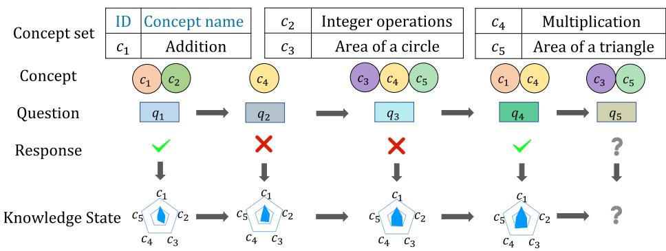
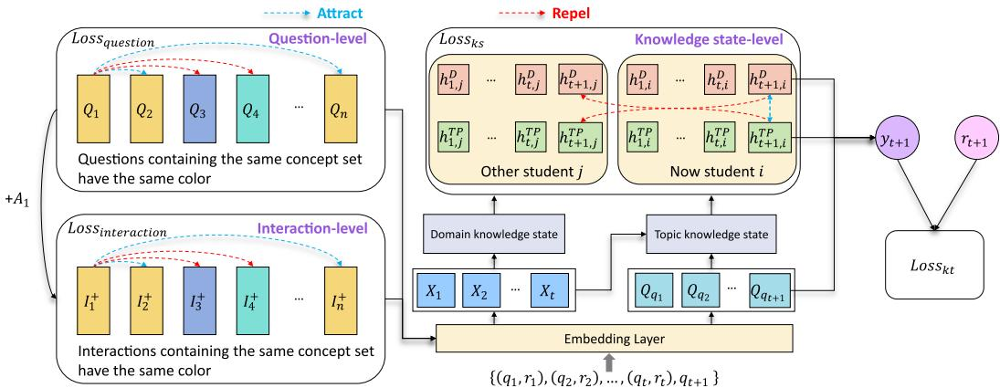
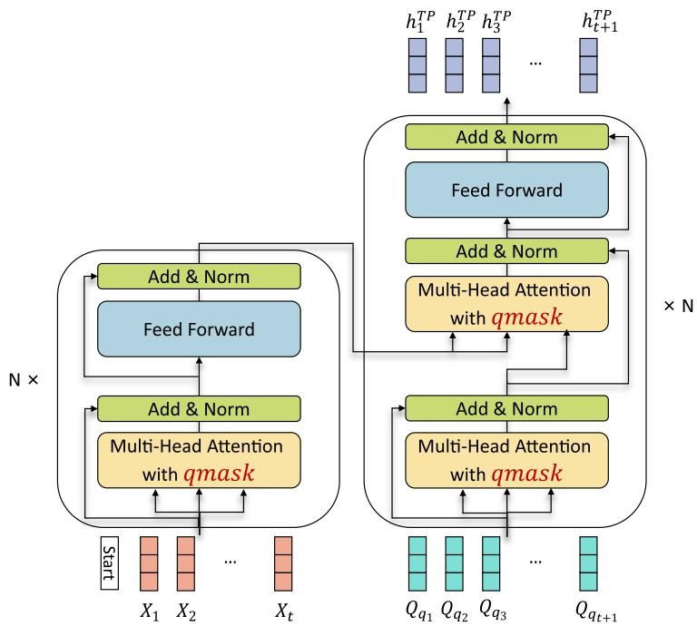
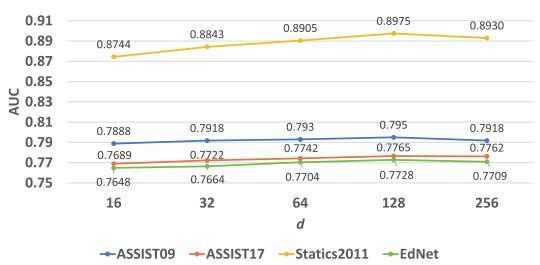
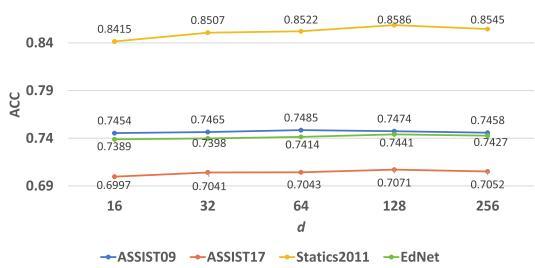
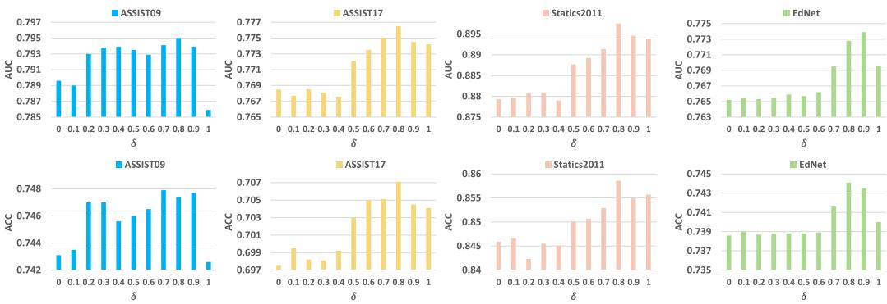
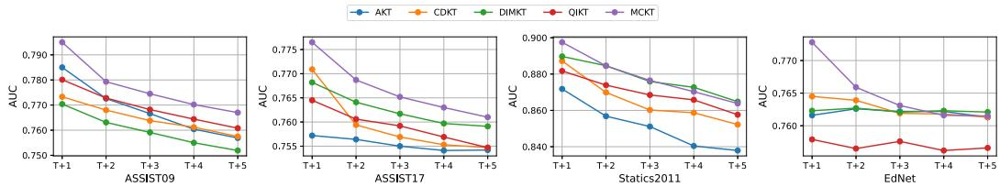
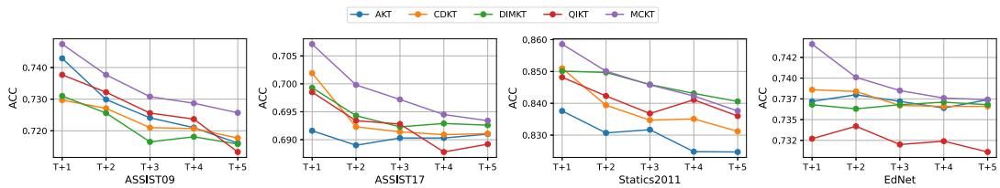
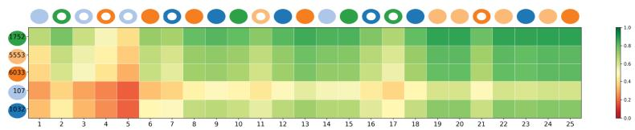
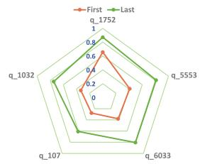

# Multi-level Contrastive Learning for Knowledge Tracing

XIAOXUAN SHEN, FENGHUA YU, and QIAN WAN, National Engineering Research Center of Educational Big Data, Central China Normal University, Wuhan, China and Faculty of Artificial Intelligence in Education, Central China Normal University, Wuhan, China

RUXIA LIANG, School of Computer Science, Central China Normal University, Wuhan, China JIANWEN SUN, National Engineering Research Center of Educational Big Data, Central China Normal University, Wuhan, China and Faculty of Artificial Intelligence in Education, Central China Normal University, Wuhan, China

Knowledge Tracing (KT) is the task of predicting students’ future performance based on their past interactions with educational resources. A key aspect of KT is representation learning, which aims to capture meaningful features from students’ learning behaviors to improve prediction performance. Recently, contrastive learning methods have shown great promise in representation learning. As a result, KT models based on contrastive learning have been introduced to enhance representation learning for KT. However, these models have posed several challenges. Firstly, most of these models adopt the contrastive learning approach used in other fields, which involves data augmentation followed by contrastive learning, yet efectively applying data augmentation in KT remains an open challenge. Secondly, these models typically apply contrastive learning to only one of the fundamental components of KT: questions, interactions, or knowledge states, thereby limiting their overall performance. To address these issues, this article proposes a Multi-level Contrastive learning model for Knowledge Tracing (MCKT). MCKT (The code can be found at https://github.com/lilstrawberry/MCKT.) does not rely on data augmentation strategies; instead, it deeply integrates domain knowledge and performs contrastive learning at three levels: questions, interactions, and knowledge states. Experimental results on four publicly available datasets, compared against a total of 20 state-of-the-art KT models, demonstrate that MCKT consistently outperforms other models. Subsequent experiments further validate the efectiveness of the multi-level contrastive learning approach.

This work was joint supported by the National Science and Technology Major Project (2022ZD0117103), National Natural Science Foundation of China (62207017, 62307015, 62293554). Youth AI Talents Fund of China Association of Automation (HBRC-JKYZD-2024-310), Higher Education Science Research Program of China Association of Higher Education (23XXK0301), Hubei Provincial Natural Science Foundation of China (2023AFA020), Fundamental Research Funds for the Central Universities (CCNU25AI019, CCNU25AI005), and China Postdoctoral Science Foundation (2022M711282).

Authors’ Contact Information: Xiaoxuan Shen, National Engineering Research Center of Educational Big Data, Central China Normal University, Wuhan, China and Faculty of Artificial Intelligence in Education, Central China Normal University, Wuhan, China; e-mail: shenxiaoxuan@ccnu.edu.cn; Fenghua Yu, National Engineering Research Center of Educational Big Data, Central China Normal University, Wuhan, China and Faculty of Artificial Intelligence in Education, Central China Normal University, Wuhan, China; e-mail: ayu2anqi@mails.ccnu.edu.cn; Qian Wan, National Engineering Research Center of Educational Big Data, Central China Normal University, Wuhan, China and Faculty of Artificial Intelligence in Education, Central China Normal University, Wuhan, China; e-mail: wanq8228@ccnu.edu.cn; Ruxia Liang (corresponding author), School of Computer Science, Central China Normal University, Wuhan, China; e-mail: rxliang@ccnu.edu.cn; Jianwen Sun (corresponding author), National Engineering Research Center of Educational Big Data, Central China Normal University, Wuhan, China and Faculty of Artificial Intelligence in Education, Central China Normal University, Wuhan, China; e-mail: sunjw@ccnu.edu.cn.

Permission to make digital or hard copies of all or part of this work for personal or classroom use is granted without fee provided that copies are not made or distributed for profit or commercial advantage and that copies bear this notice and the full citation on the first page. Copyrights for components of this work owned by others than the author(s) must be honored. Abstracting with credit is permited. To copy otherwise, or republish, to post on servers or to redistribute to lists, requires prior specific permission and/or a fee. Request permissions from permissions@acm.org. © 2025 Copyright held by the owner/author(s). Publication rights licensed to ACM.

ACM 1556-472X/2025/9-ART155

https://doi.org/10.1145/3759920

CCS Concepts: • Applied computing → Education; Distance learning;

Additional Key Words and Phrases: knowledge tracing, multi-level contrastive learning, user modeling, educational data mining

Associate Editor: Mahsa Salehi

ACM Reference format:

Xiaoxuan Shen, Fenghua Yu, Qian Wan, Ruxia Liang, and Jianwen Sun. 2025. Multi-level Contrastive Learning for Knowledge Tracing. ACM Trans. Knowl. Discov. Data. 19, 8, Article 155 (September 2025), 29 pages. https://doi.org/10.1145/3759920

## 1 Introduction

In recent years, with the rapid development of multimedia technology, educational methods have become increasingly diverse. Particularly since the outbreak of the COVID-19 pandemic, online education using the internet as a medium has gained widespread popularity. Online education platforms such as MOOCs and Coursera have atracted a large number of learners. As online education data accumulates, mining the underlying learning paterns is of paramount importance [77]. Once these learning paterns are captured, educators can tailor instruction to address learners’ weaknesses, continually improving their abilities, thus achieving a more personalized form of education [56]. Knowledge Tracing (KT) plays a crucial role in online education systems, predicting students’ future performance based on their past interactions with educational resources. Efectively addressing KT tasks undoubtedly assists educators in beter understanding students’ learning needs, thereby providing more personalized and targeted educational support [3].

A simple illustration of KT is shown in Figure 1. In this illustration, each question contains one or more relevant concepts, and students practice with diferent questions. Their knowledge state, which represents their mastery of knowledge, constantly evolves as they progress. KT involves predicting students’ future performance when answering questions. A key element in achieving accurate predictions is efective representation learning, which captures meaningful features from students’ learning behaviors and provides a foundation for modeling the dynamic progression of their knowledge over time. Clearly, how to trace and represent students’ knowledge states is crucial for KT [1, 43, 47]. In addition, in KT, the number of questions is often very high, leading to sparse interaction data between students and questions [6] (interaction here refers to students’ responses to questions in KT, typically indicating whether a question was answered correctly or incorrectly). In such cases, simple representations of questions and interactions can result in catastrophic failures of KT models [6, 66]. Therefore, how to represent questions and interactions is of paramount importance [33, 57, 83]. Several KT models [2, 12, 22, 45] have been proposed to address KT problems. For example, the earliest model proposed to address KT was Bayesian KT [11], which utilizes hidden Markov models to trace students’ knowledge states for each concept. Subsequently, with the rise of deep learning, deep learning-based KT models like DKT [43] were introduced, where DKT employs recurrent neural networks to trace students’ knowledge states. AKT [16] introduces the Rasch [44] method to represent questions and interactions, along with a context-aware atention mechanism to simulate students’ forgeting behavior for more efective representation ofstudents’ knowledge states. GIKT [74] employs Graph Convolutional Networks (GCNs) [26] to capture the relationships between questions and concepts. It also incorporates state evolution and review modules to represent students’ knowledge states.

Recently, contrastive learning methods have demonstrated powerful representation learning capabilities by capturing useful information in data through the learning of similarities and diferences between diferent samples or features [8, 20]. Subsequently, research has atempted to introduce

Multi-level Contrastive Learning for Knowledge Tracing

  
Fig. 1. A simple example of KT. Each question is associated with one or more concepts. A student practices on diferent questions, continuously accumulating knowledge, and KT involves predicting the probability of the student correctly solving the next question.

contrastive learning methods into the field of KT. For instance, CL4KT [30] proposed various interaction-enhancement strategies, utilizing contrastive learning to construct efective knowledge state representations. Bi-CLKT [51] employed graph-enhancement strategies [78] and employed contrastive learning to learn efective question representations. Currently, contrastive learningbased KT methods are still in the early stages of research. Despite their promising results, they have also brought about some challenges for further research: (1) They often follow contrastive learning paradigms from other domains, i.e., they first perform data augmentation and then apply contrastive learning. However, how to enhance KT through data augmentation strategies has remained an unexplored challenge. For example, data augmentation strategies proposed in CL4KT involve swapping the order of student responses. While this approach, when combined with contrastive learning, can enhance the performance of KT models, it remains unclear whether such practices align with real-world scenarios. Bi-CLKT employs graph-enhancement strategies in the graph domain, such as edge perturbation, which inevitably disrupts the semantic structure of the graph, leading to redundant and unreliable internal connections. (2) They often focus on contrastive learning for only one of the three fundamental elements in KT: questions, interactions, and knowledge states. This limitation results in restricted performance. As mentioned earlier, in KT, the representation of the knowledge state is crucial, and similarly, how to represent the questions and interactions is also very important. Modeling only one of these aspects is clearly insuficient.

For the first challenge, we aim to delve deeper into domain-specific knowledge, achieving the benefits of contrastive learning while breaking free from the limitations of data augmentation. For the second challenge, we believe that using contrastive learning to represent questions, interactions, and knowledge states is beneficial. However, this also brings forth an inquiry: How can we utilize domain-specific knowledge to construct contrastive learning for questions, interactions, and knowledge states? Regarding questions, in fact, in KT, two questions that contain the same concepts can be considered similar; this idea is reflected in much KT research [14, 33, 59]. Therefore, we treat two questions containing the same concepts as positive samples, and otherwise as negative samples. As for interactions, there is currently limited research exploring how to beter represent interactions. This is due to the fact that the reasons for answering questions correctly or incorrectly vary from person to person, making it an unresolved issue how to constrain interactions for efective representation. Inspired by a simple intuition that “the reasons for correct answers are often similar, while the reasons for incorrect answers are diverse,” we apply contrastive learning to positive interactions (i.e., questions answered correctly). This intuition aligns with Smith et al. [50], who found that correct answers tend to arise from a coherent and shared understanding of concepts, whereas incorrect answers often reflect diverse and individualized interpretations ofprior knowledge. We consider two positive interactions containing the same concepts as positive samples and do not impose constraints on negative interactions (the intuition reflected here is that the representations of two similar questions answered correctly are also similar). Regarding the knowledge state, we have designed two distinct yet complementary knowledge states to contrastive learning based on students’ cognition: domain knowledge state and topic knowledge state. The domain knowledge state signifies a student’s overall comprehension of knowledge within a particular domain (data in KT is typically targeted towards a specific domain), developed through extensive training. In contrast, the topic knowledge state represents the knowledge state reconstructed by a student specifically for a particular question.

Specifically, in this article, we propose a Multi-level Contrastive Learning Model for Knowledge Tracing (MCKT). It does not rely on data augmentation; instead, it deeply integrates domain knowledge and constructs multi-level contrastive learning from the question-level, interaction-level to the knowledge state-level to learn advantageous representations for KT. MCKT brings together questions containing the same concepts and excludes those without the same concepts, thereby obtaining meaningful and efective question representations for KT. In interaction-level contrastive learning, MCKT brings together positive interaction pairs containing the same concepts, without making any changes to negative interaction pairs. This is because there are various reasons for answering questions incorrectly and it does not restrict it to be more in line with practical significance. In knowledge state-level contrastive learning, we design two diferent knowledge states for students. The first one is domain knowledge state built based on the entire interaction history, and the second one is topic knowledge state constructed based on reviewing similar past interactions related to the current question. For any student, these two knowledge states characterize their knowledge level to varying degrees. We bring together these two knowledge states of the same student and exclude those of diferent students. Extensive experiments on four public datasets, with 20 state-of-the-art KT models, show that MCKT significantly outperforms other KT models. We believe that MCKT will provide new insights for KT research, especially for contrastive learning-based KT research.

In summary, our contributions can be summarized as follows:

—Considering that existing contrastive learning-based KT models rely on data augmentation strategies, we propose a deeper integration of domain knowledge to overcome this limitation.

—We construct the student’s knowledge state from diferent perspectives, with a particular emphasis on the topic knowledge state that students form by reviewing similar past interactions for the current question. Combining this topic knowledge state with the domain knowledge state enables us to capture the student’s knowledge more comprehensively.

—We propose MCKT, which establishes multi-level contrastive learning from the question-level, interaction-level, to the knowledge state-level, to learn advantageous representations for promoting KT.

—Extensive experiments on four public datasets involving a total of 20 state-of-the-art KT models consistently demonstrate that MCKT outperforms other models significantly.

The rest of the article is organized as follows: Section 2 provides a review of related work on KT. Section 3 presents the problem statement for KT. In Section 4, we provide a detailed introduction to our MCKT model. Section 5 contains extensive experiments and analyses conducted on MCKT. Section 6 shows an application of KT. Finally, in Section 7, we summarize the article.

## 2 Related Work

In this section, we first review the fundamental work of KT. Then, we explore two topics relevant to this article: Representation learning for KT and contrastive learning for KT.

## 2.1 KT

KT can be traced back to the proposal of Bayesian KT [11]. In subsequent work, there have also been some KT methods based on factor analysis introduced [5, 42, 65, 69]. In this article, we focus exclusively on deep learning-based KT models. In recent years, with the rise of deep learning techniques, research in KT based on deep learning has made significant advancements. We categorize KT models into the following four types based on their characteristics: Sequential based, Memory based, Graph based, and Atention based.

Sequential Based. In sequential-based KT modeling methods, DKT [43] was the first deep learningbased KT model to use LSTM [23] to trace students’ knowledge states and achieved impressive performance. Considering that DKT cannot reconstruct observed inputs and has unstable knowledge states, DKT+ [76] proposed to enhance DKT by introducing reconstruction error and stable knowledge states. As knowledge forgeting is inevitable during the student learning process, DKT+forgeting [38] incorporated forgeting mechanisms into DKT to enhance its performance. ATKT [19] found that deep learning-based KT models have a risk of overfiting and introduced adversarial training [17] to mitigate overfiting. LPKT [46] focuses on maintaining the consistency of students’ knowledge states during their learning process, enhancing interpretability while maintaining high performance. DIMKT [45] delves into the impact of question dificulty on students’ knowledge states to enhance KT. LBKT [73] explores the influence of students’ learning behavior and knowledge states in-depth to strengthen KT.

Memory Based. In memory-based KT modeling methods, DKVMN [79] was the first to propose a Dynamic Key-Value Memory Network to model students’ knowledge states, considering that each concept is associated with many potential knowledge concepts. SKVMN [1], based on DKVMN, introduced a Hop-LSTM structure to enhance the representation capability of knowledge states. DGMN [2] considers relationships between latent concepts and takes into account students’ forgeting behaviors. MAN [22] addresses skill transition phenomena and proposes a memoryenhanced atention network.

Graph Based. In graph-based KT modeling methods, GKT [39] designed multiple strategies to construct knowledge graph structures and propagated knowledge states on this graph. SKT [63] considered various relationships between concepts on the graph, such as prerequisite and similarity relationships. HGKT [62] proposes a hierarchical graph KT to explore potentially complex relationships between exercises.

Atention Based. In atention-based KT modeling methods, SAKT [40] was the first to use a self-atention mechanism to capture the degree of student atention to concepts in building their knowledge states. SAINT [9] used a Transformer [64] to construct students’ knowledge states. AKT [16] proposes a context-aware atention architecture to simulate students’ forgeting behavior. sparseKT [24] recognizes the risk of overfiting on small datasets in KT and introduces a sparse atention KT model to enhance KT robustness.

## 2.2 Representation Learning for KT

In deep learning-based KT, representation learning is crucial for capturing meaningful paterns in students’ learning behaviors and improving prediction performance. Based on students’ learning processes, KT consists of three fundamental components: questions, interactions, and knowledge states [35, 43, 58].

Questions. Questions refer to the exercises or learning units that students encounter during their learning process. They form the most fundamental component of KT. To enhance question representations, researchers have made numerous eforts: DHKT [66] explores the relationships between questions to constrain their representations. EERNN [53] leverages textual information of questions, using word2vec [37] to obtain question embeddings. AKT [16], inspired by the Rasch [44] model, positions question representations near relevant concepts. MIKT [58] extends AKT by introducing an extended Rasch model, accommodating multi-concept representations for questions. SimQE [55] employs random walks on a heterogeneous graph with multiple entity relations to learn question embeddings.

Interactions. Interactions capture students’ responses to questions, playing a key role in inferring their knowledge mastery. Despite their importance, research on improving interaction representations remains relatively limited. The most common approach is to combine question and response information through specific operations, as implemented in models such as simpleKT [35], LBKT [73], and ReKT [47]. Some studies have explored more sophisticated ways to represent interactions: CAKT [83] enforces similarity constraints on interactions with the same question to improve their representations. MRT-KT [12] introduces a multi-relation transformer to model complex interaction representations.

Knowledge States. Knowledge states represent a student’s implicit mastery of knowledge concepts, making them the core of predicting future performance. Numerous approaches have been proposed to model and represent knowledge states efectively: DKT [43] employs LSTMs to trace students’ evolving knowledge states. LPKT [46] introduces a stable knowledge acquisition process to constrain knowledge state representations. LBKT [73] incorporates multiple learning behaviors to enhance the representation of knowledge states. ReKT [47] adopts a multi-perspective approach for representing student knowledge states. GRKT [13] applies Graph Neural Networks (GNNs) to model the interdependencies among concepts for more accurate knowledge state representations.

In summary, questions, interactions, and knowledge states are the foundational components of KT. Efectively representing them is critical to advancing KT models and improving their predictive performance.

## 2.3 Contrastive Learning for KT

Contrastive learning is a specialized branch of self-supervised learning [32]. In recent years, contrastive learning has demonstrated strong representation learning capabilities in various fields such as computer vision [8, 18, 20], natural language processing [15, 72], GNNs [61, 78, 82], and more. These studies indicate that customized data augmentation strategies tailored to specific tasks are crucial for the success of contrastive learning. Various data augmentation strategies, such as cropping and rotation for images in computer vision, synonym replacement and word insertion for natural language processing, and feature masking and random edge removal for GNNs, have been shown to be efective.

The KT methods based on contrastive learning are still in their early stages, with only a limited amount of research using contrastive learning methods to promote KT. Bi-CLKT [51] was the first to introduce contrastive learning into KT, using it on both question-question graphs and conceptconcept graphs, following the paradigm of graph augmentation-contrastive learning, to obtain representations of questions and concepts. TCL4KT [54] represents questions from three diferent perspectives on the concept-question-student heterogeneous graph to perform contrastive learning and enhance DKT. $S ^ { 2 } - \bar { H } \bar { H } \bar { N }$ [71] utilizes multiple data features of KT, considers higher-order and heterogeneous relationships among questions on a heterogeneous graph, and uses contrastive learning to obtain good question representations. CL4KT [30] designs enhancement strategies for questions and responses to build diferent knowledge states for students based on the AKT [16] base model for contrastive learning. DTransformer [77] combines diferent sequence augmentation strategies to construct various knowledge states for contrastive learning to ensure stable student knowledge. GraphCA [67] introduces a novel graph counterfactual [27] enhancement method to obtain good user representations through contrastive learning.

<table><tr><td></td><td> $c_1$ </td><td> $c_2$ </td><td> $c_3$ </td></tr><tr><td> $q_1$ </td><td>1</td><td>0</td><td>0</td></tr><tr><td> $q_2$ </td><td>0</td><td>1</td><td>1</td></tr><tr><td> $q_3$ </td><td>0</td><td>1</td><td>0</td></tr><tr><td> $q_4$ </td><td>1</td><td>1</td><td>1</td></tr></table>

Question-Concept Matrix S  
Fig. 2. A simple example of question-concept matrix 𝑆. Each question is associated with one or more concepts.

Unlike these contrastive learning-based KT methods, there are several key diferences with MCKT. Firstly, MCKT’s contrastive learning does not rely on data augmentation strategies, whereas they all require designing various data augmentation strategies for contrastive learning. Although combining contrastive learning has been proven efective in these methods, the impact it brings remains unknown. For example, in methods like CL4KT and DTransformer, they involve random swapping of students’ answer sequences and flipping the correctness of student responses. While these approaches align with intuition, their efects on students’ experience and learning in real educational setings are still unknown. Secondly, they all focus solely on modeling one of the three fundamental elements of KT: the question, interaction, or knowledge state, disregarding the crucial role of other elements. While methods like TCL4KT [54] represent questions from various perspectives, it still primarily constructs contrastive learning at the question-level. In contrast, MCKT constructs multi-level contrastive learning, encompassing the question-level, interaction-level, and knowledge state-level.

It is worth noting that MCKT can further enhance its performance by integrating graph structures. Graph Contrastive Learning (GCL) [4, 68] can capture complex relationships among questions, interactions, and knowledge states by modeling them as graph nodes. Through graph atention mechanisms or other techniques, GCL can focus on relevant connections, improving MCKT’s ability to learn contextual and semantic relationships. This integration will boost MCKT’s representation learning and performance in modeling student knowledge. We leave this aspect for future work.

## 3 Problem Statement

The problem of KT can be formalized as follows: Given a sequence of interactions in student 𝑢’s learning history, denoted as $L _ { u } = \{ ( q _ { 1 } , r _ { 1 } ) , ( q _ { 2 } , r _ { 2 } ) , ( q _ { 3 } , r _ { 3 } ) , \ldots ( q _ { t } , r _ { t } ) \}$ , where $u \in \mathbb { U } ,$ U represents all students, $q _ { t }$ represents the question that student 𝑢 needs to answer at time $t ,$ and $r _ { t }$ indicates whether student 𝑢 answered question $q _ { t }$ correctly $( r _ { t } ~ = ~ 1$ for a correct answer, $r _ { t } ~ = ~ 0$ for an incorrect answer). The task of KT is to predict the probability $P ( r _ { t + 1 } = 1 | L _ { u } , q _ { t + 1 } )$ of student 𝑢 correctly answering the question $q _ { t + 1 }$ at time $t + 1$

Additionally, it’s worth mentioning that each question is associated with one or more concepts. For instance, the question “What is the value of $1 + 2 2 \times 1 3 ? ^ { \mathfrak { n } }$ encompasses the concepts of “addition” and “multiplication.” Formally, we represent the question-concept matrix as $S \in \mathbb { R } ^ { n \times m }$ , where 𝑛 represents the total number of questions, 𝑚 represents the total number of concepts. If a specific question $q \in \mathbb { Q }$ is related to a particular concept $c \in \mathbb { C } ,$ , then $S _ { q c } = 1$ ; otherwise, $S _ { q c } = 0$ . Here, Q represents the set of all questions, C represents the set of all concepts, and $S _ { q c }$ denotes the element in the 𝑞th row and 𝑐th column of the matrix 𝑆. As illustrated in Figure 2 in this example, where 𝑛 = 4 and $m = 3 ,$ , for the question $q _ { 2 } ,$ , it is associated with concepts $c _ { 2 }$ and $c _ { 3 }$ .

## 4 MCKT

In this section, we will provide a detailed overview of the various components of MCKT. The overall architecture of MCKT is depicted in Figure 3. We will start by discussing the model’s embedding component, followed by a detailed introduction of MCKT’s question-level, interaction-level, and knowledge state-level contrastive learning. Finally, we will explain how MCKT predicts a student’s response based on their knowledge state. Furthermore, to beter illustrate MCKT, we will provide a summary of the entire algorithmic process of MCKT.

  
Fig. 3. The overall architecture of MCKT. During the question-level contrastive loss calculation process, we pull in questions that contain the same concept set, otherwise we exclude them. In the calculation process of interaction-level contrast loss, we also pull in the positive interactions containing the same concept set. In the knowledge state-level contrast loss, we pull in the domain knowledge state and topic knowledge state of the same student, and exclude the domain knowledge state and topic knowledge state of diferent students. Finally, we combine the current question with the student’s domain and topic knowledge state to obtain the final prediction of the model.

## 4.1 Embedding

MCKT’s input features consist of questions, concepts, and responses. We denote the embedding matrix for questions as $Q \in \mathbb { R } ^ { n \times d }$ , the embedding matrix for concepts as $C \in \mathbb { R } ^ { m \times d }$ , and the embedding matrix for responses as $A \in \mathbb { R } ^ { 2 \times d }$ , where 𝑛 represents the total number of questions, 𝑚 represents the total number of concepts, and 𝑑 represents the dimensionality of the embedding features. $Q _ { i } , C _ { i } ,$ , and $A _ { i } ,$ respectively, refer to the 𝑖th row of $Q , C ,$ and 𝐴.

Assuming the current timestep is 𝑡, the interaction $\left( q _ { t } , a _ { t } \right)$ of the student at the current timestep 𝑡 after embedding is represented as follows:

$$
X _ {t} = Q _ {q _ {t}} + A _ {a _ {t}},\tag{1}
$$

where $X _ { t }$ represents the interaction embedding at time 𝑡, $Q _ { q _ { t } }$ denotes the $q _ { t }$ th row of $Q ,$ and $A _ { a _ { t } }$ represents the $a _ { t }$ th row of 𝐴. Please note that some KT methods [40, 43, 79] are known to use an embedding matrix of size $\mathbb { R } ^ { 2 n \times d }$ to represent interactions, where this matrix is designed to diferentiate between correct and incorrect responses to a particular question. However, a drawback of this approach is that it overlooks the fact that both cases involve the same question. In contrast, while the interaction embeddings in MCKT are quite simple, they efectively capture this characteristic. Furthermore, if we learn an efective representation of the questions, this interaction embedding will also benefit from it.

For the next timestep $t + 1$ , when the student needs to answer the question $q _ { t + 1 }$ , we represent it in embedded form as $Q _ { q _ { t + 1 } }$

Clearly, the embedding component of MCKT is very straightforward. This is because we aim to simplify this aspect and focus on the core of MCKT (multi-level contrastive learning). This also helps subsequent KT research to more easily grasp the core part of MCKT.

## 4.2 Question-Level Contrastive Learning

The main purpose of question-level contrastive learning is to acquire beter question representations to enhance KT. Numerous studies [16, 33, 66, 74] have shown that exploring the relationships between questions and concepts is crucial for improving question representations. Some representative methods, such as the Rasch representation proposed by AKT [16], explicitly constrain the representation of questions to their associated concepts, while GIKT [74] proposed using GCNs on question-concept graphs to aggregate their relationships. Although these methods have made improvements in question representation, they are limited to the connections between questions and concepts and fail to fully exploit the inherent relationships between questions. In contrast, contrastive learning emphasizes the similarity and dissimilarity between samples, providing potential opportunities for improving question representations.

In this article, we employ contrastive learning to obtain improved question representations by considering pairs of questions. Specifically, for any two distinct questions $i , j \in \mathbb { Q } , \operatorname { i f } S _ { i } = S _ { j }$ , then questions 𝑖 and 𝑗 are considered positive samples; otherwise, they are considered negative samples, where $S _ { i }$ represents the 𝑖th row of the question-concept matrix 𝑆, and $S _ { j }$ represents the 𝑗th row of 𝑆. We denote the positive samples for question 𝑖 as 𝑝𝑜𝑠𝑖, then:

$$
p o s _ {i} = \cup j, w h e r e j \in \mathbb {Q} a n d S _ {i} = S _ {j},\tag{2}
$$

where ∪ represents the union operation.

Then, for any question $i \in \mathbb { Q } .$ we pull it closer to its positive samples and push it away from its negative samples, and the contrastive loss for question 𝑖 is calculated as:

$$
L o s s _ {q u e s t i o n} ^ {i} = - l o g \frac {\sum_ {k \in p o s _ {i}} \exp (s i m (Q _ {i} , Q _ {k}) / \tau)}{\sum_ {j \in \mathbb {Q}} \exp (s i m (Q _ {i} , Q _ {j}) / \tau)},\tag{3}
$$

among them, exp represents the exponential function, 𝑠𝑖𝑚 represents the similarity function, the cosine similarity is used in this article, and 𝜏 represents the temperature coeficient, which is a hyperparameter that afects the way the distance between samples is measured.

Finally, the question-level contrastive loss 𝐿𝑜𝑠𝑠𝑞𝑢𝑒𝑠𝑡𝑖𝑜𝑛 is calculated as:

$$
L o s s _ {q u e s t i o n} = \sum_ {i \in \mathbb {Q}} L o s s _ {q u e s t i o n} ^ {i}.\tag{4}
$$

We will apply this loss to learn good question representations.

## 4.3 Interaction-Level Contrastive Learning

The goal of interactive-level contrastive learning is to learn good interaction representations to facilitate KT. It’s worth mentioning that interaction representations are crucial for constructing a student’s knowledge state, and a good knowledge state is essential for the success of KT. Therefore, acquiring good interaction representations is of utmost importance. Such as DKT [43], the pioneering work of KT based on deep learning, which only requires interaction representations as input for constructing knowledge states. However, despite the importance of interaction representations, there is limited research in KT methods on how to represent them, as the current mainstream approach in KT methods involves designing complex model architectures for knowledge state construction.

We aim to learn good interaction representations to enhance KT. Inspired by a simple intuition that “the reasons for correct answers are often similar, while the reasons for incorrect answers are diverse,” in this article, we impose constraints on positive interactions and do not impose constraints on negative interactions. For any question $i \in \mathbb { Q } .$ , its positive interaction (i.e., questions answered correctly) $I _ { i } ^ { + }$ is:

$$
I _ {i} ^ {+} = Q _ {i} + A _ {1},\tag{5}
$$

where $A _ { 1 }$ represents the embedding representation for correctly answered questions $( A _ { 0 }$ represents the embedding representation for incorrectly answered questions). It is important to note that the diference here compared to Equation (1) is that Equation (1) refers to interaction representations at time 𝑡, while this equation refers to positive interaction representations (without a time factor and specifically positive interactions).

Notice that since the reasons for students answering questions correctly are quite similar, the reasons for them answering similar questions correctly should also be similar. In other words, for any two distinct positive interactions, if the set of concepts covered by the questions represented in the interaction is the same, then these two positive interactions are considered similar. Clearly, for any question $i \in \mathbb { Q } ,$ , its positive interaction has the same positive sample set as question 𝑖, which is $p o s _ { i }$ . Similarly, for the positive interactions of any question $i \in \mathbb { Q } .$ , we bring them closer to their positive samples while pushing them away from their negative samples, the contrastive loss of the positive interaction behind question 𝑖 is calculated as:

$$
L o s s _ {i n t e r a c t i o n} ^ {i} = - l o g \frac {\sum_ {k \in p o s _ {i}} \exp (s i m (I _ {i} ^ {+} , I _ {k} ^ {+}) / \tau)}{\sum_ {j \in \mathbb {Q}} \exp (s i m (I _ {i} ^ {+} , I _ {j} ^ {+}) / \tau)}.\tag{6}
$$

Finally, the interaction-level contrastive loss 𝐿𝑜𝑠𝑠𝑖𝑛𝑡𝑒𝑟𝑎𝑐𝑡𝑖𝑜𝑛 is calculated as:

$$
L o s s _ {i n t e r a c t i o n} = \sum_ {i \in \mathbb {Q}} L o s s _ {i n t e r a c t i o n} ^ {i}.\tag{7}
$$

We will apply this loss to learn good interaction representations.

## 4.4 Knowledge State-Level Contrastive Learning

In KT, the key to predicting students’ responses lies in their knowledge state, and it can be said that the representation of the knowledge state is crucial for the success of KT. In this article, we will trace students’ knowledge state from two diferent perspectives: one is the domain knowledge state constructed from the student’s entire interaction history, and the other is the topic knowledge state constructed from the student’s responses to specific questions. Furthermore, to beter harness the potential of these two knowledge states, we employ contrastive learning to understand their similarities and diferences.

4.4.1 Domain Knowledge State. Domain knowledge state is designed to trace and represent students’ overall mastery of knowledge in the specific domain after long-term learning. Formally speaking, for the student’s interaction $X _ { t }$ at time 𝑡 and the domain knowledge state $h _ { t } ^ { D }$ at time 𝑡, the student’s domain knowledge state $h _ { t + 1 } ^ { D }$ at the next moment (that’s the time to answer the question) is calculated as:

$$
f _ {t + 1} = \sigma (W _ {f} [ h _ {t} ^ {D} \oplus X _ {t} ] + b _ {f}),\tag{8}
$$

$$
i _ {t + 1} = \sigma (W _ {i} [ h _ {t} ^ {D} \oplus X _ {t} ] + b _ {i}),\tag{9}
$$

$$
\widetilde {C _ {t + 1}} = \tanh (W _ {C} [ h _ {t} ^ {D} \oplus X _ {t} ] + b _ {C}),\tag{10}
$$

$$
C _ {t + 1} = f _ {t + 1} * C _ {t} + i _ {t + 1} * \widetilde {C _ {t + 1}},\tag{11}
$$

$$
o _ {t + 1} = \sigma (W _ {o} [ h _ {t} ^ {D} \oplus X _ {t} ] + b _ {o}),\tag{12}
$$

$$
h _ {t + 1} ^ {D} = o _ {t + 1} * \tanh (C _ {t + 1}).\tag{13}
$$

In the above equations, 𝜎 represents the Sigmoid function, tanh represents the Tanh function, and $W _ { f } , W _ { i } , W _ { C } , W _ { o } , b _ { f } , b _ { i } , b _ { C }$ and $b _ { o }$ are all learnable parameters.

In other words, domain knowledge state is updated step by step. In fact, this is very consistent with the general situation of students’ learning: step by step accumulation.

4.4.2 Topic Knowledge State. The topic knowledge state is mainly designed for students to solve specific problems. It aims to more accurately extract information that is beneficial to solving problems from the students’ interaction history. Generally, when a student needs to answer a specific question, he/she will recall similar questions he/she has done before to reconstruct his/her knowledge state based on his/her cognition. However, this thinking mode often depends on the individual’s cognitive level. According to Cognitive Load Theory [60], students with a strong knowledge base experience lower cognitive load, enabling them to process information more eficiently. This means that students with beter knowledge can recall similar questions more accurately, which in turn helps them solve problems more efectively. In contrast, students with poorer knowledge face higher cognitive load, which makes it dificult for them to learn from interactive history tasks, as they struggle to process and integrate new information. Therefore, it is dificult to find key information in the interaction history based on the student’s knowledge state. Considering that the degree of similarity between questions exists objectively, it will not be afected by personal cognitive level. Therefore, in this article, we find efective information in the interaction history based on the similarity between questions.

Specifically, for the question $q _ { t + 1 }$ that students need to answer at the next moment, its embedding is expressed as $Q _ { q _ { t + 1 } }$ , and its similarity to the question $Q _ { q _ { i } }$ at the previous moment $i \in [ 1 , t + 1 ]$ is 𝑠𝑖𝑚 $( Q _ { q _ { t + 1 } } , Q _ { q _ { i } } )$ , where 𝑠𝑖𝑚 represents the cosine similarity function.

However, it is crucial to recognize that if a student were to focus on all their interaction history to solve a specific question, it would hinder rather than aid problem-solving, as it would lead to an overwhelming and diverse array of information to consider. This approach also does not align with real-world scenarios, where students typically extract only key information rather than all available information. Recent research, such as sparseKT [24], suggests that sparse atention is more beneficial for enhancing the robustness of KT. Therefore, we introduce a similarity threshold $\delta$ between questions, allowing students to concentrate only on questions with similarity scores surpassing $\delta .$

We denote the historical moments that the student needs to pay atention to as $q m a s k _ { t + 1 }$ . Then:

$$
q m a s k _ {t + 1} = \cup i, \text {   where   } \operatorname{sim} (Q _ {q _ {t + 1}}, Q _ {q _ {i}}) > = \delta \text {   and   } i \in [ 1, t + 1 ].\tag{14}
$$

We use the Transformer [64] architecture to simulate the process by which students build the topic knowledge state from interactions related to these historical moments, as shown in Figure 4.

Typically, given the $q u e r y _ { t + 1 }$ at time $t + 1$ , along with 𝑘𝑒𝑦𝑖 for any timestep $i \in q m a s k _ { t + 1 }$ (only allowing students to focus on relevant historical moments), atention can be calculated as follows:

$$
A t t n _ {t + 1, i} = S o f t m a x \left(\frac {\text { query } _ {t + 1} \cdot \text { key } _ {i} ^ {T}}{\sqrt {d _ {k}}}\right),\tag{15}
$$

where $d _ { k }$ represents the dimensionality of the $q u e r y _ { t + 1 }$ and $k e y _ { i }$ . However, in KT, simply using this method to compute atention scores performs poorly because students often forget when recalling knowledge. As time passes, a student’s memory of the knowledge tends to become more vague, and considering the student’s forgeting behavior is crucial in KT [2, 38, 46]. Therefore, following the approach of AKT [16], we employ a context-aware atention calculation method:

  
Fig. 4. The overall structure of the topic knowledge state. The way it is constructed difers from the typical Transformer-based KT models in that its atention calculation depends on a 𝑚𝑎𝑠𝑘. The 𝑚𝑎𝑠𝑘 ensures that the student only focuses on historical information that is very similar to the current question $q _ { t + 1 }$ , rather than all historical information. The calculation method of 𝑚𝑎𝑠𝑘 is shown in Equation (14).

$$
\text { Attn } _ {t + 1, i} = \text { Softmax } \left(e ^ {- \theta \cdot d i s (t + 1, i)} \frac {\text { query } _ {t + 1} \cdot \text { key } _ {i} ^ {T}}{\sqrt {d _ {k}}}\right),\tag{16}
$$

where $\theta$ is a learnable decay rate parameter and $d i s ( t + 1 , i )$ is temporal distance measure between timesteps $t + 1$ and 𝑖. 𝑑𝑖𝑠(𝑡 + 1, 𝑖) can be calculated as:

$$
d i s (t + 1, i) = | t + 1 - i | \cdot \sum_ {j = i + 1, j \in q m a s k _ {t + 1}} ^ {t + 1} b _ {t + 1, j},\tag{17}
$$

$$
b _ {t + 1, j} = \frac {e ^ {q u e r y _ {t + 1} \cdot k e y _ {j} ^ {T} / \sqrt {d _ {k}}}}{\sum_ {g = 1} ^ {t + 1} e ^ {q u e r y _ {t + 1} \cdot k e y _ {g} ^ {T} / \sqrt {d _ {k}}}}.\tag{18}
$$

In the Transformer encoder part, the input is $\boldsymbol { \xi } = ( X _ { 1 } , X _ { 2 } , X _ { 3 } , \ldots , X _ { t } )$ , and in the decoder part, the input is $\eta = ( Q _ { q _ { 1 } } , Q _ { q _ { 2 } } , Q _ { q _ { 3 } } , \ldots , Q _ { q _ { t + 1 } } )$ . Other details such as residual connections [21], layer normalization, multi-head atention, and feedforward neural networks are consistent with the Transformer-based KT approach [9, 16, 49, 81]. We record this process as $\psi ,$ then the topic knowledge state is calculated as:

$$
h _ {1} ^ {T P}, h _ {2} ^ {T P}, h _ {3} ^ {T P}, \dots , h _ {t + 1} ^ {T P} = \psi (\xi , \eta).\tag{19}
$$

The fundamental distinction from the Transformer-based KT approach lies in the construction of $h _ { t + 1 } ^ { T P }$ . It selects key (relevant) historical moments while considering the forgeting factor, whereas other methods simply focus on all timestep information.

4.4.3 Knowledge State Contrastive Learning. It can be observed that domain knowledge state and topic knowledge state each characterize a student’s level of knowledge from diferent perspectives. However, simply combining the two may not fully harness their efectiveness. For example, when a student answers a question, the domain knowledge state represents the student’s overall knowledge level, which is unrelated to the specific question, while the topic knowledge state reflects the student’s grasp of that particular question, which is closely related to the specific question. Clearly, combining the two can provide a more comprehensive representation of a student’s knowledge state. However, if students can learn the similarities and diferences between these two knowledge states (meaning that students can integrate their understanding of domain knowledge and their understanding of specific questions to compare and contrast), this indicates that students can synthesize and apply their knowledge efectively. This contributes to their ability to solve problems.

In this article, we use contrastive learning to capture the similarities and diferences between these two knowledge states. It should be noted that although these two knowledge states are diferent, for the same student, they both reflect the student’s understanding of knowledge from diferent perspectives. That is, for the same student (for example, A), A’s domain knowledge state and A’s topic knowledge state should be similar, but for diferent students (for example, A and B), A’s domain knowledge state and $\mathrm { ~ B ~ } _ { s }$ topic knowledge state are diferent (similarly, A’s topic knowledge state and $\mathrm { B } ^ { \prime } s$ domain knowledge state are also distinct).

Specifically, for any student $i \in \mathbb { U }$ , we define the domain knowledge state and topic knowledge state of student 𝑖 at timestep $t + 1$ (that’s the time to answer the question) as $h _ { t + 1 , i } ^ { \bar { D } }$ and $h _ { t + 1 , i } ^ { T P ^ { - } } ,$ respectively. The knowledge state contrastive loss for student 𝑖 at timestep $t + 1$ , denoted as $L o s s _ { k s } ^ { t + 1 , i }$ , is calculated as follows:

$$
L o s s _ {k s} ^ {t + 1, i} = - l o g \frac {\exp (s i m (h _ {t + 1 , i} ^ {D} , h _ {t + 1 , i} ^ {T P}) / \tau)}{\sum_ {j \in \mathbb {U}} \exp (s i m (h _ {t + 1 , i} ^ {D} , h _ {t + 1 , j} ^ {T P}) / \tau)} - l o g \frac {\exp (s i m (h _ {t + 1 , i} ^ {T P} , h _ {t + 1 , i} ^ {D}) / \tau)}{\sum_ {j \in \mathbb {U}} \exp (s i m (h _ {t + 1 , i} ^ {T P} , h _ {t + 1 , j} ^ {D}) / \tau)},\tag{20}
$$

then the knowledge state contrastive loss for all students at time $t + 1$ is calculated as:

$$
L o s s _ {k s} ^ {t + 1} = \sum_ {i \in \mathbb {U}} L o s s _ {k s} ^ {t + 1, i}.\tag{21}
$$

Finally, the knowledge state contrastive loss 𝐿𝑜𝑠 $s _ { k s }$ is calculated as:

$$
L o s s _ {k s} = \sum_ {t = 0} ^ {F - 1} L o s s _ {k s} ^ {t + 1},\tag{22}
$$

where 𝐹 represents the total timesteps for students to answer questions. We will use this loss to accurately represent the student’s knowledge state.

## 4.5 Prediction and Training

For the question $Q _ { q _ { t + 1 } }$ that the student needs to answer, as well as his/her two knowledge states $h _ { t + 1 } ^ { D }$ and $\overset { - } { h } _ { t + 1 } ^ { T P }$ , we use the following equation to obtain the model’s final prediction result $y _ { t + 1 } { \mathrm { : } }$

$$
y _ {t + 1} = \sigma (W _ {2} (W _ {1} [ h _ {t + 1} ^ {D}, h _ {t + 1} ^ {T P}, Q _ {q _ {t + 1}} ] + b _ {1}) + b _ {2}),\tag{23}
$$

among them, $W _ { 1 } , W _ { 2 } , b _ { 1 } , b _ { 2 }$ are all learnable parameters. Note that here we directly concat rather than use atention to distinguish the two knowledge states, mainly because these two knowledge states portray students’ knowledge from diferent perspectives, so they play diferent roles.

Algorithm 1: Training Process of MCKT
Require: Student interaction history  $L_{u}$ , question-concept matrix S, embedding feature dimension size d, temperature coefficient  $\tau$ , similarity threshold  $\delta$ , total time steps F, and the balance coefficients  $\varphi_{1}$  and  $\varphi_{2}$  for the total loss.
1: Initialize MCKT parameters  $\phi$ .
2: while not convergence do
3: Calculate the question-level contrastive loss  $Loss_{question}$  using Equation 4.
4: Calculate the interaction-level contrastive loss  $Loss_{interaction}$  using Equation 7.
5: for t = 0 to F - 1 do
6: Calculate the domain knowledge state  $h_{t+1}^{D}$  using Equation 13.
7: Calculate the topic knowledge state  $h_{t+1}^{TP}$  using Equation 19.
8: Calculate  $Loss_{ks}^{t+1}$  using Equation 21.
9: end for
10: Calculate the knowledge state-level contrastive loss  $Loss_{ks}$  using Equation 22.
11: Calculate the knowledge tracing loss  $Loss_{kt}$  using Equation 24.
12: Calculate the total loss  $Loss_{total}$  using Equation 25.
13: Update the model parameters  $\phi$  using the Adam algorithm.
14: end while
15: return  $\phi$

Finally, the loss of KT $L o s s _ { k t }$ is defined as the binary cross-entropy loss between the model’s predicted probability $y _ { t + 1 }$ and the student’s true answer $r _ { t + 1 }$

$$
L o s s _ {k t} = - \sum_ {t = 0} ^ {F - 1} r _ {t + 1} \log (y _ {t + 1}) + (1 - r _ {t + 1}) \log (1 - y _ {t + 1}).\tag{24}
$$

Then the final total loss $L o s s _ { t o t a l }$ is calculated as:

$$
L o s s _ {t o t a l} = L o s s _ {k t} + \varphi_ {1} * (L o s s _ {q u e s t i o n} + L o s s _ {i n t e r a c t i o n}) + \varphi_ {2} * L o s s _ {k s}.\tag{25}
$$

Both $\varphi _ { 1 }$ and $\varphi _ { 2 }$ are hyperparameters used to regulate the balance of loss terms. It’s worth noting that we have merged the loss terms for $L o s s _ { q u e s t i o n }$ and $L o s s _ { i n t e r a c t i o n }$ into a single term. This decision was made due to their similar efects and to reduce the number of hyperparameters. Finally, we optimize the model parameters using the Adam [25] algorithm.

To provide a beter explanation of MCKT, the entire process of MCKT can be seen in Algorithm 1.

## 5 Experiments

In this section, we will conduct extensive experiments to answer the following questions:

—RQ1: How does MCKT perform in predicting student performance compared to state-of-the-art KT methods?

—RQ2: How do diferent components of MCKT influence its performance?

—RQ3: How sensitive is MCKT to hyperparameters?

—RQ4: What is the stability of MCKT in predicting student performance?

—RQ5: What is the time complexity of MCKT?

## 5.1 Datasets

We evaluated the performance of MCKT on the following four publicly available datasets:

ACM Transactions on Knowledge Discovery from Data, Vol. 19, No. 8, Article 155. Publication date: September 2025.

Table 1. Summary Statistics of Processed Datasets

<table><tr><td></td><td>ASSIST09</td><td>ASSIST17</td><td>Statics2011</td><td>EdNet</td></tr><tr><td># Student</td><td>4,160</td><td>1,706</td><td>331</td><td>5,000</td></tr><tr><td># Question</td><td>15,680</td><td>1,150</td><td>633</td><td>11,775</td></tr><tr><td># Concept</td><td>167</td><td>86</td><td>106</td><td>1,837</td></tr><tr><td># Interaction</td><td>207,659</td><td>153,324</td><td>91,133</td><td>1,156,254</td></tr></table>

—ASSIST09:1 Collected from the ASSISTments online educational platform during 2009–2010.

$A S S I S T { 1 7 } \mathrm { : } ^ { 2 }$ Collected from the ASSISTments online educational platform in 2017.

$- S t a t i c s 2 0 1 1 \cdot ^ { 3 }$ Collected from a college-level engineering course on statics.

$- E d N e t { : } ^ { 4 }$ A dataset collected by Santa [10], an online tutoring platform, from 2017 to 2019.

Based on previous research, for the ASSIST series datasets, we removed scafold questions and records without concepts [16]. In the case of Statics2011, original question indexes and step indexes were combined into a new question index. If the same question was answered consecutively, only the first answer was retained. Moreover, due to the large scale of EdNet datasets, and limitations in computational resources, similar to previous work [29, 33, 74], we randomly sampled records from 5,000 students. The statistical information for these datasets is provided in Table 1.

## 5.2 Baselines

To assess the performance of MCKT, we compared it with 20 state-of-the-art KT models as follows:

—BKT [11]: Traces students’ knowledge states using hidden Markov models.

—DKT [43]: Traces students’ knowledge states using LSTM [23].

—DKT+ [76]: Enhances DKT by addressing inconsistent knowledge states and irrecoverable inputs.

—KQN [28]: Predicts students’ performance using knowledge state and concept encoder.

—DKT+forgeting [38]: Augments DKT by incorporating various behavioral features to consider forgeting in student knowledge states.

—PEBG+DKT [33]: Enhances DKT by deeply exploring the relationship between questions and concepts to obtain pre-trained question representations.

—ATKT [19]: Use adversarial training to improve the generalization ability of the model.

—CDKT [14]: On the basis of DKT, use contrastive learning between questions to represent questions.

—DIMKT [45]: Traces the impact of question dificulty on students’ knowledge states.

—QIKT [6]: Models centered around questions and enhances model interpretability with interpretable parameters.

—AT-DKT [34]: Enhances DKT with two additional tasks to improve performance.

—DKVMN [79]: Traces students’ knowledge states using a dynamic key-value memory network.

—Deep-IRT [75]: Integrates IRT with DKVMN to improve interpretability.

—GKT [39]: Propagates students’ conceptual knowledge states using a graph structure.

—SAKT [40]: Captures student-concept relationships using self-atention mechanism.

—SAINT [9]: Employs a Transformer [64] architecture to model students’ knowledge states.

—AKT [16]: Simulates students’ forgeting behavior using context-based atention mechanism.

—CL4KT [30]: Mitigates sparsity in student-concept interactions using contrastive learning.

—simpleKT [35]: Simplifies the model structure based on AKT, achieving simplicity without sacrificing performance.

—DTransformer [77]: Uses contrastive learning to trace students’ stable knowledge states.

Please note that, in order to ensure a fair comparison of the models, we have not included state-ofthe-art KT methods such as SAINT+ [49], SKT [63], LPKT [46], DGMN [2], LBKT [73], EKT [31], and others that utilize additional features such as student response times, question text information, and so on. Consistent with most KT research, we have only included state-of-the-art KT models that take input consisting solely of concepts, questions, and responses (including MCKT).

## 5.3 Experimental Setup

We implemented MCKT using Pytorch [41] with the following setings: a learning rate of 0.002, a batch size of 80, a temperature coeficient 𝜏 of 0.8. Additionally, L2 weight regularization with a weight decay of 1e-5 was applied to the model’s weights. To prevent overfiting, we set the dropout rate to 0.4. For data preprocessing, sequences with a length less than 3 were removed from the dataset. Since input sequence lengths varied, we standardized all sequences to a fixed length of 200 (i.e., total timesteps $F = 2 0 0 )$ . The embedding dimension size $d \in [ 1 6 , 3 2 , 6 4 , 1 2 8 , 2 5 6 ]$ , the similarity threshold $\delta \in [ 0 , 0 . 1 , 0 . 2 , 0 . 3 , 0 . 4 , 0 . 5 , 0 . 6 , 0 . 7 , 0 . 8 , 0 . 9 , 1 ]$ , and the balance coeficients for the total loss $\varphi _ { 1 } , \varphi _ { 2 } \in \lbrack 0 . 0 0 0 1 , 0 . 0 0 1 , 0 . 0 1 , 0 . 1 , 1 \rbrack$ . We will discuss their impact on MCKT in Section 5.6. For each dataset, we used 80% of all sequences as the training set and 20% as the test set [48, 74, 77]. We conducted five experiments and reported the average results [2, 53]. All models are trained on a Linux server with two 2.00 GHz Intel(R) Xeon(R) CPUs and a Nvidia Tesla P100-PCIE-16GB GPU. Consistent with prior work [7, 36, 52, 70, 80], we use Area Under the Curve (AUC) as the first evaluation metric and ACC (Accuracy) as the second metric. Higher values for both metrics indicate superior model performance.

## 5.4 Performance (RQ1)

Table 2 presents a performance comparison of MCKT with other KT baselines, with the best performance highlighted in bold and the second-best performance indicated with an underline. The grouping details of the models are discussed in Section 2. BKT is a machine learning-based model (all others are deep learning-based models) and is thus not included in this grouping. The construction of MCKT’s domain and topic knowledge states involves sequence and atention modeling, respectively, so its grouping is Sequential based+Atention based. Based on Table 2, we can draw the following conclusions: (1) Deep learning-based KT models significantly outperform machine learning-based KT models (BKT), demonstrating the efectiveness of deep learning in KT. (2) Sequential-based models like DKT and QIKT efectively capture the temporal evolution of student knowledge and have shown strong performance in early KT research. However, they rely on a single evolving knowledge state, which makes them less efective in modeling recent answering behaviors. MCKT introduces a topic knowledge state, allowing it to focus on question-topic-specific answering paterns, ensuring beter adaptability to recent interactions. (3) Atention-based models such as simpleKT and DTransformer improve KT by dynamically weighting past interactions, allowing them to focus on important historical events. However, they lack a stable long-term knowledge representation, making them sensitive to noisy interactions. MCKT integrates a domain knowledge state, which aggregates long-term learning history, ensuring a more robust and holistic representation of student proficiency. (4) KT methods incorporating contrastive learning, such as CDKT and CL4KT, enhance representation learning by diferentiating similar and dissimilar fundamental components of KT. However, they typically apply contrastive learning at a single level (e.g., question-level or knowledge state-level), which limit their ability to capture diferent aspects of student learning interactions. MCKT extends contrastive learning to three levels—question, interaction, and knowledge state—allowing for a more structured and comprehensive representation of student learning behaviors. (5) CDKT and AKT demonstrate strong baseline performance. CDKT benefits from the efective question representation based on contrastive learning, while AKT leverages its Rasch-based representation, which models the relationship between questions and concepts. Additionally, its context-aware atention mechanism efectively simulates students’ forgeting behaviors. (6) MCKT achieved the highest AUC and ACC across all datasets, with statistically significant improvements. This provides strong evidence for the efectiveness of the multi-level contrastive learning approach proposed in this article.

Table 2. Comparison of MIKT and 20 KT Models on Four Datasets

<table><tr><td rowspan="2">Model</td><td rowspan="2">Model Group</td><td colspan="2">ASSIST09</td><td colspan="2">ASSIST17</td><td colspan="2">Statics2011</td><td colspan="2">EdNet</td></tr><tr><td>AUC</td><td>ACC</td><td>AUC</td><td>ACC</td><td>AUC</td><td>ACC</td><td>AUC</td><td>ACC</td></tr><tr><td>BKT [11]</td><td>-</td><td>0.7180</td><td>0.6922</td><td>0.6519</td><td>0.6290</td><td>0.7444</td><td>0.7973</td><td>0.6737</td><td>0.7018</td></tr><tr><td>DKT [43]</td><td>Sequential based</td><td>0.7684</td><td>0.7297</td><td>0.7188</td><td>0.6673</td><td>0.8483</td><td>0.8275</td><td>0.7006</td><td>0.7129</td></tr><tr><td>DKT+ [76]</td><td>Sequential based</td><td>0.7783</td><td>0.7337</td><td>0.7095</td><td>0.6622</td><td>0.8718</td><td>0.8270</td><td>0.7028</td><td>0.6698</td></tr><tr><td>KQN [28]</td><td>Sequential based</td><td>0.7546</td><td>0.7249</td><td>0.7065</td><td>0.6611</td><td>0.8031</td><td>0.7969</td><td>0.6909</td><td>0.7117</td></tr><tr><td>DKT+forgetting [38]</td><td>Sequential based</td><td>0.7717</td><td>0.7295</td><td>0.7165</td><td>0.6665</td><td>0.8467</td><td>0.8182</td><td>0.7018</td><td>0.7159</td></tr><tr><td>PEBG+DKT [33]</td><td>Sequential based</td><td>0.7738</td><td>0.7329</td><td>0.7619</td><td>0.6949</td><td>0.8655</td><td>0.8368</td><td>0.7571</td><td>0.7366</td></tr><tr><td>ATKT [19]</td><td>Sequential based</td><td>0.7735</td><td>0.7332</td><td>0.7198</td><td>0.6699</td><td>0.8175</td><td>0.7991</td><td>0.7027</td><td>0.7109</td></tr><tr><td>CDKT [14]</td><td>Sequential based</td><td>0.7733</td><td>0.7297</td><td> $\underline{0.7709}$ </td><td> $\underline{0.7019}$ </td><td>0.8872</td><td>0.8510</td><td> $\underline{0.7645}$ </td><td> $\underline{0.7386}$ </td></tr><tr><td>DIMKT [45]</td><td>Sequential based</td><td>0.7704</td><td>0.7310</td><td>0.7682</td><td>0.6993</td><td> $\underline{0.8897}$ </td><td>0.8501</td><td>0.7623</td><td>0.7368</td></tr><tr><td>QIKT [6]</td><td>Sequential based</td><td>0.7801</td><td>0.7377</td><td>0.7645</td><td>0.6985</td><td>0.8817</td><td>0.8482</td><td>0.7579</td><td>0.7327</td></tr><tr><td>AT-DKT [34]</td><td>Sequential based</td><td>0.7671</td><td>0.7293</td><td>0.7265</td><td>0.6702</td><td>0.8687</td><td>0.8386</td><td>0.7039</td><td>0.7136</td></tr><tr><td>DKVMN [79]</td><td>Memory based</td><td>0.7629</td><td>0.7266</td><td>0.7142</td><td>0.6639</td><td>0.8363</td><td>0.8224</td><td>0.6975</td><td>0.7120</td></tr><tr><td>Deep-IRT [75]</td><td>Memory based</td><td>0.7657</td><td>0.7279</td><td>0.7174</td><td>0.6647</td><td>0.8408</td><td>0.8262</td><td>0.6997</td><td>0.7124</td></tr><tr><td>GKT [39]</td><td>Graph based</td><td>0.7666</td><td>0.7290</td><td>0.7203</td><td>0.6685</td><td>0.8384</td><td>0.8224</td><td>0.6943</td><td>0.7104</td></tr><tr><td>SAKT [40]</td><td>Attention based</td><td>0.7564</td><td>0.7192</td><td>0.7079</td><td>0.6596</td><td>0.8092</td><td>0.8111</td><td>0.6956</td><td>0.7115</td></tr><tr><td>SAINT [9]</td><td>Attention based</td><td>0.7515</td><td>0.7134</td><td>0.7537</td><td>0.6894</td><td>0.8279</td><td>0.8110</td><td>0.7621</td><td>0.7370</td></tr><tr><td>AKT [16]</td><td>Attention based</td><td> $\underline{0.7850}$ </td><td> $\underline{0.7429}$ </td><td>0.7572</td><td>0.6916</td><td>0.8718</td><td>0.8376</td><td>0.7616</td><td>0.7372</td></tr><tr><td>CL4KT [30]</td><td>Attention based</td><td>0.7626</td><td>0.7275</td><td>0.7139</td><td>0.6615</td><td>0.8251</td><td>0.8170</td><td>0.6965</td><td>0.7118</td></tr><tr><td>simpleKT [35]</td><td>Attention based</td><td>0.7772</td><td>0.7315</td><td>0.7570</td><td>0.6899</td><td>0.8614</td><td>0.8350</td><td>0.7627</td><td>0.7373</td></tr><tr><td>DTransformer [77]</td><td>Attention based</td><td>0.7646</td><td>0.7223</td><td>0.7538</td><td>0.6898</td><td>0.8686</td><td> $\underline{0.8513}$ </td><td>0.7501</td><td>0.6954</td></tr><tr><td>MCKT</td><td>Sequential based+Attention based</td><td> $0.7950^*$ </td><td> $0.7474^*$ </td><td> $0.7765^*$ </td><td> $0.7071^*$ </td><td> $0.8975^*$ </td><td> $0.8586^*$ </td><td> $0.7728^*$ </td><td> $0.7441^*$ </td></tr></table>

Best results in bold, next best underlined.  
\*Indicates t-test p-value < 0.05 compared to the second-best result. Model grouping details can be found in Section 2 (Related Work).

## 5.5 Efect of Diferent Components (RQ2)

In this section, we will analyze how diferent components of MCKT impact its performance. Specifically, we will start with conducting ablation experiments to investigate the efectiveness of multi-level contrastive learning. Secondly, we will analyze how diferent knowledge states afect the performance of MCKT.

5.5.1 Ablation Study. We conducted ablation experiments on MCKT to explore the efectiveness of its multi-level contrastive learning. As shown in Table 3, where “Q” indicates the inclusion of question-level contrastive loss, “I” indicates the inclusion of interaction-level contrastive loss, and “KS” indicates the inclusion of knowledge state-level contrastive loss, the best-performing results are highlighted in bold. We can draw the following conclusions: (1) Performance is significantly worse when no contrastive loss is included compared to other scenarios, indicating that the proposed contrastive losses in this article indeed contribute to KT. (2) Including only one of the contrastive loss levels results in a noticeable performance improvement compared to not including any contrastive loss. In particular, question-level and interaction-level contrastive losses lead to the most substantial improvements on datasets like ASSIST09, possibly because this dataset is sensitive to the representation of questions and interactions, and efectively representing them greatly benefits the model. Similarly, on the ASSIST17 dataset, the inclusion ofknowledge state-level contrastive loss leads to a more pronounced improvement, indicating that the mutual contrastive learning of domain and topic knowledge states is indeed beneficial. (3) When any two levels of contrastive loss are included, performance improves compared to scenarios with only one level or none. This suggests that the various levels of contrastive loss are reasonable, and combining them genuinely promotes the model’s performance from diferent perspectives. (4) MCKT, which includes all levels of contrastive loss, achieves the best performance, demonstrating the efectiveness of the multi-level contrastive losses proposed by MCKT.

Table 3. Ablation Experiments for Multi-Level Contrastive Learning in MCKT

<table><tr><td rowspan="2">Q</td><td rowspan="2">I</td><td rowspan="2">KS</td><td colspan="2">ASSIST09</td><td colspan="2">ASSIST17</td><td colspan="2">Statics2011</td><td colspan="2">EdNet</td></tr><tr><td>AUC</td><td>ACC</td><td>AUC</td><td>ACC</td><td>AUC</td><td>ACC</td><td>AUC</td><td>ACC</td></tr><tr><td></td><td></td><td></td><td>0.7671</td><td>0.7297</td><td>0.7684</td><td>0.7004</td><td>0.8931</td><td>0.8541</td><td>0.7716</td><td>0.7423</td></tr><tr><td>√</td><td></td><td></td><td>0.7848</td><td>0.7443</td><td>0.7696</td><td>0.7013</td><td>0.8943</td><td>0.8535</td><td>0.7721</td><td>0.7425</td></tr><tr><td></td><td>√</td><td></td><td>0.7891</td><td>0.7456</td><td>0.7706</td><td>0.7015</td><td>0.8941</td><td>0.8551</td><td>0.7719</td><td>0.7426</td></tr><tr><td></td><td></td><td>√</td><td>0.7680</td><td>0.7299</td><td>0.7752</td><td>0.7056</td><td>0.8960</td><td>0.8551</td><td>0.7725</td><td>0.7433</td></tr><tr><td>√</td><td>√</td><td></td><td>0.7929</td><td>0.7465</td><td>0.7714</td><td>0.7019</td><td>0.8945</td><td>0.8532</td><td>0.7720</td><td>0.7430</td></tr><tr><td>√</td><td></td><td>√</td><td>0.7869</td><td>0.7453</td><td>0.7754</td><td>0.7064</td><td>0.8962</td><td>0.8549</td><td>0.7718</td><td>0.7425</td></tr><tr><td></td><td>√</td><td>√</td><td>0.7907</td><td>0.7463</td><td>0.7752</td><td>0.7048</td><td>0.8951</td><td>0.8554</td><td>0.7714</td><td>0.7424</td></tr><tr><td>√</td><td>√</td><td>√</td><td>0.7950</td><td>0.7474</td><td>0.7765</td><td>0.7071</td><td>0.8975</td><td>0.8586</td><td>0.7728</td><td>0.7441</td></tr></table>

“Q” indicates whether question-level contrastive loss is included, “I” indicates whether interactionlevel contrastive loss is included, and “KS” indicates whether knowledge state-level contrastive loss is included. The best results are highlighted in bold.

5.5.2 The Influence ofKnowledge State. In this section, we will explore the impact of diferent knowledge states on MCKT. Specifically, we explore the efect of including only one of MCKT’s knowledge states. As shown in Table 4, where MCKT-D represents MCKT using only domain knowledge state, MCKT-TP represents MCKT using only topic knowledge state (without knowledge state-level contrastive loss). Additionally, we added MCKT-w/o forget to explore the impact of forgeting on knowledge states. MCKT-w/o forget removes the forgeting of the knowledge state (i.e., Equation (16) is modified to Equation (15)). Based on Table 4, we can draw the following conclusions: (1) A direct comparison between MCKT-D and MCKT-TP reveals that MCKT-D exhibits a significant performance advantage. This is expected since constructing these two knowledge states involves diferent amounts of data. MCKT-D utilizes the entire interaction history, while MCKT-TP only uses interactions with the current question that surpass the similarity threshold 𝛿. This observation aligns with real-world scenarios where students who solely focus on solving specific questions tend to perform poorly because they often concentrate on these specific questions while neglecting other critical aspects that contribute to problem-solving, such as accumulated problem-solving strategies and skills. In other words, they fail to integrate their knowledge efectively. MCKT outperforms both of these scenarios, indicating the efectiveness of the two proposed knowledge states, and combining them contributes to a more comprehensive representation of a student’s knowledge state. (2) MCKT-w/o forget shows a similar degree of performance decline compared to MCKT. This suggests that considering the forgeting of a student’s knowledge state during the answering process is efective. This aligns with the view that over time, students gradually forget what they have previously learned [2, 38, 46].

Table 4. The Impact of Diferent Knowledge States on MCKT Performance

<table><tr><td rowspan="2">Model</td><td colspan="2">ASSIST09</td><td colspan="2">ASSIST17</td><td colspan="2">Statics2011</td><td colspan="2">EdNet</td></tr><tr><td>AUC</td><td>ACC</td><td>AUC</td><td>ACC</td><td>AUC</td><td>ACC</td><td>AUC</td><td>ACC</td></tr><tr><td>MCKT-D</td><td>0.7924</td><td>0.7456</td><td>0.7718</td><td>0.7018</td><td>0.8913</td><td>0.8529</td><td>0.7660</td><td>0.7390</td></tr><tr><td>MCKT-TP</td><td>0.7603</td><td>0.7201</td><td>0.7115</td><td>0.6541</td><td>0.8541</td><td>0.8288</td><td>0.7385</td><td>0.7269</td></tr><tr><td>MCKT-w/o forget</td><td>0.7932</td><td>0.7457</td><td>0.7734</td><td>0.7022</td><td>0.8929</td><td>0.8545</td><td>0.7709</td><td>0.7412</td></tr><tr><td>MCKT</td><td>0.7950</td><td>0.7474</td><td>0.7765</td><td>0.7071</td><td>0.8975</td><td>0.8586</td><td>0.7728</td><td>0.7441</td></tr></table>

“MCKT-D” represents using only domain knowledge states, “MCKT-TP” represents using only topic knowledge states, and “MCKT-w/o Forget” removes the forgeting process of knowledge states. The best results are highlighted in bold.

  
Fig. 5. The impact of feature embedding dimension size 𝑑 on MCKT performance.

## 5.6 Sensitivity Analysis (RQ3)

In this section, we will explore the impact of hyperparameters on MCKT. Specifically, we investigate the feature embedding dimension size 𝑑, the similarity threshold 𝛿, and the balance coeficients for total loss $\varphi _ { 1 }$ and $\varphi _ { 2 }$ .

5.6.1 The Impact of 𝑑. We set $d \in [ 1 6 , 3 2 , 6 4 , 1 2 8 , 2 5 6 ]$ to investigate its impact on MCKT, and their performance is shown in Figure 5. We can draw the following conclusions: (1) Smaller values of 𝑑 do not benefit the performance of MCKT, as observed in the case of $d = 1 6 .$ . This phenomenon is atributed to the fact that representations of questions, interactions, and knowledge states all depend on the dimensionality size of embeddings 𝑑. A dimension that is too small cannot capture richer semantics to facilitate model optimization. (2) Larger values of𝑑 are advantageous for MCKT. It is evident that when $d = 1 2 8 ,$ , MCKT achieves optimal performance. When $d = 2 5 6$ , MCKT also demonstrates good performance gains; however, it is important to note that a larger 𝑑 implies greater computational resource consumption and further increases in model parameters, which may carry the risk of overfiting. In this article, we consistently set $d = 1 2 8 .$

5.6.2 The Impact of𝛿. In this section, we will explore the impact of the similarity threshold 𝛿 (Equation (14)) on MCKT. Clearly, 𝛿 plays a crucial role in the construction of topic knowledge state. We select $\delta \in [ 0 , 0 . 1 , 0 . 2 , 0 . 3 , 0 . 4 , 0 . 5 , 0 . 6 , 0 . 7 , 0 . 8 , 0 . 9 , 1 ]$ and examine their influence on MCKT performance, as shown in Figure 6. We draw the following conclusions: (1) Smaller values of 𝛿 do not benefit the performance of MCKT, as the performance is significantly worse for $\delta < 0 . 2$ compared to other cases. It is important to note that smaller 𝛿 implies that a greater number of interaction history are used in building topic knowledge state, but the performance deteriorates for smaller 𝛿 values. This emphasizes the importance of seting an appropriate similarity threshold when constructing topic knowledge state. (2) Overall, the performance of MCKT first increases as 𝛿 increases, and then decreases as $\delta$ increases. This phenomenon suggests the following: first, as mentioned in (1), smaller 𝛿 values are not beneficial for MCKT, as they weaken the role of topic knowledge state by using too many interaction history. Secondly, excessively large $\delta \left( \mathrm { e . g . , } \delta = 1 \right)$ are also not advantageous for MCKT, as seting a very high similarity threshold results in using too few interaction history, leading to the construction of poor topic knowledge state. (3) When $\delta \in [ 0 . 7 , 0 . 8 , 0 . 9 ]$ , the performance of MCKT is optimal. This is in line with expectations because a moderate 𝛿 uses an appropriate amount of interaction history. Notably, a performance stability is observed at $\delta = 0 . 8$ , indicating that when constructing topic knowledge state, information from interaction history with a similarity of ${ \ge } 0 . 8$ to the current question is particularly crucial.

  
Fig. 6. The impact of diferent values of 𝛿 on MCKT performance across all datasets.

Table 5. The Impact of Removing the Similarity Threshold 𝛿 on MCKT, where “MCKT-w/o Sim” Indicates the Removal of the Constraint for Constructing Topic Knowledge State Similarity Thresholds

<table><tr><td rowspan="2">Model</td><td colspan="2">ASSIST09</td><td colspan="2">ASSIST17</td><td colspan="2">Statics2011</td><td colspan="2">EdNet</td></tr><tr><td>AUC</td><td>ACC</td><td>AUC</td><td>ACC</td><td>AUC</td><td>ACC</td><td>AUC</td><td>ACC</td></tr><tr><td>MCKT-w/o sim</td><td>0.7899</td><td>0.7432</td><td>0.7674</td><td>0.6999</td><td>0.8803</td><td>0.8472</td><td>0.7648</td><td>0.7385</td></tr><tr><td>MCKT</td><td>0.7950</td><td>0.7474</td><td>0.7765</td><td>0.7071</td><td>0.8975</td><td>0.8586</td><td>0.7728</td><td>0.7441</td></tr></table>

The best results are highlighted in bold.

We conducted experiments to validate the efectiveness of seting the similarity threshold 𝛿 for the topic knowledge state. As shown in Table 5, MCKT-w/o sim removed the constraint of the similarity threshold, meaning that the topic knowledge state, in this case, is constructed from the entire interaction history, similar to the domain knowledge state. We observed that when the constraint of the similarity threshold was removed, the performance of MCKT-w/o sim significantly decreased compared to MCKT. Although in this case, the information used for constructing the topic knowledge state expanded to encompass the complete interaction history, it failed to adapt to the domain knowledge state, resulting in a decline in performance. This illustrates the efectiveness of the topic knowledge state constructed in this article, indicating that interaction history aligning with the “topic” holds significance for the topic knowledge state.

5.6.3 The Impact $o f \varphi _ { 1 }$ and $\varphi _ { 2 }$ . In this section, we will explore the impact of $\varphi _ { 1 }$ and $\varphi _ { 2 }$ on MCKT, where $\varphi _ { 1 }$ influences the question-level and interaction-level contrastive loss, and $\varphi _ { 2 }$ afects the knowledge state-level contrastive loss. We set $\varphi _ { 1 } , \varphi _ { 2 } \in \left[ 0 . 0 0 0 1 , 0 . 0 0 1 , 0 . 0 1 , 0 . 1 , 1 \right]$ , and investigate their performance on four datasets, as shown in Tables 6–9. In each case, we have highlighted the best AUC and ACC values in bold. We can draw the following conclusions: (1) Regarding the question-level and interaction-level contrastive loss, on the ASSIST09 dataset, larger $\varphi _ { 1 }$ values, such as $\varphi _ { 1 } = 1$ , tend to be more beneficial in promoting MCKT. This is likely because the ASSIST09 dataset is highly sensitive to the relationships between questions. On other datasets, a moderate $\varphi _ { 1 }$ value, such as $\varphi _ { 1 } = 0 . 0 1$ , benefits the model, and the performance shows a trend of first increasing and then decreasing as $\varphi _ { 1 }$ increases. Too small $\varphi _ { 1 }$ limit the advantages of question and interaction representations, leading to restricted model performance. Excessively large $\varphi _ { 1 }$ , except for the ASSIST09 dataset, are not conducive to model optimization because they make the model overly focus on question and interaction representations, making KT task optimization more challenging. (2) Regarding the knowledge state-level contrastive loss, as $\varphi _ { 2 }$ increases, MCKT’s performance on all datasets generally follows an increasing-then-decreasing trend. Initially, too small $\varphi _ { 2 }$ fail to allow the model to capture the similarities and diferences between domain knowledge states and topic knowledge states. Subsequently, too large $\varphi _ { 2 }$ make the model overly focus on diferentiating domain knowledge states from topic knowledge states, which is not conducive to model training. When $\varphi _ { 2 } = 0 . 1$ , MCKT’s performance achieves a relatively stable advantage.

Table 6. Performance of the Total Loss Balance Coeficients $\varphi _ { 1 }$ and $\varphi _ { 2 }$ on the ASSIST09 Dataset

<table><tr><td rowspan="2">ASSIST09</td><td colspan="2"> $\varphi_2=0.0001$ </td><td colspan="2"> $\varphi_2=0.001$ </td><td colspan="2"> $\varphi_2=0.01$ </td><td colspan="2"> $\varphi_2=0.1$ </td><td colspan="2"> $\varphi_2=1$ </td></tr><tr><td>AUC</td><td>ACC</td><td>AUC</td><td>ACC</td><td>AUC</td><td>ACC</td><td>AUC</td><td>ACC</td><td>AUC</td><td>ACC</td></tr><tr><td> $\varphi_1=0.0001$ </td><td>0.7687</td><td>0.7285</td><td>0.7669</td><td>0.7290</td><td>0.7671</td><td>0.7287</td><td>0.7670</td><td>0.7270</td><td>0.7395</td><td>0.7158</td></tr><tr><td> $\varphi_1=0.001$ </td><td>0.7684</td><td>0.7286</td><td>0.7689</td><td>0.7296</td><td>0.7677</td><td>0.7292</td><td>0.7668</td><td>0.7291</td><td>0.7423</td><td>0.7191</td></tr><tr><td> $\varphi_1=0.01$ </td><td>0.7684</td><td>0.7246</td><td>0.7678</td><td>0.7286</td><td>0.7692</td><td>0.7285</td><td>0.7673</td><td>0.7284</td><td>0.7382</td><td>0.7152</td></tr><tr><td> $\varphi_1=0.1$ </td><td>0.7696</td><td>0.7310</td><td>0.7701</td><td>0.7303</td><td>0.7691</td><td>0.7316</td><td>0.7687</td><td>0.7315</td><td>0.7402</td><td>0.7147</td></tr><tr><td> $\varphi_1=1$ </td><td>0.7939</td><td>0.7474</td><td>0.7936</td><td>0.7481</td><td>0.7950</td><td>0.7474</td><td>0.7903</td><td>0.7443</td><td>0.7785</td><td>0.7375</td></tr></table>

We chose 𝜑1, 𝜑2 ∈ [0.0001, 0.001, 0.01, 0.1, 1]. The best results are highlighted in bold.

Table 7. Performance of the Total Loss Balance Coeficients $\varphi _ { 1 }$ and $\varphi _ { 2 }$ on the ASSIST17 Dataset

<table><tr><td rowspan="2">ASSIST17</td><td colspan="2"> $\varphi_2=0.0001$ </td><td colspan="2"> $\varphi_2=0.001$ </td><td colspan="2"> $\varphi_2=0.01$ </td><td colspan="2"> $\varphi_2=0.1$ </td><td colspan="2"> $\varphi_2=1$ </td></tr><tr><td>AUC</td><td>ACC</td><td>AUC</td><td>ACC</td><td>AUC</td><td>ACC</td><td>AUC</td><td>ACC</td><td>AUC</td><td>ACC</td></tr><tr><td> $\varphi_1=0.0001$ </td><td>0.7700</td><td>0.7003</td><td>0.7706</td><td>0.7013</td><td>0.7757</td><td>0.7060</td><td>0.7765</td><td>0.7071</td><td>0.7691</td><td>0.7004</td></tr><tr><td> $\varphi_1=0.001$ </td><td>0.7708</td><td>0.7014</td><td>0.7697</td><td>0.7016</td><td>0.7754</td><td>0.7053</td><td>0.7757</td><td>0.7072</td><td>0.7691</td><td>0.6995</td></tr><tr><td> $\varphi_1=0.01$ </td><td>0.7706</td><td>0.7005</td><td>0.7703</td><td>0.7018</td><td>0.7744</td><td>0.7048</td><td>0.7752</td><td>0.7050</td><td>0.7713</td><td>0.7020</td></tr><tr><td> $\varphi_1=0.1$ </td><td>0.7693</td><td>0.7010</td><td>0.7687</td><td>0.7005</td><td>0.7715</td><td>0.7034</td><td>0.7735</td><td>0.7037</td><td>0.7699</td><td>0.7002</td></tr><tr><td> $\varphi_1=1$ </td><td>0.7653</td><td>0.6966</td><td>0.7663</td><td>0.6978</td><td>0.7678</td><td>0.6998</td><td>0.7690</td><td>0.7012</td><td>0.7643</td><td>0.6966</td></tr></table>

We chose $\varphi _ { 1 } .$ , 𝜑2 ∈ [0.0001, 0.001, 0.01, 0.1, 1]. The best results are highlighted in bold.

## 5.7 𝑻 + 𝑵 Prediction (RQ4)

In this section, we conducted 𝑇 + 𝑁 prediction experiments [34, 77] to explore the stability of MCKT in predicting future student performance. Specifically, let the current time be 𝑇. This experiment involved not only predicting a student’s performance at the next timestep (𝑇 +1), but also predicting the student’s performance at $T + 2 , T + 3 , . . . , T + N$ (still using the knowledge state at time $T + 1 )$ Clearly, as 𝑁 increases, if the model can maintain good performance, it indicates the model’s stable ability to predict future learning outcomes. We compared MCKT with some high-performing models (as shown in Table 2, including AKT, CDKT, DIMKT, and QIKT) in the $T + N$ prediction experiments, and their performance is depicted in Figures 7 and 8. We can find: (1) As 𝑁 increases, all models exhibit a noticeable decrease in performance. This is expected because the KT task is primarily focused on predicting a student’s performance at $T + 1$ , and atempting to predict their performance at $T + 2 , T + 3 , . . . , T + N$ inevitably weakens the model’s ability. (2) The performance of atention-based KT models (such as AKT and MCKT in this article) has dropped significantly. In fact, the atention-based KT model (including MCKT) is not suitable for $T + N$ prediction experiments, because the knowledge state they construct often depends on the question at $T + 1$ (because it uses the question as the query to construct the knowledge state), and this knowledge state obviously does not apply to questions at $T + 2 , T + 3 , . . . , T + N .$ . (3) Despite MCKT not being specifically designed for this experiment (given that its topic knowledge state is constructed with atention), due to the advantages of having two types of knowledge states, MCKT still benefits from the domain knowledge state and knowledge state-level contrastive loss. We found that MCKT maintains its performance advantage in almost all scenarios, indicating its impressive stability.

Table 8. Performance of the Total Loss Balance Coeficients $\varphi _ { 1 }$ and $\varphi _ { 2 }$ on the Statics2011 Dataset

<table><tr><td rowspan="2">Statics2011</td><td colspan="2"> $\varphi_2=0.0001$ </td><td colspan="2"> $\varphi_2=0.001$ </td><td colspan="2"> $\varphi_2=0.01$ </td><td colspan="2"> $\varphi_2=0.1$ </td><td colspan="2"> $\varphi_2=1$ </td></tr><tr><td>AUC</td><td>ACC</td><td>AUC</td><td>ACC</td><td>AUC</td><td>ACC</td><td>AUC</td><td>ACC</td><td>AUC</td><td>ACC</td></tr><tr><td> $\varphi_1=0.0001$ </td><td>0.8923</td><td>0.8540</td><td>0.8933</td><td>0.8536</td><td>0.8950</td><td>0.8560</td><td>0.8949</td><td>0.8551</td><td>0.8899</td><td>0.8505</td></tr><tr><td> $\varphi_1=0.001$ </td><td>0.8940</td><td>0.8549</td><td>0.8940</td><td>0.8549</td><td>0.8959</td><td>0.8549</td><td>0.8961</td><td>0.8557</td><td>0.8888</td><td>0.8508</td></tr><tr><td> $\varphi_1=0.01$ </td><td>0.8940</td><td>0.8543</td><td>0.8940</td><td>0.8553</td><td>0.8956</td><td>0.8564</td><td>0.8975</td><td>0.8586</td><td>0.8903</td><td>0.8520</td></tr><tr><td> $\varphi_1=0.1$ </td><td>0.8926</td><td>0.8550</td><td>0.8928</td><td>0.8529</td><td>0.8951</td><td>0.8554</td><td>0.8942</td><td>0.8561</td><td>0.8891</td><td>0.8520</td></tr><tr><td> $\varphi_1=1$ </td><td>0.8853</td><td>0.8491</td><td>0.8875</td><td>0.8499</td><td>0.8880</td><td>0.8504</td><td>0.8889</td><td>0.8517</td><td>0.8858</td><td>0.8497</td></tr></table>

We chose 𝜑1, 𝜑2 ∈ [0.0001, 0.001, 0.01, 0.1, 1]. The best results are highlighted in bold.

Table 9. Performance of the Total Loss Balance Coeficients $\varphi _ { 1 }$ and $\varphi _ { 2 }$ on the EdNet Dataset

<table><tr><td rowspan="2">EdNet</td><td colspan="2"> $\varphi_2=0.0001$ </td><td colspan="2"> $\varphi_2=0.001$ </td><td colspan="2"> $\varphi_2=0.01$ </td><td colspan="2"> $\varphi_2=0.1$ </td><td colspan="2"> $\varphi_2=1$ </td></tr><tr><td>AUC</td><td>ACC</td><td>AUC</td><td>ACC</td><td>AUC</td><td>ACC</td><td>AUC</td><td>ACC</td><td>AUC</td><td>ACC</td></tr><tr><td> $\varphi_1=0.0001$ </td><td>0.7717</td><td>0.7425</td><td>0.7714</td><td>0.7428</td><td>0.7722</td><td>0.7428</td><td>0.7720</td><td>0.7423</td><td>0.7703</td><td>0.7425</td></tr><tr><td> $\varphi_1=0.001$ </td><td>0.7714</td><td>0.7414</td><td>0.7716</td><td>0.7424</td><td>0.7720</td><td>0.7408</td><td>0.7716</td><td>0.7418</td><td>0.7698</td><td>0.7418</td></tr><tr><td> $\varphi_1=0.01$ </td><td>0.7717</td><td>0.7419</td><td>0.7725</td><td>0.7428</td><td>0.7723</td><td>0.7431</td><td>0.7728</td><td>0.7441</td><td>0.7692</td><td>0.7418</td></tr><tr><td> $\varphi_1=0.1$ </td><td>0.7680</td><td>0.7407</td><td>0.7688</td><td>0.7407</td><td>0.7685</td><td>0.7406</td><td>0.7671</td><td>0.7397</td><td>0.7688</td><td>0.7415</td></tr><tr><td> $\varphi_1=1$ </td><td>0.7658</td><td>0.7401</td><td>0.7656</td><td>0.7397</td><td>0.7667</td><td>0.7404</td><td>0.7651</td><td>0.7404</td><td>0.7587</td><td>0.7368</td></tr></table>

We chose 𝜑1, 𝜑2 ∈ [0.0001, 0.001, 0.01, 0.1, 1]. The best results are highlighted in bold.

## 5.8 The Time Complexity of MCKT (RQ5)

To gain a deeper understanding of MCKT, this section analyzes its time complexity. Specifically, we begin with a theoretical analysis of the time complexity of ${ \mathrm { M C K T } } \ '$ core components, followed by experimental measurements of its actual execution time across diferent datasets.

  
Fig. 7. $T + N$ prediction experiments on all datasets for MCKT and some high-performing KT models. We compare their performance (AUC) at timesteps $T + 1$ to $T + 5 .$

  
Fig. 8. $T + N$ prediction experiments on all datasets for MCKT and some high-performing KT models. We compare their performance (ACC) at timesteps $T + 1$ to $T + 5 .$

5.8.1 Theoretical Analysis. As mentioned previously, the number of questions is denoted as 𝑛, the maximum number of timesteps in the sequence is $F ,$ and the embedding dimension is 𝑑. Since the knowledge state contrastive loss is computed within a mini-batch, the batch size is denoted as 𝐵. The time complexity of MCKT involves several key components:

—Question-level Contrastive Loss: This involves calculating the similarity between question representations, with a complexity of $O ( n ^ { 2 } d )$

—Interaction-level Contrastive Loss: This involves calculating the similarity between positive interaction representations (the representations of correctly answered questions), with a complexity of ${ \overset { \cdot } { O } } ( n ^ { 2 } d )$

—Domain Knowledge State: This is computed based on an LSTM model, with a complexity of $O ( F d ^ { 2 } )$

—Topic Knowledge State: This is computed using a Transformer model, with a complexity of $O ( F ^ { 2 } d + F d ^ { 2 } )$ .

—Knowledge State-level Contrastive Loss: This involves calculations across 𝐹 timesteps, with each timestep having a complexity of $O ( B ^ { 2 } d )$ , leading to a total complexity of $O ( F B ^ { 2 } d )$

—Model Prediction: This involves calculations over 𝐹 timesteps, where each step corresponds to an MLP operation with a complexity of $O ( d ^ { 2 } )$ , resulting in a total complexity of $O ( F d ^ { 2 } )$ .

Since the embedding layer only involves lookup operations, its time complexity is omited from the overall calculation.

As a result, the overall time complexity of MCKT is $O ( n ^ { 2 } d ) + O ( F d ^ { 2 } ) + O ( F ^ { 2 } d ) + O ( F B ^ { 2 } d )$

5.8.2 Experimental Measurements. To explore the actual time consumption (in minutes) of MCKT, we report its data across all datasets. For comparison, in Table 10, we present the training time (Time/epoch) and model convergence time (Total time) [73] for MCKT and four commonly used classic baselines (the representative model of each group). We can observe the following: First, MCKT has a smaller training time compared to DKVMN and GKT, indicating that MCKT outperforms them both in terms of performance and eficiency. Second, DKT has the smallest training time, as it is solely composed ofan LSTM, which also leads to its highly limited performance.

Table 10. Consuming Training Time (in Minutes) for Diferent Models on All Datasets

<table><tr><td rowspan="2">Model</td><td rowspan="2">Model Group</td><td colspan="2">ASSIST09</td><td colspan="2">ASSIST17</td><td colspan="2">Statics2011</td><td colspan="2">EdNet</td></tr><tr><td>Time/epoch</td><td>Total time</td><td>Time/epoch</td><td>Total time</td><td>Time/epoch</td><td>Total time</td><td>Time/epoch</td><td>Total time</td></tr><tr><td>DKT [43]</td><td>Sequential based</td><td>0.05</td><td>1.85</td><td>0.02</td><td>0.56</td><td>0.01</td><td>0.33</td><td>0.13</td><td>3.90</td></tr><tr><td>DKVMN [79]</td><td>Memory based</td><td>0.08</td><td>10.40</td><td>0.03</td><td>2.64</td><td>0.02</td><td>2.77</td><td>0.20</td><td>8.20</td></tr><tr><td>GKT [39]</td><td>Graph based</td><td>1.28</td><td>52.48</td><td>1.11</td><td>92.58</td><td>0.29</td><td>24.07</td><td>17.92</td><td>501.76</td></tr><tr><td>AKT [16]</td><td>Attention based</td><td>0.08</td><td>2.24</td><td>0.04</td><td>2.80</td><td>0.01</td><td>1.12</td><td>0.22</td><td>21.78</td></tr><tr><td>MCKT</td><td>Sequential based+Attention based</td><td>0.22</td><td>4.62</td><td>0.04</td><td>2.52</td><td>0.02</td><td>1.76</td><td>0.45</td><td>5.88</td></tr></table>

The best results are bold.

Table 11. The Execution Time (in Minutes) of Key Stages in MCKT (Contrastive Learning and Inference)

<table><tr><td>Stage</td><td>ASSIST09 Time/epoch</td><td>ASSIST17 Time/epoch</td><td>Statics2011 Time/epoch</td><td>EdNet Time/epoch</td></tr><tr><td>MCKT-contrastive learning</td><td>0.10</td><td>0.02</td><td>0.01</td><td>0.18</td></tr><tr><td>MCKT-inference</td><td>0.03</td><td>0.01</td><td>0.01</td><td>0.06</td></tr></table>

Additionally, although MCKT requires more time per epoch than AKT, MCKT converges more quickly. Finally, in terms of absolute time, MCKT’s training time is relatively short while achieving the best performance, further demonstrating the efectiveness of MCKT.

We also report the time consumption of two key stages in a training epoch of MCKT: Contrastive learning and inference. As shown in Table 11, MCKT-contrastive learning refers to the time of computing three contrastive losses in one training epoch, while MCKT-inference refers to the time consumption of testing the model each time. According to Table 11, the time consumption of MCKT in both key stages is very small. This indicates that MCKT maintains low computational costs while achieving eficient contrastive learning and inference, further enhancing its practical feasibility and eficiency for real-world use.

## 6 Application

One of the most interesting applications of KT is probably monitoring students’ knowledge states. Once a student’s knowledge state is accurately captured, teachers can provide targeted guidance to address their weaknesses in understanding. In this section, we randomly selected a student’s answer records for five questions over 25 timesteps from the ASSIST09 dataset and visualized the student’s knowledge state for each question at each timestep.

As shown in Figure 9(a), the y-axis represents the questions that the student answered, with diferent questions distinguished by diferent colored circles. The x-axis represents the student’s interactions (questions and responses), with correct answers shown as the corresponding circles and incorrect answers having an additional white circle. Each element in the matrix represents the student’s mastery of the question at that moment, with larger values indicating a beter understanding. We can draw the following conclusions: (1) When a student answers a question correctly/incorrectly, their mastery of that question significantly increases/decreases, which aligns with intuition because correctness in answering questions does reflect a student’s knowledge level for that specific question. (2) We can notice that as time progresses, students gradually forget their previous knowledge. For example, the student’s mastery of question 6033 is high during timesteps 8–13 but significantly decreases at timesteps 16–17. This emphasizes the importance of considering students’ forgeting during the learning process. (3) Moreover, in the initial stages of tracing, a student’s knowledge state is not stable, but with more practice over time, the traced knowledge state becomes increasingly stable. (4) Finally, as shown in Figure 9(b), the student’s mastery of all questions significantly improves from the first timestep to the last timestep, even if the student made mistakes during the learning process. This is consistent with real-life scenarios, where errors can also enhance knowledge, and continuous practice of questions benefits students in improving their knowledge mastery.

  
(a) An example of the evolution of a student's knowledge state over 25 time steps for 5 questions in the ASSIST09 dataset. The y-axis represents specific questions which are distinguished by different colored circles. The x-axis represents student interactions (questions and responses), showing the corresponding circle if the student answered correctly. If the student answered a question incorrectly, an additional white circle is added to indicate the difference. Each element in the matrix represents the student's mastery of that particular question at the corresponding time step.

  
(b) The radar chart displays the student's mastery levels on 5 questions at the first time step and the last time step.  
Fig. 9. An application of KT.

## 7 Conclusions and Future Work

In this article, we propose a novel Multi-level Contrastive learning for Knowledge Tracing (MCKT). Unlike relying on data augmentation strategies, MCKT delves deep into domain knowledge and leverages contrastive learning at three distinct levels to acquire representations conducive to KT: question-level, interaction-level, and knowledge state-level. Furthermore, we model student learning data from diferent perspectives to comprehensively capture their knowledge state. Extensive experiments on four publicly available datasets demonstrate that MCKT outperforms other KT models significantly. Ablation experiments confirm the efectiveness of multi-level contrastive learning.

Of course, MCKT still ofers room for further improvements. The way question-level and interaction-level contrastive learning selects positive samples relies on the concept labels behind the questions. While using concept labels in questions is a prevalent practice in current KT models, exploring methods to overcome this limitation is a promising direction. Additionally, MCKT lacks interpretability, although this is a common issue in most KT models, a more decisiontransparent KT model would certainly be more desirable. Lastly, the complex relationships between questions, interactions, and knowledge states can be further explored using graph structures to more efectively capture the semantic connections between them. In future work, we will investigate how to address MCKT’s reliance on concept labels using unsupervised methods. Simultaneously, we will introduce additional interpretable components to enhance the interpretability of MCKT, such as atention scores and IRT predictions. Furthermore, we plan to apply GCL to delve deeper into the complex relationships between questions, interactions, and knowledge states by modeling them as graph nodes. By leveraging methods like graph atention networks, we aim to learn the dependencies between them and further uncover the relationships between questions and interactions, questions and knowledge states, as well as interactions and knowledge states. This will improve MCKT’s ability to model contextual information and semantic connections, thereby enhancing its overall performance.

## References

[1] Ghodai Abdelrahman and Qing Wang. 2019. Knowledge tracing with sequential key-value memory networks. In 42nd International ACM SIGIR Conference on Research and Development in Information Retrieval. ACM, 175–184.

[2] Ghodai Abdelrahman and Qing Wang. 2022. Deep graph memory networks for forgeting-robust knowledge tracing. IEEE Transactions on Knowledge and Data Engineering 35, 8 (2022), 7844–7855.

[3] Ghodai Abdelrahman, Qing Wang, and Bernardo Nunes. 2023. Knowledge tracing: A survey. ACM Computing Surveys 55, 11 (2023), 1–37

[4] Xuheng Cai, Chao Huang, Lianghao Xia, and Xubin Ren. 2023. LightGCL: Simple yet efective graph contrastive learning for recommendation. In International Conference on Learning Representations.

[5] Hao Cen, Kenneth Koedinger, and Brian Junker. 2006. Learning factors analysis–a general method for cognitive model evaluation and improvement. In International Conference on Intelligent Tutoring Systems. Springer, 164–175.

[6] Jiahao Chen, Zitao Liu, Shuyan Huang, Qiongqiong Liu, and Weiqi Luo. 2023. Improving interpretability of deep sequential knowledge tracing models with question-centric cognitive representations. In AAAI Conference on Artificial Intelligence. AAAI Press.

[7] Mingzhi Chen, Quanlong Guan, Yizhou He, Zhenyu He, Liangda Fang, and Weiqi Luo. 2022. Knowledge tracing model with learning and forgeting behavior. In 31st ACM International Conference on Information & Knowledge Management, 3863–3867.

[8] Ting Chen, Simon Kornblith, Mohammad Norouzi, and Geofrey Hinton. 2020. A simple framework for contrastive learning of visual representations. In 37th International Conference on Machine Learning. PMLR, 1597–1607.

[9] Youngduck Choi, Youngnam Lee, Junghyun Cho, Jineon Baek, Byungsoo Kim, Yeongmin Cha, Dongmin Shin, Chan Bae, and Jaewe Heo. 2020. Towards an appropriate query, key, and value computation for knowledge tracing. In 7th ACM Conference on Learning @ Scale. ACM, 341–344.

[10] Youngduck Choi, Youngnam Lee, Dongmin Shin, Junghyun Cho, Seoyon Park, Seewoo Lee, Jineon Baek, Chan Bae, Byungsoo Kim, and Jaewe Heo. 2020. Ednet: A large-scale hierarchical dataset in education. In International Conference on Artificial Intelligence in Education. Springer, 69–73.

[11] Albert T. Corbet and John R. Anderson. 1994. Knowledge tracing: Modeling the acquisition of procedural knowledge. User Modeling and User-Adapted Interaction 4, 4 (1994), 253–278.

[12] Jiajun Cui, Zeyuan Chen, Aimin Zhou, Jianyong Wang, and Wei Zhang. 2023. Fine-grained interaction modeling with multi-relational transformer for knowledge tracing. ACM Transactions on Information Systems 41, 4 (2023), 1–26.

[13] Jiajun Cui, Hong Qian, Bo Jiang, and Wei Zhang. 2024. Leveraging pedagogical theories to understand student learning process with graph-based reasonable knowledge tracing. In 30th ACM SIGKDD Conference on Knowledge Discovery and Data Mining, 502–513.

[14] Huan Dai, Yue Yun, Yupei Zhang, Wenxin Zhang, and Xuequn Shang. 2022. Contrastive deep knowledge tracing. In International Conference on Artificial Intelligence in Education. Springer, 289–292.

[15] Tianyu Gao, Xingcheng Yao, and Danqi Chen. 2021. SimCSE: Simple contrastive learning of sentence embeddings. In Conference on Empirical Methods in Natural Language Processing (EMNLP).

[16] Aritra Ghosh, Neil Hefernan, and Andrew S. Lan. 2020. Context-aware atentive knowledge tracing. In 26th ACM SIGKDD International Conference on Knowledge Discovery & Data Mining. ACM, 2330–2339.

[17] Ian J. Goodfellow, Jonathon Shlens, and Christian Szegedy. 2015. Explaining and harnessing adversarial examples. In International Conference on Learning Representations.

[18] Jean-Bastien Grill, Florian Strub, Florent Altché, Corentin Tallec, Pierre Richemond, Elena Buchatskaya, Carl Doersch, Bernardo Avila Pires, Zhaohan Guo, Mohammad Gheshlaghi Azar, et al. 2020. Bootstrap your own latent-a new approach to self-supervised learning. In Advances in Neural Information Processing Systems. Curran Associates, Inc., 21271–21284.

[19] Xiaopeng Guo, Zhijie Huang, Jie Gao, Mingyu Shang, Maojing Shu, and Jun Sun. 2021. Enhancing knowledge tracing via adversarial training. In 29th ACM International Conference on Multimedia. ACM, 367–375.

[20] Kaiming He, Haoqi Fan, Yuxin Wu, Saining Xie, and Ross Girshick. 2020. Momentum contrast for unsupervised visual representation learning. In IEEE/CVF Conference on Computer Vision and Patern Recognition, 9729–9738.

[21] Kaiming He, Xiangyu Zhang, Shaoqing Ren, and Jian Sun. 2016. Deep residual learning for image recognition. In IEEE Conference on Computer Vision and Patern Recognition, 770–778.

[22] Liangliang He, Xiao Li, Pancheng Wang, Jintao Tang, and Ting Wang. 2023. MAN: Memory-augmented atentive networks for deep learning-based knowledge tracing. ACM Transactions on Information Systems 42, 1 (2023), 1–22.

[23] Sepp Hochreiter and Jürgen Schmidhuber. 1997. Long short-term memory. Neural Computation 9, 8 (1997), 1735–1780.

[24] Shuyan Huang, Zitao Liu, Xiangyu Zhao, Weiqi Luo, and Jian Weng. 2023. Towards robust knowledge tracing models via k-sparse atention. In 46th International ACM SIGIR Conference on Research and Development in Information Retrieval. Association for Computing Machinery, 2441–2445.

[25] Diederik P. Kingma and Jimmy Ba. 2015. Adam: A method for stochastic optimization. In International Conference on Learning Representations.

[26] Thomas N. Kipf and Max Welling. 2017. Semi-supervised classification with graph convolutional networks. In International Conference on Learning Representations.

[27] Mat J. Kusner, Joshua Loftus, Chris Russell, and Ricardo Silva. 2017. Counterfactual fairness. In Advances in Neural Information Processing Systems.

[28] Jinseok Lee and Dit-Yan Yeung. 2019. Knowledge query network for knowledge tracing: How knowledge interacts with skills. In 9th International Learning Analytics and Knowledge Conference (LAK ’19), 491–500.

[29] Seewoo Lee, Youngduck Choi, Juneyoung Park, Byungsoo Kim, and Jinwoo Shin. 2021. Consistency and monotonicity regularization for neural knowledge tracing. arXiv:2105.00607. Retrieved from https://arxiv.org/abs/2105.00607

[30] Wonsung Lee, Jaeyoon Chun, Youngmin Lee, Kyoungsoo Park, and Sungrae Park. 2022. Contrastive learning for knowledge tracing. In ACM Web Conference 2022. ACM, 2330–2338.

[31] Qi Liu, Zhenya Huang, Yu Yin, Enhong Chen, Hui Xiong, Yu Su, and Guoping Hu. 2021. Ekt: Exercise-aware knowledge tracing for student performance prediction. IEEE Transactions on Knowledge and Data Engineering 33, 1 (2021), 100–115.

[32] Xiao Liu, Fanjin Zhang, Zhenyu Hou, Li Mian, Zhaoyu Wang, Jing Zhang, and Jie Tang. 2021. Self-supervised learning: Generative or contrastive. IEEE Transactions on Knowledge and Data Engineering 35, 1 (2021), 857–876.

[33] Yunfei Liu, Yang Yang, Xianyu Chen, Jian Shen, Haifeng Zhang, and Yong Yu. 2020. Improving knowledge tracing via pre-training question embeddings. In 29th International Joint Conference on Artificial Intelligence. Morgan Kaufmann, 1577–1583.

[34] Zitao Liu, Qiongqiong Liu, Jiahao Chen, Shuyan Huang, Boyu Gao, Weiqi Luo, and Jian Weng. 2023. Enhancing deep knowledge tracing with auxiliary tasks. In ACM Web Conference 2023. Association for Computing Machinery, 4178–4187.

[35] Zitao Liu, Qiongqiong Liu, Jiahao Chen, Shuyan Huang, and Weiqi Luo. 2023. simpleKT: A simple but tough-to-beat baseline for knowledge tracing. In International Conference on Learning Representations.

[36] Ting Long, Jiarui Qin, Jian Shen, Weinan Zhang, Wei Xia, Ruiming Tang, Xiuqiang He, and Yong Yu. 2022. Improving knowledge tracing with collaborative information. In 15th ACM International Conference on Web Search and Data Mining, 599–607.

[37] Tomas Mikolov, Ilya Sutskever, Kai Chen, Greg S. Corrado, and Jef Dean. 2013. Distributed representations of words and phrases and their compositionality. In Advances in Neural Information Processing Systems. Curran Associates, Inc., 3111–3119.

[38] Koki Nagatani, Qian Zhang, Masahiro Sato, Yan-Ying Chen, Francine Chen, and Tomoko Ohkuma. 2019. Augmenting knowledge tracing by considering forgeting behavior. In 28th International Conference on World Wide Web. International World Wide Web Conferences Steering Commitee, 3101–3107.

[39] Hiromi Nakagawa, Yusuke Iwasawa, and Yutaka Matsuo. 2019. Graph-based knowledge tracing: Modeling student proficiency using graph neural network. In IEEE/WIC/ACM International Conference on Web Intelligence. Association for Computing Machinery, 156–163.

[40] Shalini Pandey and George Karypis. 2019. A self-atentive model for knowledge tracing. In 12th International Conference on Educational Data Mining. International Educational Data Mining Society, 384–389.

[41] Adam Paszke, Sam Gross, Francisco Massa, Adam Lerer, James Bradbury, Gregory Chanan, Trevor Killeen, Zeming Lin, Natalia Gimelshein, Luca Antiga, et al. 2019. Pytorch: An imperative style, high-performance deep learning library. In Advances in Neural Information Processing Systems. Curran Associates, Inc., 8026–8037.

[42] Philip I. Pavlik, Jr, Hao Cen, and Kenneth R. Koedinger. 2009. Performance factors analysis – A new alternative to knowledge tracing. In International Conference on Artificial Intelligence in Education. Springer, 531–538.

[43] Chris Piech, Jonathan Bassen, Jonathan Huang, Surya Ganguli, Mehran Sahami, Leonidas J. Guibas, and Jascha Sohl-Dickstein. 2015. Deep knowledge tracing. In Advances in Neural Information Processing Systems. Curran Associates, Inc., 505–513.

[44] Georg Rasch. 1993. Probabilistic Models for Some Intelligence and Atainment Tests. MESA Press.

[45] Shuanghong Shen, Zhenya Huang, Qi Liu, Yu Su, Shijin Wang, and Enhong Chen. 2022. Assessing student’s dynamic knowledge state by exploring the question dificulty efect. In 45th International ACM SIGIR Conference on Research and Development in Information Retrieval. ACM, 427–437.

[46] Shuanghong Shen, Qi Liu, Enhong Chen, Zhenya Huang, Wei Huang, Yu Yin, Yu Su, and Shijin Wang. 2021. Learning process-consistent knowledge tracing. In 27th ACM SIGKDD International Conference on Knowledge Discovery & Data Mining. ACM, 1452–1460.

[47] Xiaoxuan Shen, Fenghua Yu, Yaqi Liu, Ruxia Liang, Qian Wan, Kai Yang, and Jianwen Sun. 2024. Revisiting knowledge tracing: A simple and powerful model. In 32nd ACM International Conference on Multimedia, 263–272.

[48] Xiaoxuan Shen, Fenghua Yu, Yaqi Liu, Ruxia Liang, Qian Wan, Tianhao Yang, Mengtian Shi, and Jianwen Sun. 2025. Enhancing knowledge tracing with question-based contrastive learning. Knowledge-Based Systems 325 (2025), 113899.

[49] Dongmin Shin, Yugeun Shim, Hangyeol Yu, Seewoo Lee, Byungsoo Kim, and Youngduck Choi. 2021. Saint+: Integrating temporal features for ednet correctness prediction. In 11th International Learning Analytics and Knowledge Conference (LAK ’21). Association for Computing Machinery, 490–496.

[50] John P. Smith, III, Andrea A. DiSessa, and Jeremy Roschelle. 1994. Misconceptions reconceived: A constructivist analysis of knowledge in transition. Journal ofthe Learning Sciences 3, 2 (1994), 115–163.

[51] Xiangyu Song, Jianxin Li, Qi Lei, Wei Zhao, Yunliang Chen, and Ajmal Mian. 2022. Bi-CLKT: Bi-graph contrastive learning based knowledge tracing. Knowledge-Based Systems 241 (2022), 108274

[52] Xiangyu Song, Jianxin Li, Yifu Tang, Taige Zhao, Yunliang Chen, and Ziyu Guan. 2021. Jkt: A joint graph convolutiona network based deep knowledge tracing. Information Sciences 580 (2021), 510–523.

[53] Yu Su, Qingwen Liu, Qi Liu, Zhenya Huang, Yu Yin, Enhong Chen, Chris Ding, Si Wei, and Guoping Hu. 2018. Exerciseenhanced sequential modeling for student performance prediction. In AAAI Conference on Artificial Intelligence. AAAI Press, 2435–2443.

[54] Jianwen Sun, Shangheng Du, Zhi Liu, Fenghua Yu, Sannyuya Liu, Qing Li, and Xiaoxuan Shen. 2023. Weighted heterogeneous graph-based three-view contrastive learning for knowledge tracing in personalized e-learning systems. IEEE Transactions on Consumer Electronics 70, 1 (2023), 2838–2847.

[55] Jianwen Sun, Shangheng Du, Jianpeng Zhou, Xin Yuan, Xiaoxuan Shen, and Ruxia Liang. 2024. Question embedding on weighted heterogeneous information network for knowledge tracing. ACM Transactions on Knowledge Discovery from Data 19, 1 (2024), 1–28.

[56] Jianwen Sun, Mengqi Wei, Jintian Feng, Fenghua Yu, Qing Li, and Rui Zou. 2024. Progressive knowledge tracing: Modeling learning process from abstract to concrete. Expert Systems with Applications 238 (2024), 122280.

[57] Jianwen Sun, Fenghua Yu, Sannyuya Liu, Yawei Luo, Ruxia Liang, and Xiaoxuan Shen. 2023. Adversarial bootstrapped question representation learning for knowledge tracing. In 31st ACM International Conference on Multimedia, 8016–8025.

[58] Jianwen Sun, Fenghua Yu, Qian Wan, Qing Li, Sannyuya Liu, and Xiaoxuan Shen. 2024. Interpretable knowledge tracing with multiscale state representation. In ACM Web Conference 2024, 3265–3276.

[59] Jianwen Sun, Jianpeng Zhou, Kai Zhang, Qing Li, and Zijian Lu. 2021. Collaborative embedding for knowledge tracing. In International Conference on Knowledge Science, Engineering and Management. Springer, 333–342.

[60] John Sweller. 1994. Cognitive load theory, learning dificulty, and instructional design. Learning and Instruction 4, 4 (1994), 295–312.

[61] Shantanu Thakoor, Corentin Tallec, Mohammad Gheshlaghi Azar, Rémi Munos, Petar Veličković, and Michal Valko. 2021. Bootstrapped representation learning on graphs. In Workshop on Geometrical and Topological Representation Learning (ICLR ’21).

[62] Hanshuang Tong, Zhen Wang, Yun Zhou, Shiwei Tong, Wenyuan Han, and Qi Liu. 2022. Introducing problem schema with hierarchical exercise graph for knowledge tracing. In 45th International ACM SIGIR Conference on Research and Development in Information Retrieval. ACM, 405–415.

[63] Shiwei Tong, Qi Liu, Wei Huang, Zhenya Hunag, Enhong Chen, Chuanren Liu, Haiping Ma, and Shijin Wang. 2020. Structure-based knowledge tracing: An influence propagation view. In 2020 IEEE International Conference on Data Mining (ICDM). IEEE, 541–550.

[64] Ashish Vaswani, Noam Shazeer, Niki Parmar, Jakob Uszkoreit, Llion Jones, Aidan N. Gomez, Łukasz Kaiser, and Illia Polosukhin. 2017. Atention is all you need. In Advances in Neural Information Processing Systems. Curran Associates, Inc., 5998–6008.

[65] Jill-Jênn Vie and Hisashi Kashima. 2019. Knowledge tracing machines: Factorization machines for knowledge tracing. In AAAI Conference on Artificial Intelligence, 750–757.

[66] Tianqi Wang, Fenglong Ma, and Jing Gao. 2019. Deep hierarchical knowledge tracing. In 12th International Conference on Educational Data Mining. International Educational Data Mining Society, 671–674.

[67] Xinhua Wang, Shasha Zhao, Lei Guo, Lei Zhu, Chaoran Cui, and Liancheng Xu. 2023. GraphCA: Learning from graph counterfactual augmentation for knowledge tracing. IEEE/CAA Journal ofAutomatica Sinica 10, 11 (2023), 2108–2123.

[68] Chunyu Wei, Jian Liang, Di Liu, and Fei Wang. 2022. Contrastive graph structure learning via information botleneck for recommendation. In Advances in Neural Information Processing Systems, Vol. 35, 20407–20420.

[69] Kevin H. Wilson, Yan Karklin, Bojian Han, and Chaitanya Ekanadham. 2016. Back to the basics: Bayesian extensions of IRT outperform neural networks for proficiency estimation. In 9th International Conference on Educational Data Mining. International Educational Data Mining Society, 539–544.

[70] Jinze Wu, Zhenya Huang, Qi Liu, Defu Lian, Hao Wang, Enhong Chen, Haiping Ma, and Shijin Wang. 2021. Federated deep knowledge tracing. In 14th ACM International Conference on Web Search and Data Mining, 662–670.

[71] Tangjie Wu and Qiang Ling. 2023. Self-supervised heterogeneous hypergraph network for knowledge tracing. Information Sciences 624 (2023), 200–216.

[72] Zhuofeng Wu, Sinong Wang, Jiatao Gu, Madian Khabsa, Fei Sun, and Hao Ma. 2020. Clear: Contrastive learning for sentence representation. arXiv:2012.15466. Retrieved from https://arxiv.org/abs/2012.15466

[73] Bihan Xu, Zhenya Huang, Jiayu Liu, Shuanghong Shen, Qi Liu, Enhong Chen, Jinze Wu, and Shijin Wang. 2023. Learning behavior-oriented knowledge tracing. In 29th ACM SIGKDD International Conference on Knowledge Discovery & Data Mining. ACM, 2789–2800.

[74] Yang Yang, Jian Shen, Yanru Qu, Yunfei Liu, Kerong Wang, Yaoming Zhu, Weinan Zhang, and Yong Yu. 2021. GIKT: A graph-based interaction model for knowledge tracing. In Machine Learning and Knowledge Discovery in Databases. Springer, 299–315.

[75] Chun-Kit Yeung. 2019. Deep-IRT: Make deep learning based knowledge tracing explainable using item response theory. In 12th International Conference on Educational Data Mining. International Educational Data Mining Society, 683–686.

[76] Chun-Kit Yeung and Dit-Yan Yeung. 2018. Addressing two problems in deep knowledge tracing via predictionconsistent regularization. In 5th ACM Conference on Learning @ Scale, 1–10.

[77] Yu Yin, Le Dai, Zhenya Huang, Shuanghong Shen, Fei Wang, Qi Liu, Enhong Chen, and Xin Li. 2023. Tracing knowledge instead of paterns: Stable knowledge tracing with diagnostic transformer. In ACM Web Conference 2023. ACM, 855–864.

[78] Yuning You, Tianlong Chen, Yongduo Sui, Ting Chen, Zhangyang Wang, and Yang Shen. 2020. Graph contrastive learning with augmentations. In Advances in Neural Information Processing Systems. Curran Associates, Inc., 5812–5823.

[79] Jiani Zhang, Xingjian Shi, Irwin King, and Dit-Yan Yeung. 2017. Dynamic key-value memory networks for knowledge tracing. In 26th International Conference on World Wide Web. International World Wide Web Conferences Steering Commitee, 765–774.

[80] Moyu Zhang, Xinning Zhu, Chunhong Zhang, Feng Pan, Wenchen Qian, and Hui Zhao. 2023. No length left behind: Enhancing knowledge tracing for modeling sequences of excessive or insuficient lengths. In 31st ACM International Conference on Information & Knowledge Management.

[81] Xuelong Zhang, Juntao Zhang, Nanzhou Lin, and Xiandi Yang. 2021. Sequential self-atentive model for knowledge tracing. In 30th International Conference on Artificial Neural Networks. Springer, 318–330.

[82] Yanqiao Zhu, Yichen Xu, Feng Yu, Qiang Liu, Shu Wu, and Liang Wang. 2021. Graph contrastive learning with adaptive augmentation. In 30th International Conference on World Wide Web. International World Wide Web Conferences Steering Commitee, 2069–2080.

[83] Shuaishuai Zu, Li Li, andJun Shen. 2023. CAKT: Coupling contrastive learning with atention networks for interpretable knowledge tracing. In 2023 International Joint Conference on Neural Networks (IJCNN). IEEE, 1–8

Received 4 January 2024; revised 19 February 2025; accepted 28 July 2025