# Enhancing knowledge tracing with question-based contrastive learning

Xiaoxuan Shen a, Fenghua Yu a , Yaqi Liu b ,∗, Ruxia Liang a, Qian Wan a , Tianhao Yang b , Mengtian Shi a, Jianwen Sun a

a Faculty of Artificial Intelligence in Education, Central China Normal University, Wuhan, 430079, Hubei, China

b School of Information and Engineering, Zhongnan University of Economics and Law, Wuhan, 430073, Hubei, China

## A R T I C L E I N F O

Keywords: Knowledge tracing Question representation Contrastive learning Educational data mining

## A B S T R A C T

Knowledge Tracing (KT) plays a crucial role in online education systems, with the primary goal of monitoring students’ mastery of knowledge during the learning process. Typically, this understanding is assessed through students’ responses to specific questions. Therefore, the manner in which questions are represented is of paramount importance in knowledge tracing. Many current KT methods aim to enhance KT by adding additional features to represent questions. However, this significantly increases the burden and cost of data collection. Conversely. methods that enhance KT using only basic features (questions and concepts) often harbor unreasonable assumptions and lack interpretability in representing the questions. Moreover, they fail to exploit the higher-order relationships between questions, resulting in limited performance. We propose QCKT to solve these problems. QCKT represents questions from two perspectives. First, by leveraging the relationship between questions and concepts, question representations were constructed using concept embedding. We explicitly incorporated the difficulty of questions into this representation to construct interpretable question representations. Second, to uncover higher-order relationships between questions, we constructed a Concept Aware Question Relationship Graph and utilize a graph encoder on this graph to aggregate the relationships between questions. Finally, based on the assumption of different relationship granularities between questions, we propose five contrastive learning strategies to explore the similarities and differences between these two types of question representations. We evaluated QCKT by extending 13 existing KT methods to six publicly available datasets. Extensive experiments demonstrate that QCKT significantly improves the performance, with many baseline models extended by QCKT exhibiting capabilities surpassing those of state-of-the-art models.

## 1. Introduction

With the rapid development of digital technology, online education is attracting increasing attention. Students can use the Internet to access relevant educational resources anytime and anywhere. As online education data accumulate, uncovering underlying learning patterns plays a crucial role in achieving personalized learning [1]. Knowledge tracing (KT) is crucial in online education systems. It traces students’ mastery of knowledge, often reflected in their responses to specific questions, by analyzing their interactions with educational resources. Effectively addressing KT problems can assist teachers and online ed ucation systems to gain a better understanding of students’ learning progress and needs. For example, when teachers or online education systems identify students struggling with certain knowledge, they can offer extra exercises and instructional materials to help them overcome these challenges [2,3].

Fig. 1 illustrates a basic example of knowledge tracing, in which each question is associated with one or more concepts. Students respond to different questions, and KT aims to predict the probability of students answering the next question correctly. Several methods have been proposed to address the KT problem, including machine learning-based models [4–6], factor analysis-based models [7–9], and deep learning-based models [10–13]. Considering the significance of representing questions, numerous KT studies [14–16] have enhanced question representation by introducing additional features to foster KT. Approaches such as EERNN [17] and RKT [18] utilize textual information from questions, �2-HHN [19] incorporates template information, LBKT [20] considers the number of attempts for a question, and PEBG [15] employs question types to represent the questions. This method has proven to be effective and has significantly advanced KT research. However, the introduction of these additional features, while bringing about benefits, has increased the burden and cost of data collection. Many publicly available KT datasets, including widely used datasets such as the ASSIST series [21], EdNet [22], and Eedi [23], lack features such as textual data for questions. Other features were only present in specific datasets. Therefore, there is a need to enhance question representation using only the fundamental elements of KT: questions and concepts.

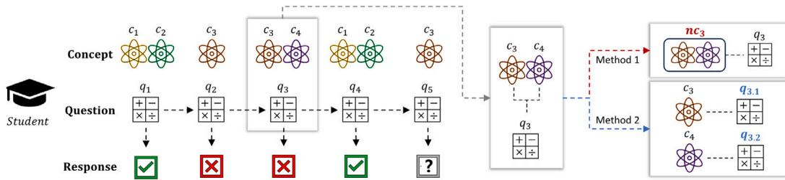  
Fig. 1. The figure above shows a basic example of knowledge tracing. ‘‘Response’’ indicates the student’s answer. Method 1 combines the multiple concepts covered by the question into a new concept to simplify the problem. Method 2 splits the multiple concepts covered by the question into individual concepts to simplify the problem.

There are several methods [24–26] for this purpose. However, they often make unreasonable assumptions to simplify tasks. As shown in Fig. 1, methods such as [24] (Method 1) merge multiple distinct concepts into a new one to simplify the task, whereas others such as AKT [25] (Method 2) simplify the task by breaking down multiple concepts into individual ones. However, neither aligns well with real educational scenarios. Furthermore, methods such as DHKT [27], and PEBG [15] often employ random question representations. However, owing to the vast number of questions, there are limited data on student responses, making it challenging to optimize the model. Moreover, this approach lacks interpretability when representing questions. Finally, they failed to delve deeply into the higher-order relationships among questions, resulting in constrained performance.

Given the above considerations, it is evident that we must ensure that questions are associated with multiple concepts (i.e., using the original data of the unsimplified task). However, we still have the following challenges to address. First, how do we construct an interpretable question representation? This is crucial, because questions span the entire process of KT. Second, how do we extract the high-order relationships between questions? Although graph neural networks offer a reliable solution, how do we define the graph concerning questions? Conducting graph neural networks on a complete graph is highly impractical because it is computationally expensive and weakens the representation of relationships between similar questions. Finally, we hope that the final question representation benefits from both aspects. Contrastive learning [28,29] emerges as a promising solution; however, it relies on the selection of positive and negative samples. How should we define positive and negative samples between questions?

To address the challenges mentioned above, in this study, we pro pose a novel approach called QCKT, which enhances KT by incorporating an additional Question-based Contrastive learning task. Specifically, QCKT represents questions from two perspectives. First, by leveraging attention mechanisms based on the relationship between questions and concepts, question representations were constructed using concept embeddings. Inspired by the one-parameter Item Response Theory [30], which suggests that questions can be distinguished by their difficulty, we explicitly incorporate question difficulty into this representation to construct interpretable question representations (the first challenge). Second, to reduce the number of relationships between the questions, we utilize concepts related to the questions as premises. In other words, if two questions contain one or more common concepts, they are considered related. We refer to the resulting graph under this constraint as the Concept-Aware Question Relationship Graph and employ a graph encoder to capture the higher-order relationships between questions (the second challenge). Finally, to identify positive and negative sam ples between questions, we propose five contrastive learning strategies (see Section 4.4) based on the assumption of different granularities of relationships between questions, aiming to explore the similarities and differences between questions (the third challenge). We extend 13 existing KT methods to six public datasets to evaluate QCKT, and extensive experiments demonstrate that QCKT significantly improves performance. Moreover, many baseline models extended by QCKT show capabilities that surpass those of state-of-the-art models. We believe that the simplicity and effectiveness of QCKT will provide new insights for further KT research.

In summary, our contributions can be summarized as follows:

• We propose a novel approach, QCKT, that represents questions from two different perspectives. This not only effectively captures high-order relationships between questions but also enhances the interpretability of question representations.

• Based on the assumption of different granularities in the rela- tionships between questions, we propose five contrastive learning strategies to uncover the similarities and differences between questions. To the best of our knowledge, this is the first few attempt at exploring the selection of positive and negative samples between questions in KT.

• We extend the 13 KT methods to six publicly available datasets. Extensive experiments demonstrate that QCKT significantly improves the performance, and many baseline models extended by QCKT exhibit capabilities that surpass those of state-of-the-art models.

## 2. Related work

In this section, we first review the development of KT, then introduce graph representation learning techniques closely related to this work, and finally discuss question representation in KT.

## 2.1. Knowledge tracing (KT)

Knowledge tracing can be traced back to the 1990s when [4] introduced Bayesian knowledge tracing. Classic knowledge tracing methods can be categorized into Bayesian-based methods such as BKT [4,5] and factor analysis-based methods such as LFA [31], AFM [7], PFA [9], KTM [8]. With the advancement of deep learning, many deep learning based knowledge tracing models have emerged. [3] provides an excellent summary of deep learning-based knowledge tracing methods. DKT [32] was the first deep learning-based model to use a sequencebased network (LSTM [33]), to model a student’s knowledge state (i.e., mastery of knowledge). DKT + forgetting [34] considers a student’s forgetting behavior to enhance DKT. LPKT [11] considers the consistency of students’ knowledge states during the answer process to enhance KT, while LBKT [20] explores the impact of various learning behaviors, such as response speed and number of attempts, on students knowledge states.

Inspired by memory-augmented neural networks [35], DKVMN [36] employs a dynamic key–value memory network to model a student’s knowledge state. SKVMN [37] introduces a Hop-LSTM structure to enhance the representation of knowledge states. DGMN [38] considers the relationships between concepts and takes into account students forgetting behaviors.

With the rise of attention mechanisms, SAKT [39] use self-attention mechanisms to establish relationships between students and concepts. AKT [25] proposes a context-aware attention architecture to simulate student’s forgetting behavior. SAINT [40] uses a Transformer [41] architecture to trace a student’s knowledge state. Considering the complexity of Transformer-based KT methods, simpleKT [26] simplifies the architecture based on AKT.

With the emergence of graph neural networks, GKT [42] is the first to propagate a student’s knowledge state across a knowledge-concept graph. SKT [43] considers various relationships between concepts such as prerequisites and similarities, to explore the influences between concepts. HGKT [12] proposes a hierarchical graph KT to explore the potentially complex relationships between exercises.

## 2.2. Graph representation learning

Graph Representation Learning (GRL) is a critical field that seeks to transform graph-structured data into low-dimensional embeddings while preserving essential structural and semantic relationships. Key advancements in GRL include methods such as Graph Convolutional Networks (GCNs) [44], which aggregate information from neighbors using convolutional operations to capture local structures effectively, and Graph Attention Networks (GATs) [45], which introduce attention mechanisms to assign varying importance to neighboring nodes. The recent GATv2 [46] further enhances this by enabling dynamic attention coefficients for more expressive modeling. Additionally, methods such as BGRL [47] leverage contrastive learning objectives to maximize agreement between positive samples, effectively improving graph rep resentation quality. Variational approaches, such as the framework proposed in VCLANC [48] integrate structural and attribute informa tion through variational inference, enabling effective representation and clustering of attributed networks by capturing both node attributes and graph topology. Together, these advancements highlight GRL’s versatility and its potential to tackle challenges in understanding complex relationships, uncovering latent patterns, and driving innovation across various applications.

## 2.3. Question representation in KT

The KT process primarily relies on students’ responses to questions, emphasizing the significance of questions throughout the KT pro cess. Therefore, the representation of these questions is of paramount importance.

Given the importance of textual content in question representation, EERNN [17], EKT [16], and RKT [18] utilize word2vec [49] to represent questions based on textual information. By contrast, qDKT [14] employs FastText [50] to represent questions based on their order of arrangement.

Inspired by graph neural networks, research on mining question rep resentations from question-based graphs has increased. Methods such as DHKT [27] and PEBG [15] transform the relationship between questions and concepts into constraints, constraining question representations using the relationships between questions themselves. CoKT [51] utilizes node2vec [52] on a heterogeneous graph of questions, concepts, and students to explore the relationships between questions and other entities. GIKT [53] employs GCN [44] on a bipartite graph of questions and concepts to represent questions. Bi-CLKT [54] constructs questionquestion and concept-concept graphs based on answer accuracy to mine question information. �2-HHN [19] defines heterogeneous graphs of various entities (e.g., questions, templates, students and topics) to represent questions.

Unlike others, QCKT does not rely on additional features (such as question text content or question templates) and only requires questions and concepts. Additionally, to delve deeper into question representations, we approach them from two distinct perspectives: one based on the relationship between questions and concepts, combined with question difficulty, for an interpretable representation, and the other from a graph perspective to uncover higher-order relationships between questions. Furthermore, based on the assumption of different relationship granularities between questions, we propose five contrastive learning strategies to explore these relationships. Additionally, we extensively expand upon numerous KT methods on multiple public datasets, with extensive experiments consistently demonstrating the effectiveness of QCKT. This suggests that QCKT can easily augment other KT methods to enhance their performance, a capability lacking in most KT approaches.

## 3. Problem formulation

The KT task can be defined as follows: Given a student’s historical interaction sequence represented as: $X ~ = ~ \{ ( q _ { 1 } , N e i b o r _ { q _ { 1 } } , a _ { 1 } )$ $( q _ { 2 } , N e i b o r _ { q _ { 2 } } , a _ { 2 } ) , \dots , ( q _ { t } , N e i b o r _ { q _ { t } } , a _ { t } ) \}$ where $q _ { t }$ represents the question that the student needs to answer at time $t , N e i b o r _ { q _ { t } }$ denotes the set of concepts related to question $q _ { t } ,$ and $a _ { t } ~ \in ~ \{ 0 , 1 \}$ represents the result of answering $q _ { t } ,$ with $a _ { t } \ = \ 1$ indicating a correct answer and $a _ { t } \ = \ 0$ indicating an incorrect answer. KT aims to predict the probability of a student answering the next question $q _ { t + 1 }$ correctly.

## 4. QCKT architecture

The overall architecture of QCKT is shown in Fig. 2. In the following sections, we provide a detailed overview of QCKT.

## 4.1. Embeddings

Before providing a detailed overview of QCKT, we introduce its fundamental embeddings. Considering that QCKT utilizes three basic elements: questions, concepts, and answers, we embed them separately. Specifically, we denote the embedding matrix for questions as $Q \in$ $\mathbb { R } ^ { m \times d }$ , for concepts as $C \in \mathbb { R } ^ { n \times d }$ , and for answers as $A \in \mathbb { R } ^ { 2 \times d }$ , where � represents the total number of questions, $d$ denotes the dimension size of the embedding, and � signifies the total number of concepts. We use $Q _ { i } , C _ { i }$ and $A _ { i }$ to represent the �th rows of $Q , C$ and $A ,$ respectively.

## 4.2. Represent questions using concept and difficulty information

In this section, concepts and difficulty information are used to represent the questions. As a question is often related to multiple concepts, we employ an attention mechanism to capture these relationships. First, for any given $q , k ,$ , and $v ,$ the attention representation is calculated as:

$$
\text { Attention } (q, k, v, \text { Mask }) = \text { Softmax } (\text { Mask } (\frac {q k ^ {T}}{\sqrt {d _ {k}}})) v\tag{1}
$$

Here, the $M a s k$ function sets elements that meet certain conditions to $- \infty ,$ and $d _ { k }$ represents the dimensionality of � and �. To consider the relationship between questions and concepts from multiple aspects and make the results more robust, we extend attention to multiple heads and compute the concept representation $F C$ as:

$$
F C = \operatorname{Concat} \left(\text {head} _ {1}, \text {head} _ {2}, \dots , \text {head} _ {h}\right) W ^ {o}\tag{2}
$$

$$
w h e r e \quad h e a d _ {i} = A t t e n t i o n (Q W _ {i} ^ {q}, C W _ {i} ^ {k}, C W _ {i} ^ {v}, M a s k _ {q c})\tag{3}
$$

where $h$ represents the number of heads, $W ^ { o } , \ W _ { i } ^ { q } , \ W _ { i } ^ { k }$ , and $W _ { i } ^ { v }$ are linear transformations; and � and � represent the question and concept embedding matrices, respectively. $M a s k _ { q c }$ sets concepts unrelated to the question $\mathrm { t o } - \infty ,$

Furthermore, considering the significant role of the question difficulty information, we aggregate it into question representations. Thus, the final question representation, $F Q _ { 1 }$ , is calculated as:

$$
F Q _ {1} = F C + d f * v\tag{4}
$$

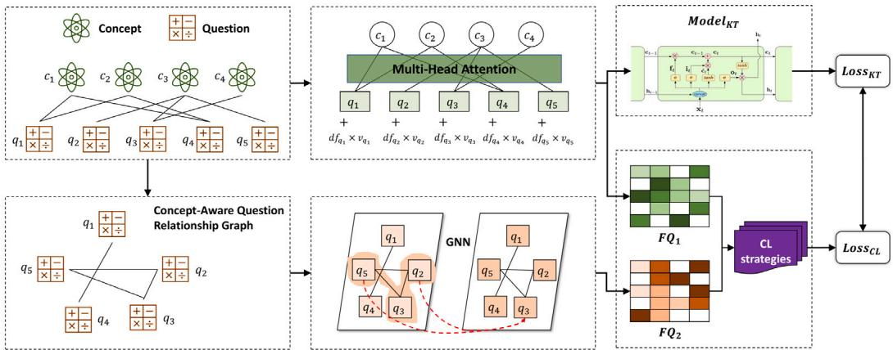  
Fig. 2. The overall framework of QCKT. For the question-concept graph, we use relevant concepts and question difficulties to build an interpretable representation. We then convert this graph into a Concept-Aware Question Relationship Graph using a graph encoder to uncover higher-order question relationships. We propose contrastive learning strategies to learn the similarities and differences between the two question representations. Finally, we apply these insights to improve the KT model.

where $\boldsymbol { d f } \in \mathbb { R } ^ { m \times 1 }$ represents question difficulty as a scalar. $v \in \mathbb { R } ^ { m \times d }$ represents the degree of change of the question compared to the con cepts. This is done to account for the fact that pure question difficulty may not accurately capture the semantics of a question, and question difficulty should be related to its associated concepts. Therefore, we have added this additional term.

## 4.3. Represent questions from graph

In this section, we represent the questions on the graph. First, we construct a Concept-Aware Question Relationship Graph based on the relationship between questions and concepts. Then we represent the question on this graph.

## 4.3.1. Concept-aware question relationship graph

Mining the relationships between questions is crucial. However, considering the relationships between all pairs of questions is impracti cal. Therefore, we use the presence of shared concepts in the questions as a prerequisite to explore their relationships. In other words, we only consider questions to be related if they both contain one or more common concepts. As illustrated in Fig. 2, this approach significantly reduces the number of relationships between questions. This approach aligns with educational significance because questions sharing common concepts can be considered relevant. However, we acknowledge that this method overlooks cases in which questions are related despite not sharing common concepts, which we will explore in future studies.

Formally, we denote the Concept-Aware Question Relationship Graph as $G = \{ ( q _ { i } , q _ { j } , r _ { q _ { i } q _ { i } } ) | q _ { i } , q _ { j } \in Q S \}$ , where � and $q _ { j }$ represent any two questions from the question set ��. If $N e i b o r _ { q _ { i } } \stackrel { . } { \cap } N e i b o r _ { q _ { i } } \ne \emptyset$ then $r _ { q _ { i } q _ { i } } = 1$ , otherwise $r _ { q _ { i } q _ { j } } = 0$ . Among them, ������� and $N e i b o r _ { q _ { i } }$ represents the concept sets associated with $q _ { i }$ and $q _ { j } ,$ respectively.

## 4.3.2. Represent questions

In this section, we adopt a graphical perspective to represent questions. Specifically, for the original question embeddings � and the Concept-Aware Question Relationship Graph $G ,$ we employ a graph encoder $f _ { \theta }$ to capture relationships between questions as follows:

$$
Z ^ {i} = Z ^ {i - 1} + R e L U (f _ {\theta} (Z ^ {i - 1}, G)), i = 1, 2, \ldots , L\tag{5}
$$

where $Z ^ { 0 } = Q$ and L represents the number of lavers in the graph encoder. The function $f _ { \theta }$ denotes the graph encoder, which can be implemented using techniques such as GCN [44], GraphSAGE [55] and GAT [45]. Notably, we incorporate residual connections [56] into each layer. Consequently, the final representation of the questions in the current context, denoted $F Q _ { 2 } ,$ is computed as follows:

$$
F Q _ {2} = Z ^ {L}\tag{6}
$$

## 4.4. Question-based contrastive learning

To improve the representation of questions and uncover their similarities and differences, we propose five contrastive learning strategies. Each strategy assumes a different granularity of relationships between questions and optimizes the alignment of the two question representations, $F Q _ { 1 }$ and $F Q _ { 2 }$ . Details of each strategy are provided below.

Strategy $S _ { 1 } \colon$ Any two different questions are considered unrelated. This strategy emphasizes the independence of the questions, suggesting that there is no direct relationship between any two different questions.

Considering any question � in $F Q _ { 1 } ,$ , its positive sample consists only of the corresponding question � in $F Q _ { 2 }$ , with all the others serving as negative samples. Hence, the contrastive loss for � can be calculated as follows:

$$
L o s s _ {C L} ^ {i} = - \log \frac {\exp (s i m (F Q _ {1} ^ {i} , F Q _ {2} ^ {i}) / \tau)}{\sum_ {j \neq i} \exp (s i m (F Q _ {1} ^ {i} , F Q _ {1} ^ {j}) / \tau) + \sum_ {j} \exp (s i m (F Q _ {1} ^ {i} , F Q _ {2} ^ {j}) / \tau)}\tag{7}
$$

where ��� represents the cosine similarity function, � is the temperature coefficient, and $F Q _ { 1 } ^ { i }$ and $F Q _ { 2 } ^ { i }$ respectively represent the �th row of $F Q _ { 1 }$ and $F Q _ { 2 }$

This implies that no explicit or implicit relationships exist between any two distinct questions, making it suitable for datasets lacking relational annotations.

Strategy $S _ { 2 } { \mathrm { : } }$ Two questions are related only when they share one or more concepts. This approach focuses on the concepts associated with the questions, considering that they are related when they have at least one common concept. This type of relationship is common in educational systems where questions are linked to knowledge concepts.

Considering any question � in $F Q _ { 1 }$ , we denote its positive sample set as $p o s _ { i }$ , it can be defined as:

$$
p o s _ {i} = \{j | N e i b o r _ {i} \cap N e i b o r _ {j} \neq \emptyset \}\tag{8}
$$

where ������ represents the set of concepts associated with question �. Then the contrastive loss for question � can be calculated as:

$$
L o s s _ {C L} ^ {i} = - \log \frac {\sum_ {j \in p o s _ {i}} \exp (\frac {s i m (F Q _ {1} ^ {i} , F Q _ {1} ^ {j})}{\tau}) + \sum_ {j \in \{p o s _ {i} \cup i \}} \exp (\frac {s i m (F Q _ {1} ^ {i} , F Q _ {2} ^ {j})}{\tau})}{\sum_ {j \neq i} \exp (\frac {s i m (F Q _ {1} ^ {i} , F Q _ {1} ^ {j})}{\tau}) + \sum_ {j} \exp (\frac {s i m (F Q _ {1} ^ {i} , F Q _ {2} ^ {j})}{\tau})}\tag{9}
$$

This strategy captures broad similarities between questions by integrating prior knowledge of question–concept relationships. This method is particularly suitable for datasets with well-annotated concept mappings.

Strategy $S _ { 3 } { \mathrm { : } }$ Two questions are related only when they contain the same set of concepts. Strategy $S _ { 3 }$ builds upon � by introducing a stricter assumption: Two questions are related only if they share an identical set of concepts. This ensures a higher degree of semantic alignment.

For any question � in $F Q _ { 1 }$ , its positive sample set $p o s _ { i }$ can be defined as:

$$
p o s _ {i} = \{j | N e i b o r _ {i} = N e i b o r _ {j} \}\tag{10}
$$

The contrastive loss of question � is the same as in strategy $S _ { 2 }$ (see Eq. (9)), with the positive sample set defined more strictly.

This strategy reduces noise introduced by loosely related questions, making it ideal for high-precision educational tasks with well-defined concept mappings.

Please note the differences between $S _ { 2 } , S _ { 3 } ,$ and the graph �. The relationships constructed by � are purely prior, and aim to reduce the number of relationships within the graph. In actuality, the true relationships are captured by the graph encoder $f _ { \theta } .$ . Conversely, $S _ { 2 }$ and $S _ { 3 }$ can be seen as posterior constraints. They impose restrictions based on assumptions to constrain the relationships between the questions.

Strategy $S _ { 4 } \colon$ Two different questions are related based on similar ity: Beyond explicit concept sharing, the questions may exhibit latent semantic relationships. Strategy $S _ { 4 }$ identifies such relationships using the similarity scores between question representations.

Specifically, for any question � in $F Q _ { 1 }$ , its $p o s _ { i }$ is defined as:

$$
p o s _ {i} = \{j | s i m (F Q _ {1} ^ {i}, F Q _ {1} ^ {j}) \geq \delta o r s i m (F Q _ {1} ^ {i}, F Q _ {2} ^ {j}) \geq \delta \}\tag{11}
$$

where � is the threshold for determining the relevance of the positive sample set. The contrastive loss for question � is identical to that in strategy $S _ { 2 }$ (see Eq. (9)).

This strategy captures the implicit relationships, allowing the model to adapt to datasets with diverse question formulations or incomplete annotations.

Then for $S _ { 1 } , S _ { 2 } , S _ { 3 }$ and $S _ { 4 } ,$ the total contrastive loss $L o s s _ { C L }$ is:

$$
L o s s _ {C L} = \frac {1}{m} \sum_ {i} L o s s _ {C L} ^ {i}\tag{12}
$$

It is worth noting that we did not include the mirrored contrastive loss from $F Q _ { 2 }$ for two reasons: first, the representation of $F Q _ { 1 }$ is more interpretable, as it encompasses connections to concepts and question difficulty; second, it reduces computational complexity, which is also a requirement for ensuring the simplicity of the calculations of QCKT as an extensible plugin model.

Strategy $S _ { 5 } { \mathrm { : } }$ Based on Cross-Correlation Matrices Alignment, this strategy does not depend on the selection of positive and negative samples. It aims to make the two representations as similar as possible by minimizing the difference between their cross-correlation matrices and the identity matrix.

Specifically, $S _ { 5 }$ optimizes the model through the cross-correlation matrix of two features [57]. In this case, the contrastive loss can be computed as:

$$
L o s s _ {C L} = \sum_ {i} (1 - K _ {i i}) ^ {2} + \frac {1}{d} \sum_ {i} \sum_ {j \neq i} K _ {i j} ^ {2}\tag{13}
$$

$$
w h e r e K _ {i j} = \frac {\sum_ {b} F Q _ {1} ^ {b , i} F Q _ {2} ^ {b , j}}{\sqrt {\sum_ {b} (F Q _ {1} ^ {b , i}) ^ {2}} \sqrt {\sum_ {b} (F Q _ {2} ^ {b , j}) ^ {2}}}\tag{14}
$$

where $F Q _ { 1 } ^ { b , i }$ selects the element at row � and column � from $F Q _ { 1 } ,$ and $F Q _ { 2 } ^ { b , j }$ selects the element at row � and column � from $F Q _ { 2 }$ . This loss aims to make the correlation matrix of embedding features across different perspectives close to the identity matrix. In other words, it promotes diverse feature dimensions to represent distinct information, thus enhancing feature representation.

This strategy eliminates reliance on predefined relationships and significantly reduces the computational complexity for large-scale datasets. This is particularly suitable for scenarios in which relational information is unavailable or difficult to infer

## 4.5. Training

QCKT can be easily extended and enhanced on other models. We denote the model that needs to be extended as $M o d e l _ { K T }$ . QCKT only requires modifications to the question and interaction representations of $M o d e l _ { K T }$ . Specifically, for the interaction history $X \ =$ $\{ ( q _ { 1 } , N e i b o r _ { q _ { 1 } } , a _ { 1 } ) , ( q _ { 2 }$ $N e i b o r _ { q _ { 2 } } , a _ { 2 } ) , \dots , ( q _ { t } , N e i b o r _ { q _ { t } } , a _ { t } ) \}$ and the next question $q _ { t + 1 } , \ F Q _ { 1 }$ is used to represent the questions (because its representation contains essential features of the questions). In other words, we embed $q _ { 1 } , q _ { 2 } , \dots , q _ { t + 1 }$ using $F Q _ { 1 }$ , denoted as $E _ { 1 } , E _ { 2 } , \dots , E _ { t + 1 }$ respectively:

$$
E _ {1}, E _ {2}, \dots , E _ {t + 1} = F Q _ {1} ^ {q _ {1}}, F Q _ {1} ^ {q _ {2}}, \dots , F Q _ {1} ^ {q _ {t + 1}}\tag{15}
$$

At any moment �, its interaction representation $I _ { t }$ equals:

$$
I _ {t} = E _ {t} + A _ {a _ {t}}\tag{16}
$$

where � represents the answer embedding matrix. Note that many methods $[ 3 2 , 3 6 , 3 9 ]$ use a new R2�� matrix to represent interactions, assuming that answering a question correctly and incorrectly should be embedded separately. However, this approach does not consider the fact that both pertain to the same question. Here, we directly add the question embedding matrix and answer embedding matrix, which is a simple approach that fully leverages the advantages of the question embedding matrix.

Then, we provide the historical interaction representations $I _ { 1 } , I _ { 2 } ,$ $\dots , I _ { t }$ and the representation of the next question $E _ { t + 1 }$ to ����� to obtain the model’s prediction probability $y _ { t + 1 } .$

$$
y _ {t + 1} = M o d e l _ {K T} (I _ {1}, I _ {2}, \ldots , I _ {t}, E _ {t + 1})\tag{17}
$$

The knowledge tracing loss $L o s s _ { K T }$ is calculated as the crossentropy loss between $y _ { t + 1 }$ and the true answer $a _ { t + 1 }$

$$
L o s s _ {K T} = - \sum_ {t = 1} ^ {T - 1} a _ {t + 1} l o g (y _ {t + 1}) + (1 - a _ {t + 1}) l o g (1 - y _ {t + 1})\tag{18}
$$

where � represents the total number of time steps.

Finally, the total loss $L o s s _ { t o t a l }$ is calculated as:

$$
L o s s _ {t o t a l} = L o s s _ {K T} + \varphi * L o s s _ {C L}\tag{19}
$$

where $\varphi$ represents a hyperparameter that balances the two losses, $L o s s _ { C L }$ can be chosen from any of these five contrastive learning strategies. The model is optimized using the Adam [58] algorithm.

## 5. Experiment

In this section, we conduct extensive experiments to answer the following questions:

• RQ1: How does the performance of the model extended by QCKT compare to the original model and the state-of-the-art models?

• RQ2: How does QCKT perform compared to other integrable KT methods?

• RQ3: What are the impacts of the five contrastive learning strate- gies proposed in this paper?

• RQ4: How do different components of QCKT affect its perfor- mance?

• RQ5: What are the advantages of extending the model with QCKT compared to the original model?

## 5.1. Datasets

We evaluated the performance of QCKT on six publicly available datasets: ASSIST09, ASSIST12, ASSIST17, Statics2011, EdNet, and Eedi.

Table 1  
Summary statistics of the processed datasets.

<table><tr><td></td><td>ASSIST09</td><td>ASSIST12</td><td>ASSIST17</td><td>Statics2011</td><td>EdNet</td><td>Eedi</td></tr><tr><td># Student</td><td>4,160</td><td>5,000</td><td>1,706</td><td>331</td><td>5,000</td><td>5,000</td></tr><tr><td># Question</td><td>15,680</td><td>36,056</td><td>1,150</td><td>633</td><td>11,775</td><td>26,706</td></tr><tr><td># Concept</td><td>167</td><td>242</td><td>86</td><td>106</td><td>1,837</td><td>1,050</td></tr><tr><td># Interaction</td><td>207,659</td><td>717,188</td><td>153,324</td><td>91,133</td><td>1,156,254</td><td>597,124</td></tr></table>

• ASSIST091: Collected from the ASSISTments online educational platform from 2009 to 2010.

• ASSIST122: Collected from the ASSISTments online educational platform from 2012 to 2013.

• ASSIST173: Collected from ASSISTments online educational plat form in 2017.

• Statics20114: Collected from a college-level engineering course on statics.

• EdNet,5: Dataset collected from 2017 to 2019 by Santa [22] an online tutoring platform.

• Eedi6: Used for the NeurIPS 2020 Education Data Mining Chal- lenge, collected from the online education platform Eedi from 2018 to 2020.

Based on previous research, we removed scaffold questions and records without concepts [25] from the ASSIST series datasets. In the case of Statics2011, the original question and step indices were combined into a new question index. If the same questions were answered consecutively, only the first answer was retained. Moreover, owing to the large scale of the ASSIST12, EdNet, and Eedi datasets, and limitations in computational resources, we randomly sampled records from 5000 students [15,53]. The statistical information for these datasets is provided in Table 1.

## 5.2. Baselines

We selected the following widely used state-of-the-art models as baselines:

• DKT[32]: The first KT model based on deep learning, using LSTM to model students’ knowledge states.

• DKVMN[36]: Utilizes a dynamic key–value memory network to model students’ knowledge states.

• KQN[59]: Predicts student performance using a knowledge and concept encoder.

• Deep-IRT[60]: Building on the DKVMN, an additional IRT pre- diction layer is added to enhance the interpretability of KT.

• DKT + forgetting[34]: Extends DKT by incorporating various features to model students’ forgetting behavior.

• SAKT[39]: The first KT model uses self-attention mechanisms to model relationships between students and concepts.

• SAINT[40]: The first KT model uses Transformer [41] to model student knowledge states.

• AKT[25]: Introducing a context-aware attention architecture to simulate student knowledge state forgetting behavior.

• ATKT[61]: Adversarial training is employed to enhance the gen eralization capabilities of KT models.

• CL4KT[62]: Proposes multiple data augmentation methods to better represent students’ knowledge states.

• DIMKT[63]: In-depth exploration of the influence of question difficulty on student knowledge states.

• QIKT[64]: Models student knowledge states centered around questions and adds an additional IRT prediction layer for enhanced interpretability.

• simpleKT[26]: A simplified AKT model that maintains simplicity without sacrificing too much performance.

We adapted the question representations of these models to the question representations proposed by QCKT. For models that did not use questions (i.e., using concepts), we modified their input from concept to question. Additionally, for DKT, we found that its original output was the probabilities for answering all questions, which is unsuitable for handling datasets with a large number of questions. Therefore, following the approaches of DKVMN and AKT, we modified the output layer of DKT to predict only the probability of answering the next question.

## 5.3. Experimental setup

QCKT7 was implemented by PyTorch. For each dataset, we split 80% of all sequences as the training set and 20% as the test set [1,53]. The embedding dimension size � was set to 128, the temperature coefficient � was 0.8, the batch size was 80, and the learning rate was 0.002. For the other variable choices (discussed in detail later), we set their default selections here. The GNN encoder defaults to GCN [44], the number of GNN layers � defaults to 1, the default similarity threshold � is set to 0.8, and the default choice for contrastive learning strategy is � , with a balance coefficient � set to 0.01. Additionally, we applied L2 regularization to the model weights with a decay coefficient of 1e-5. The sequence length was uniformly set to 200, and note that we remove sequences with a length less than 3 as they were too small to be meaningful. To prevent overfitting, the dropout probability was set to 0.4. We repeated the experiments five times and report the average performance [17,38]. QCKT was trained on a Linux server with two 2.00 GHz Intel(R) Xeon(R) CPUs and a Nvidia Tesla P100-PCIE-16 GB GPU. Following previous studies [65–68], we used AUC as the primary evaluation metric and ACC as the secondary metric [69]. Higher values indicated better model performance.

## 5.4. Performance (RQ1)

We extended QCKT to other baseline models and compared the AUC and ACC of all models on the six datasets, as shown in Tables 2 and 3. We modified the baseline that does not use question to incorporate h f b f d h ll b l d l significantly improved their performance overall after QCKT extension, providing strong evidence of the effectiveness of QCKT. Notably, this improvement was particularly pronounced for the baseline models that did not initially use question representations. For baseline models that used question representations, the question representations were tightly coupled with their respective architectures, making a direct switch to QCKT’s question representations less suitable. However, even in these cases, QCKT is still able to further enhance their performance, undoubtedly showcasing the powerful capabilities of QCKT. For the baseline models without question use, QCKT seamlessly integrated with them, resulting in a significant performance boost. (2) After QCKT extension, the performance of most baseline models improved; however, occasional performance decreases were observed for certain datasets. For instance, CL4KT’s performance decreased by 2.36% on the ASSIST09 dataset after the extension. We attribute this to the design of CL4KT, as its proposed data augmentation (such as question masking and question replacement) affects question representations, potentially being a key factor in the performance drop. Future research will focus on investigating the influence of question representation on different model architectures. (3) AKT has emerged as a powerful baseline because of its context-aware attention architecture, which effectively models the forgetting behavior of student knowledge states, highlighting the importance of forgetting in KT. (4) After the QCKT extension, many baseline models surpassed the state-of-the-art perfor mance. Notably, QCKT improved the most significantly for the simplest DKT model. This aligns with the consensus in various studies that while DKT is straightforward, it possesses strong capabilities for tracing student knowledge states. Once appropriately exploited, this advantage can be fully exploited.

Performance comparison based on AUC. ‘‘question’’ indicates whether the model has learned question representation, ‘‘origin’’ represents the baseline model’s original performance, ‘‘+QCKT’’ denotes the performance after extending the baseline model with QCKT. ‘‘Avg’’ signifies the average improvement/reduction of the baseline model after the QCKT extension across all datasets. The best original performance of the baseline model on each dataset is highlighted in bold, and the results exceeding the original best performance(t-test �-value <0.05) after the OCKT extension are shown in red

<table><tr><td rowspan="2">Model</td><td rowspan="2">question</td><td colspan="2">ASSIST09</td><td colspan="2">ASSIST12</td><td colspan="2">ASSIST17</td><td colspan="2">Statics2011</td><td colspan="2">EdNet</td><td colspan="2">Eedi</td><td rowspan="2">Avg</td></tr><tr><td>origin</td><td>+QCKT</td><td>origin</td><td>+QCKT</td><td>origin</td><td>+QCKT</td><td>origin</td><td>+QCKT</td><td>origin</td><td>+QCKT</td><td>origin</td><td>+QCKT</td></tr><tr><td>DKT [32]</td><td>×</td><td>0.7684</td><td>0.7886↑</td><td>0.7328</td><td>0.7753↑</td><td>0.7188</td><td>0.7740↑</td><td>0.8483</td><td>0.8957↑</td><td>0.7006</td><td>0.7664↑</td><td>0.7629</td><td>0.7953↑</td><td>4.39%↑</td></tr><tr><td>DKVMN [36]</td><td>×</td><td>0.7629</td><td>0.7696↑</td><td>0.7228</td><td>0.7604↑</td><td>0.7142</td><td>0.7618↑</td><td>0.8363</td><td>0.8791↑</td><td>0.6975</td><td>0.7639↑</td><td>0.7590</td><td>0.7893↑</td><td>3.86%↑</td></tr><tr><td>KQN [59]</td><td>×</td><td>0.7546</td><td>0.7627↑</td><td>0.7230</td><td>0.7163↓</td><td>0.7065</td><td>0.7638↑</td><td>0.8031</td><td>0.8589↑</td><td>0.6909</td><td>0.7606↑</td><td>0.7583</td><td>0.7613↑</td><td>3.12%↑</td></tr><tr><td>Deep-IRT [60]</td><td>×</td><td>0.7657</td><td>0.7698↑</td><td>0.7253</td><td>0.7622↑</td><td>0.7174</td><td>0.7623↑</td><td>0.8408</td><td>0.8738↑</td><td>0.6997</td><td>0.7627↑</td><td>0.7609</td><td>0.7901↑</td><td>3.52%↑</td></tr><tr><td>DKT+forgetting [34]</td><td>×</td><td>0.7717</td><td>0.7748↑</td><td>0.7362</td><td>0.7671↑</td><td>0.7165</td><td>0.7693↑</td><td>0.8467</td><td>0.8703↑</td><td>0.7018</td><td>0.7741↑</td><td>0.7642</td><td>0.7916↑</td><td>3.50%↑</td></tr><tr><td>SAKT [39]</td><td>×</td><td>0.7564</td><td>0.7631↑</td><td>0.7296</td><td>0.7603↑</td><td>0.7079</td><td>0.7581↑</td><td>0.8092</td><td>0.8666↑</td><td>0.6956</td><td>0.7635↑</td><td>0.7556</td><td>0.7852↑</td><td>4.03%↑</td></tr><tr><td>SAINT [40]</td><td>√</td><td>0.7515</td><td>0.7709↑</td><td>0.7643</td><td>0.7695↑</td><td>0.7537</td><td>0.7507↓</td><td>0.8279</td><td>0.8412 ↑</td><td>0.7621</td><td>0.7645↑</td><td>0.7866</td><td>0.7877↑</td><td>0.64%↑</td></tr><tr><td>AKT [25]</td><td>√</td><td>0.7850</td><td>0.7871↑</td><td>0.7830</td><td>0.7812↓</td><td>0.7572</td><td>0.7624↑</td><td>0.8718</td><td>0.8859↑</td><td>0.7616</td><td>0.7647↑</td><td>0.7882</td><td>0.7935↑</td><td>0.47%↑</td></tr><tr><td>ATKT [61]</td><td>×</td><td>0.7735</td><td>0.7746↑</td><td>0.7347</td><td>0.7710↑</td><td>0.7198</td><td>0.7659↑</td><td>0.8175</td><td>0.8812↑</td><td>0.7027</td><td>0.7685↑</td><td>0.7663</td><td>0.7902↑</td><td>3.95%↑</td></tr><tr><td>CL4KT [62]</td><td>×</td><td>0.7626</td><td>0.7390↓</td><td>0.7236</td><td>0.7504↑</td><td>0.7139</td><td>0.7644↑</td><td>0.8251</td><td>0.8880↑</td><td>0.6965</td><td>0.7557↑</td><td>0.7583</td><td>0.7806↑</td><td>3.30%↑</td></tr><tr><td>DIMKT [63]</td><td>√</td><td>0.7704</td><td>0.7821↑</td><td>0.7621</td><td>0.7763↑</td><td>0.7682</td><td>0.7680↓</td><td>0.8897</td><td>0.8924↑</td><td>0.7623</td><td>0.7643↑</td><td>0.7908</td><td>0.7912↑</td><td>0.51%↑</td></tr><tr><td>QIKT [64]</td><td>√</td><td>0.7801</td><td>0.7868↑</td><td>0.7707</td><td>0.7766↑</td><td>0.7645</td><td>0.7681↑</td><td>0.8817</td><td>0.8882↑</td><td>0.7579</td><td>0.7625↑</td><td>0.7932</td><td>0.7944↑</td><td>0.48%↑</td></tr><tr><td>simpleKT [26]</td><td>√</td><td>0.7772</td><td>0.7818↑</td><td>0.7786</td><td>0.7753↓</td><td>0.7570</td><td>0.7607↑</td><td>0.8614</td><td>0.8772↑</td><td>0.7627</td><td>0.7645↑</td><td>0.7885</td><td>0.7912↑</td><td>0.42%↑</td></tr></table>

Performance comparison based on ACC. See Table 2 for more details.

<table><tr><td rowspan="2">Model</td><td rowspan="2">question</td><td colspan="2">ASSIST09</td><td colspan="2">ASSIST12</td><td colspan="2">ASSIST17</td><td colspan="2">Statics2011</td><td colspan="2">EdNet</td><td colspan="2">Eedi</td><td rowspan="2">Avg</td></tr><tr><td>origin</td><td>+QCKT</td><td>origin</td><td>+QCKT</td><td>origin</td><td>+QCKT</td><td>origin</td><td>+QCKT</td><td>origin</td><td>+QCKT</td><td>origin</td><td>+QCKT</td></tr><tr><td>DKT [32]</td><td>×</td><td>0.7297</td><td>0.7438↑</td><td>0.7367</td><td>0.7567↑</td><td>0.6673</td><td>0.7050↑</td><td>0.8275</td><td>0.8553↑</td><td>0.7129</td><td>0.7387↑</td><td>0.7182</td><td>0.7371↑</td><td>2.41%↑</td></tr><tr><td>DKVMN [36]</td><td>×</td><td>0.7266</td><td>0.7301↑</td><td>0.7329</td><td>0.7508↑</td><td>0.6639</td><td>0.6952↑</td><td>0.8224</td><td>0.8467↑</td><td>0.7120</td><td>0.7388↑</td><td>0.7162</td><td>0.7335↑</td><td>2.02%↑</td></tr><tr><td>KQN [59]</td><td>×</td><td>0.7249</td><td>0.7311↑</td><td>0.7330</td><td>0.7314↓</td><td>0.6611</td><td>0.6968↑</td><td>0.7969</td><td>0.8298↑</td><td>0.7117</td><td>0.7366↑</td><td>0.7143</td><td>0.7159↑</td><td>1.66%↑</td></tr><tr><td>Deep-IRT [60]</td><td>×</td><td>0.7279</td><td>0.7298↑</td><td>0.7345</td><td>0.7510↑</td><td>0.6647</td><td>0.6963↑</td><td>0.8262</td><td>0.8449↑</td><td>0.7124</td><td>0.7374↑</td><td>0.7173</td><td>0.7342↑</td><td>1.84%↑</td></tr><tr><td>DKT+forgetting [34]</td><td>×</td><td>0.7295</td><td>0.7319↑</td><td>0.7359</td><td>0.7512↑</td><td>0.6665</td><td>0.7021↑</td><td>0.8182</td><td>0.8336↑</td><td>0.7159</td><td>0.7462↑</td><td>0.7186</td><td>0.7357↑</td><td>1.94%↑</td></tr><tr><td>SAKT [39]</td><td>×</td><td>0.7192</td><td>0.7211↑</td><td>0.7348</td><td>0.7484↑</td><td>0.6596</td><td>0.6927↑</td><td>0.8111</td><td>0.8394↑</td><td>0.7115</td><td>0.7383↑</td><td>0.7123</td><td>0.7296↑</td><td>2.02%↑</td></tr><tr><td>SAINT [40]</td><td>√</td><td>0.7134</td><td>0.7288↑</td><td>0.7477</td><td>0.7529↑</td><td>0.6894</td><td>0.6871↓</td><td>0.8110</td><td>0.8217↑</td><td>0.7370</td><td>0.7380↑</td><td>0.7293</td><td>0.7321↑</td><td>0.55%↑</td></tr><tr><td>AKT [25]</td><td>√</td><td>0.7429</td><td>0.7433↑</td><td>0.7599</td><td>0.7596↓</td><td>0.6916</td><td>0.6958↑</td><td>0.8376</td><td>0.8481↑</td><td>0.7372</td><td>0.7384↑</td><td>0.7340</td><td>0.7367↑</td><td>0.31%↑</td></tr><tr><td>ATKT [61]</td><td>×</td><td>0.7332</td><td>0.7318↓</td><td>0.7363</td><td>0.7545↑</td><td>0.6699</td><td>0.6985↑</td><td>0.7991</td><td>0.8482↑</td><td>0.7109</td><td>0.7400↑</td><td>0.7195</td><td>0.7349↑</td><td>2.32%↑</td></tr><tr><td>CL4KT [62]</td><td>×</td><td>0.7275</td><td>0.7134↓</td><td>0.7331</td><td>0.7421↑</td><td>0.6615</td><td>0.6964↑</td><td>0.8170</td><td>0.8509↑</td><td>0.7118</td><td>0.7328↑</td><td>0.7147</td><td>0.7296↑</td><td>1.66%↑</td></tr><tr><td>DIMKT [63]</td><td>√</td><td>0.7310</td><td>0.7399↑</td><td>0.7484</td><td>0.7576↑</td><td>0.6993</td><td>0.6991↓</td><td>0.8501</td><td>0.8529↑</td><td>0.7368</td><td>0.7390↑</td><td>0.7338</td><td>0.7353↑</td><td>0.41%↑</td></tr><tr><td>QIKT [64]</td><td>√</td><td>0.7377</td><td>0.7423↑</td><td>0.7529</td><td>0.7544↑</td><td>0.6985</td><td>0.6997↑</td><td>0.8482</td><td>0.8500↑</td><td>0.7327</td><td>0.7357↑</td><td>0.7363</td><td>0.7369↑</td><td>0.21%↑</td></tr><tr><td>simpleKT [26]</td><td>√</td><td>0.7315</td><td>0.7372↑</td><td>0.7571</td><td>0.7537↑</td><td>0.6899</td><td>0.6939↑</td><td>0.8350</td><td>0.8445↑</td><td>0.7373</td><td>0.7380↑</td><td>0.7307</td><td>0.7354↑</td><td>0.35%↑</td></tr></table>

## 5.5. Different enhanced KT methods (RQ2)

Here, we explore the improvement of DKT [32] (DKT is the most classic KT model) using QCKT and other methods (improving DKT via question representation). We compared the following approaches:

• PEBG[15]: Pretraining question representations by mining rela- tionships between questions, questions and concepts, etc., and augmenting DKT.

• AT-DKT[66]: Introduces two additional question-based tasks to enhance DKT.

Their performances are shown in Table 4. We observed the following: (1) DKT + QCKT significantly outperformed the other methods on all datasets, clearly demonstrating the effectiveness of QCKT. (2) PEBG, despite exploring various relationships between questions, exhibited poorer performance, suggesting that the pretraining paradigm is not favorable for KT. (3) Although AT-DKT incorporated two additional question-based enhancements for DKT, it did not consider how to better represent questions. As a result, while it improves DKT, the extent of the improvement is limited.

## 5.6. Analysis of different contrastive learning strategies (RQ3)

In this section, we analyze the five contrastive learning strategies designed in this study (details can be found in Section 4.4). We conducted experiments on all the datasets using the QCKT extension of DKT. The performance (AUC) is presented in Table $^ { 5 , }$ and the ACC performance is shown in Table 6. For $Q \mathrm { C K T } { \cdot } S _ { 4 } ,$ the impact of different � is shown in Fig. 3. It can be observed that: (1) Overall, these five strategies exhibited varying levels of performance, with no significant differences among them. They all perform at a similar level. We believe that this may be a case of ‘‘different paths leading to the same destination’’ from an educational standpoint. This implies that for reasonably different assumptions, even though the argumentation processes differ, their ultimate practical effects may be quite similar. In addition, DKT does not rely on any specific assumptions, which contributes to the close performance of these strategies. This finding underscores the validity of the five strategies proposed in this study. (2) We can observe the advantage of $S _ { 5 } { \mathrm { : } }$ it eliminates the need to select positive and negative samples, significantly reducing the space complexity. For $S _ { 1 } , S _ { 2 } , S _ { 3 } ,$ and $S _ { 4 } ,$ the space complexity reached $O ( m ^ { 2 } ) _ { \cdot }$ , where � is the number of questions. However, $S _ { 5 }$ only requires $O ( d ^ { 2 } )$ , where � is the size of the embedding dimension. Consequently, when the number of questions is too large, such as in the case of ASSIST12 with 36,056 questions, $S _ { 1 } ,$ $S _ { 2 } , S _ { 3 }$ and $S _ { 4 }$ would run out of memory. (3) For $Q \mathrm { C K T - } S _ { 4 } ,$ performance initially increases with � and then decreases. The model achieves better results when � is set to 0.8. This is likely because a smaller � introduces more irrelevant samples, whereas a larger � omits potentially relevant samples. Therefore, $\delta = 0 . 8$ is an optimal value and is the default setting in this study.

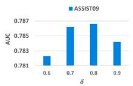

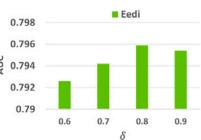

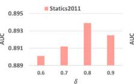

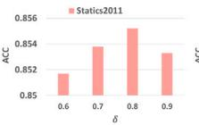

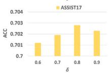

Table 4  
Performance comparison of enhanced DKT methods using question representations. The best result is highlighted in bold, and the next best result is underlined. \* indicates t-test �-value <0.05 compared to the second best result.

<table><tr><td rowspan="2">Model</td><td>ASSIST09</td><td colspan="2">ASSIST12</td><td colspan="2">ASSIST17</td><td colspan="2">Statics2011</td><td colspan="2">EdNet</td><td colspan="2">Eedi</td><td rowspan="2">ACC</td></tr><tr><td>AUC</td><td>ACC</td><td>AUC</td><td>ACC</td><td>AUC</td><td>ACC</td><td>AUC</td><td>ACC</td><td>AUC</td><td>ACC</td><td>AUC</td></tr><tr><td>DKT [32]</td><td>0.7684</td><td>0.7297</td><td>0.7328</td><td>0.7367</td><td>0.7188</td><td>0.6673</td><td>0.8483</td><td>0.8275</td><td>0.7006</td><td>0.7129</td><td>0.7629</td><td>0.7182</td></tr><tr><td>DKT+PEBG [15]</td><td>0.7738</td><td>0.7329</td><td>0.7518</td><td>0.7495</td><td>0.7619</td><td>0.6949</td><td>0.8655</td><td>0.8368</td><td>0.7571</td><td>0.7366</td><td>0.7853</td><td>0.7310</td></tr><tr><td>AT-DKT [25]</td><td>0.7671</td><td>0.7293</td><td>0.7425</td><td>0.7405</td><td>0.7265</td><td>0.6702</td><td>0.8687</td><td>0.8386</td><td>0.7039</td><td>0.7136</td><td>0.7649</td><td>0.7180</td></tr><tr><td>DKT+QCKT</td><td>0.7886*</td><td>0.7438*</td><td>0.7753*</td><td>0.7567*</td><td>0.7740*</td><td>0.7050*</td><td>0.8957*</td><td>0.8553*</td><td>0.7664*</td><td>0.7387*</td><td>0.7953*</td><td>0.7371*</td></tr></table>

Table 5

Performance (AUC) of DKT+QCKT under different strategies, with the best results highlighted in bold and ‘‘-’’ indicating out of memory.

<table><tr><td>Strategies</td><td>ASSIST09</td><td>ASSIST12</td><td>ASSIST17</td><td>Statics2011</td><td>EdNet</td><td>Eedi</td></tr><tr><td>QCKT- $S_1$ </td><td>0.7879</td><td>-</td><td>0.7745</td><td>0.8953</td><td>0.7665</td><td>0.7949</td></tr><tr><td>QCKT- $S_2$ </td><td>0.7857</td><td>-</td><td>0.7732</td><td>0.8945</td><td>0.7671</td><td>0.7955</td></tr><tr><td>QCKT- $S_3$ </td><td>0.7851</td><td>-</td><td>0.7734</td><td>0.8947</td><td>0.7674</td><td>0.7949</td></tr><tr><td>QCKT- $S_4$ </td><td>0.7866</td><td>-</td><td>0.7713</td><td>0.8939</td><td>0.7654</td><td>0.7959</td></tr><tr><td>QCKT- $S_5$  (Default)</td><td>0.7886</td><td>0.7753</td><td>0.7740</td><td>0.8957</td><td>0.7664</td><td>0.7953</td></tr></table>

Table 6

The performance (ACC) of DKT+QCKT under different strategies, with the best results highlighted in bold, and $^ { 6 6 } - ^ { 5 5 }$ indicating out of memory.

<table><tr><td>Strategies</td><td>ASSIST09</td><td>ASSIST12</td><td>ASSIST17</td><td>Statics2011</td><td>EdNet</td><td>Eedi</td></tr><tr><td>QCKT- $S_1$ </td><td>0.7411</td><td>-</td><td>0.7041</td><td>0.8544</td><td>0.7395</td><td>0.7374</td></tr><tr><td>QCKT- $S_2$ </td><td>0.7429</td><td>-</td><td>0.7053</td><td>0.8562</td><td>0.7404</td><td>0.7385</td></tr><tr><td>QCKT- $S_3$ </td><td>0.7417</td><td>-</td><td>0.7043</td><td>0.8549</td><td>0.7406</td><td>0.7383</td></tr><tr><td>QCKT- $S_4$ </td><td>0.7425</td><td>-</td><td>0.7028</td><td>0.8552</td><td>0.7388</td><td>0.7382</td></tr><tr><td>QCKT- $S_5$  (Default)</td><td>0.7438</td><td>0.7567</td><td>0.7050</td><td>0.8553</td><td>0.7371</td><td>0.7387</td></tr></table>

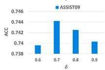  
Fig. 3. The impact of different � on $\mathbf { Q C K T - } S _ { 4 }$

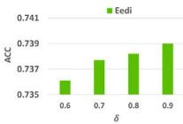

Table 7  
Performance (AUC) comparison of ablation study on DKT+QCKT.

<table><tr><td>Model</td><td>ASSIST09</td><td>ASSIST12</td><td>ASSIST17</td><td>Statics2011</td><td>EdNet</td><td>Eedi</td></tr><tr><td>DKT</td><td>0.7684</td><td>0.7328</td><td>0.7188</td><td>0.8483</td><td>0.7006</td><td>0.7629</td></tr><tr><td>DKT-Q</td><td>0.7371</td><td>0.7531</td><td>0.7588</td><td>0.8712</td><td>0.7575</td><td>0.7721</td></tr><tr><td>DKT w/o  $FQ_1$ </td><td>0.7774</td><td>0.7722</td><td>0.7713</td><td>0.8910</td><td>0.7642</td><td>0.7937</td></tr><tr><td>DKT w/o  $FQ_2$ </td><td>0.7843</td><td>0.7737</td><td>0.7718</td><td>0.8916</td><td>0.7650</td><td>0.7942</td></tr><tr><td>DKT+QCKT</td><td>0.7886</td><td>0.7753</td><td>0.7740</td><td>0.8957</td><td>0.7664</td><td>0.7953</td></tr></table>

## 5.7. Effect of different components (RQ4)

In this section, we analyze how the different components of QCKT affect its performance. Specifically, we will start by conducting ablation experiments to investigate the impact of each module of the QCKT, and then explore the sensitivity of the parameters.

## 5.7.1. Ablation study

We conducted ablation experiments on DKT + QCKT to investigate the impact of different modules of QCKT, as shown in Table 7. The same experiment (ACC metric) can be found in Table 8. In Table $^ { 7 , }$ DKT-Q represents DKT with questions as inputs, DKT w/o $F Q _ { 1 }$ means removing $F Q _ { 1 }$ (Eq. (4)) and using $F Q _ { 2 }$ (Eq. (6)) as the question representation for DKT. DKT w/o $F Q _ { 2 }$ involves removing $F Q _ { 2 }$ and using $F Q _ { 1 }$ as the question representation for DKT (neither of which includes contrastive loss). We can observe the following: (1) Comparing DKT-Q with DKT, it is evident that including additional question inputs can indeed enhance the performance. However, this improvement is limited. (2) Both DKT w/o $F Q _ { 1 }$ and DKT w/o �� exhibited significant performance improvements compared with DKT or DKT-Q. This undoubtedly highlights the effectiveness of the two perspectives on question representation proposed in this study. Moreover, DKT w/o $F Q _ { 2 }$ outperforms DKT w/o $F Q _ { 1 } ,$ possibly because FQ1 captured more essential information (such as the specific relationship between questions and concepts, as well as the difficulty of the questions) about the questions. (3) DKT-QCKT outperforms other models significantly, demonstrating the effectiveness of QCKT.

Table 8  
Performance (ACC) comparison of ablation study on DKT+QCKT.

<table><tr><td>Model</td><td>ASSIST09</td><td>ASSIST12</td><td>ASSIST17</td><td>Statics2011</td><td>EdNet</td><td>Eedi</td></tr><tr><td>DKT</td><td>0.7297</td><td>0.7367</td><td>0.6673</td><td>0.8275</td><td>0.7129</td><td>0.7182</td></tr><tr><td>DKT-Q</td><td>0.7083</td><td>0.7448</td><td>0.6924</td><td>0.8389</td><td>0.7350</td><td>0.7214</td></tr><tr><td>DKT w/o  $FQ_1$ </td><td>0.7366</td><td>0.7554</td><td>0.7014</td><td>0.8542</td><td>0.7365</td><td>0.7366</td></tr><tr><td>DKT w/o  $FQ_2$ </td><td>0.7420</td><td>0.7551</td><td>0.7019</td><td>0.8543</td><td>0.7361</td><td>0.7372</td></tr><tr><td>DKT+QCKT</td><td>0.7438</td><td>0.7567</td><td>0.7050</td><td>0.8553</td><td>0.7371</td><td>0.7387</td></tr></table>

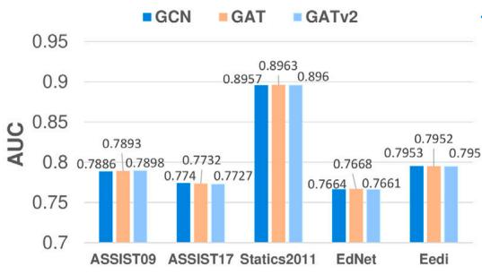  
(a) GNN encoder $f _ { \theta }$

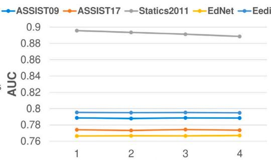  
(b) GNN layer L  
Fig. 4. The impact of $f _ { \theta }$ and � on DKT + QCKT (out of memory for graph attention networks on the ASSIST12 dataset).

Table 9  
Performance (AUC) of different � on DKT+QCKT.

<table><tr><td>φ</td><td>ASSIST09</td><td>ASSIST12</td><td>ASSIST17</td><td>Statics2011</td><td>EdNet</td><td>Eedi</td></tr><tr><td>0.0001</td><td>0.7878</td><td>0.7745</td><td>0.7724</td><td>0.8955</td><td>0.7656</td><td>0.7954</td></tr><tr><td>0.001</td><td>0.7884</td><td>0.7765</td><td>0.7734</td><td>0.8946</td><td>0.7659</td><td>0.7956</td></tr><tr><td>0.01</td><td>0.7886</td><td>0.7753</td><td>0.7740</td><td>0.8957</td><td>0.7664</td><td>0.7953</td></tr><tr><td>0.1</td><td>0.7880</td><td>0.7759</td><td>0.7713</td><td>0.8851</td><td>0.7663</td><td>0.7948</td></tr><tr><td>1</td><td>0.7845</td><td>0.7698</td><td>0.7678</td><td>0.8760</td><td>0.7654</td><td>0.7926</td></tr></table>

## 5.7.2. Parameter sensitivity

In this section, we investigate the impact of three crucial parameters on QCKT: the graph encoder $f _ { \theta } ,$ the number of GNN layers, and the balance coefficient $\varphi .$

As shown in Fig. 4.(a), we selected three types of graph encoders: GCN [44], GAT [45] and GATv2 [46], and compared their perfor mances. It can be observed that their performances are quite similar. This suggests that QCKT is not highly sensitive to the choice of $f _ { \theta } .$ . Due to higher memory demands with graph attention networks, we default to using GCN for $f _ { \theta }$

We selected the number of GNN layers $L \in \{ 1 , 2 , 3 , 4 \}$ , and their performance comparison is shown in Fig. 4.(b). We find that, except for the case of Statics2011, the choice of � does not significantly affect QCKT’s performance. The sharp performance decline in Statics2011 with increasing � is likely owing to the oversmoothing effect introduced by the GNN. We set $L = 1$ as the default value.

We also examined the impact of the balance coefficient $\varphi ,$ ranging from $\varphi \in \{ 0 . 0 0 0 1 , 0 . 0 0 1 , 0 . 0 1 , 0 . 1 , 1 \}$ , on QCKT’s performance, as shown in Table 9. It can be observed that too high of a $\varphi \left( \mathbf { e . g . , } \varphi = 1 \right)$ ) does not benefit QCKT, while excessively small varphi values $( { \bf e . g . } , \varphi = 0 . 0 0 0 1 )$ do not fully exploit QCKT’s advantages. When � is set to 0.001 or 0.01, the performance is notably superior. We set $\varphi = 0 . 0 1$ as the default value for our model.

## 5.8. Advantages (RQ5)

In this section, we demonstrate the advantages brought to the baseline model through the extension by QCKT: improved performance stability and more meaningful question representations.

## 5.8.1. T + N prediction

We conducted � + � prediction experiments to explore the stability of QCKT. In these experiments, denoted at the current time �, $T + N$ prediction involves not only predicting a student’s performance at the next time step, $T + 1 ,$ , but also predicting their performance at $T +$ $1 , T + 2 , \ldots , T + N$ . As � increases, if the model consistently maintains a high performance, it demonstrates stable predictive capabilities. We compared $\mathrm { D K T } + \mathrm { Q C K T }$ with other high-performance models (Table $^ { 2 ) , }$ as shown in Fig. 5. It can be found that: (1) Overall, DKT + QCKT consistently exhibits the best performance in all scenarios. This underscores the significant performance advantages QCKT provides to the baseline model. (2) When comparing DKT + QCKT with DKT, even as � increased, $\mathrm { D K T } + \mathrm { Q C K T }$ consistently outperformed DKT, and its performance degradation was more gradual. This undoubtedly highlights that, while QCKT enhances the baseline model’s performance, it also possesses remarkable stability.

## 5.8.2. Question visualization

We visualized the question representations learned by DKT-Q (where the input of DKT was modified to be questions) and DKT + QCKT on the ASSIST12 dataset (which contains only one concept per question) using t-SNE [70]. We labeled the questions using the concepts they encompassed and clustered them. To reduce the number of labels for ease of observation, we selected the top 10 concepts with the highest question counts and projected questions labeled with these concepts onto a 2-dimensional space, as shown in Fig. 6. It can be seen that: (1) From DKT-Q, it is apparent that the questions are arranged almost randomly, lacking any discernible patterns among them. Although DKT-Q performs reasonably well, from the perspective of question representation, it fails to provide meaningful interpretations. (2) In contrast, we can clearly see that DKT + QCKT learns question representations that naturally cluster around related concepts. This indicates that QCKT captures the relationship between questions and concepts, extending this relationship to the connections between questions. It is noteworthy that some questions were not clustered. This is normal because on a macro level, questions are clustered by concepts, but on a micro level, some individual variations are expected. These variations may capture more personalized aspects such as questions that are exceptionally difficult and deviate from the typical range of their associated concepts. In summary, the extension by QCKT resulted in more meaningful question representations.

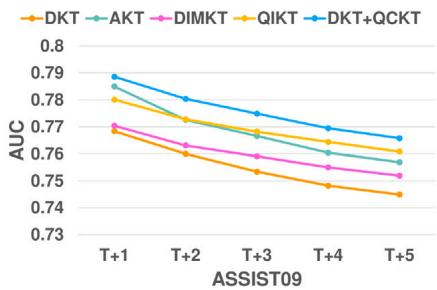

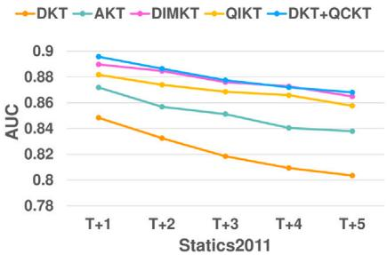  
Fig. 5. Performance comparison of T + N prediction.

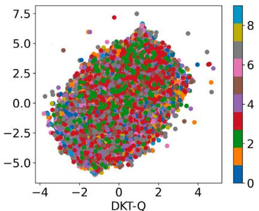

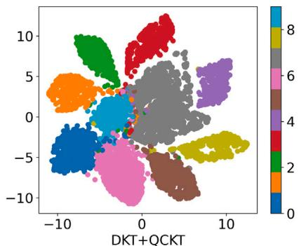  
Fig. 6. Question visualization on ASSIST12.

Table 10  
The Pearson correlation coefficient between the difficulty learned by QCKT and the statistical difficulty.

<table><tr><td>Dataset</td><td>ASSIST09</td><td>ASSIST12</td><td>ASSIST17</td><td>Statics2011</td><td>EdNet</td><td>Eedi</td></tr><tr><td>Pearson coefficient</td><td>0.6074</td><td>0.4256</td><td>0.5046</td><td>0.6687</td><td>0.8575</td><td>0.5184</td></tr></table>

## 5.9. Other analysis

## 5.9.1. Question difficulty analysis

In this section, we analyze the validity of the difficulty learned by QCKT. Specifically, we compared the learned difficulty values (denoted as �� in Eq. (4)) with the statistical difficulty (i.e., the question error rates in the dataset). We utilized the Pearson correlation coefficient as the evaluation metric, which ranges from −1 to 1, with values closer to 1 indicating a stronger correlation. The results are presented in Table 10, where we observe a high correlation between the difficulty values learned by QCKT and the statistical difficulty (mostly exceeding 0.5 and surpassing 0.8 on EdNet). This highlights the effectiveness of the difficulties learned by QCKT.

## 5.9.2. Application

The most interesting application of knowledge tracing may be to trace students’ knowledge states. Once a student’s knowledge mastery is accurately captured, teachers can provide targeted tutoring to help them. Fig. 7 shows the evolution process of tracing a student’s knowl edge state using DKT + QCKT. Specifically, we randomly selected a student from the ASSIST09 dataset who answered five questions in 25 time steps. As shown, when the student answers a question correctly or incorrectly during practice, their mastery of the question clearly strengthens or weakens, respectively. Moreover, as time passes, we find that the student gradually forgets questions he/she have previously mastered. Additionally, as the number of practice questions increased, the traced knowledge states became more stable. Overall, the student’s final knowledge state significantly improved compared to the beginning, even though he/she answered some questions incorrectly. This is consistent with our intuition that practicing questions benefits students’ knowledge mastery, and even answering questions incorrectly can enhance knowledge.

## 6. Conclusion

This paper proposes a novel Question-based Contrastive learning ap proach to enhance Knowledge Tracing (QCKT). This method improves upon the baseline models by incorporating an additional questionbased contrastive learning task. Specifically, we represent questions from two different perspectives: one is by utilizing relevant concepts and combining them with question difficulty information, and the other is by using a graph encoder to capture relationships between questions for question representation. Furthermore, we proposed five contrastive learning strategies based on different assumptions to learn the similarities and differences between these two question representations. We extended the 13 baseline models to six publicly available datasets to evaluate our approach. Extensive experiments have demonstrated that QCKT can significantly boost the performance, and many baseline models extended by QCKT exhibit the capability to surpass state-of-theart models. Moreover, experiments indicate that baseline models, after being extended by QCKT, exhibit a high level of stability in predicting student performance, while also learning more meaningful question representations. We believe that the simplicity and effectiveness of QCKT will offer new insights into the deeper study of knowledge tracing.

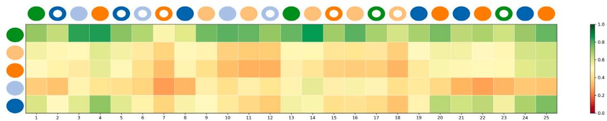  
Fig. 7. Example of a student’s knowledge state changes over 25 time steps for five questions in the ASSIST09 dataset. The �-axis represents the questions, with each question displayed as a circle of a different color. The �-axis represents student interactions (questions and answers). If the student answers a question correctly, the corresponding circle is displayed. If the student answers a question incorrectly, a white circle is added to the corresponding circle to indicate the difference.

## 7. Limitation and future work

Although the question representation learned by QCKT has the potential to significantly enhance other KT methods, it relies on associated concepts, a dependency prevalent in nearly all current KT methods. This paper has made some efforts to address this issue, such as the calculation of $F Q _ { 2 }$ (as the Concept-Aware Question Relationship Graph is a priori and theoretically replaceable by other graphs) and the inclusion of strategy $S _ { 5 } { } _ { ; }$ , which does not involve any concepts; however, this is insufficient. Overcoming the reliance on concepts for question representation constitutes the most significant limitation of QCKT and is a major deficiency of current KT approaches.

We believe that the use of fewer features, such as eliminating concepts, to advance KT is a promising direction. This approach relies heavily on unsupervised learning and data enhancement methods. However, in KT, unsupervised learning is still in the early stages of research, and the means of data enhancement are limited. Classic data enhancement methods, such as GAN [71], VAE [72] and MAE [73], have not been thoroughly explored for KT. Introducing them into KT is still an unexplored area. We hope to delve deeper into these directions in future work, aiming to solve the issue of concept dependency in question representations and provide more innovative solutions.

## CRediT authorship contribution statement

Xiaoxuan Shen: Writing – review & editing, Writing – original draft, Methodology. Fenghua Yu: Writing – review & editing, Writing – original draft, Formal analysis. Yaqi Liu: Formal analysis, Data curation, Conceptualization. Ruxia Liang: Supervision, Resources, Investigation, Conceptualization. Qian Wan: Visualization, Validation, Supervision. Tianhao Yang: Project administration, Methodology, Investigation, Conceptualization. Mengtian Shi: Validation, Software, Data curation, Conceptualization. Jianwen Sun: Supervision, Resources, Project administration, Methodology, Investigation.

## Declaration of competing interest

The authors declare that they have no known competing finan cial interests or personal relationships that could have appeared to influence the work reported in this paper.

## Acknowledgments

This work was financially supported by the National Key R&D Program of China (2023YFC3305704), National Natural Science Foundation of China (62307015). Youth Al Talents Fund of the Chinese Asso: ciation of Automation under Maior Program (HBRC-JKYZD-2024-310). Hubei Provincial Natural Science Foundation of China (2023AFA020), and Fundamental Research Funds for the Central Universities (CCNU25AI005).

## Data availability

The data that has been used is confidential

## References

[1] Y. Yin, L. Dai, Z. Huang, S. Shen, F. Wang, Q. Liu, E. Chen, X. Li, Tracing knowledge instead of patterns: Stable knowledge tracing with diagnostic transformer, in: Proceedings of the ACM Web Conference 2023, Association for Computing Machinery, 2023, pp. 855–864.

[2] G. Abdelrahman, Q. Wang, B. Nunes, Knowledge tracing: A survey, ACM Comput. Sury, 55 (11) (2023) 1–37.

[3] X. Song, J. Li, T. Cai, S. Yang, T. Yang, C. Liu, A survey on deep learning based knowledge tracing, Knowl.-Based Syst. 258 (2022) 110036.

[4] A.T. Corbett, J.R. Anderson, Knowledge tracing: Modeling the acquisition of procedural knowledge. User Model. User-Adapt. Interact. 4 (4) (1994) 253–278.

[5] M.V. Yudelson, K.R. Koedinger, G.J. Gordon, Individualized bayesian knowledge tracing models, in: International Conference on Artificial Intelligence in Education, Springer, 2013, pp. 171–180.

[6] K. Zhang, Y. Yao, A three learning states Bayesian knowledge tracing model, Knowl.-Based Syst. 148 (2018) 189–201.

[7] H. Cen, K. Koedinger, B. Junker, Learning factors analysis–a general method for cognitive model evaluation and improvement, in: International Conference on Intelligent Tutoring Systems, Springer, 2006, pp. 164–175.

[8] J.-J. Vie. H. Kashima. Knowledge tracing machines: Factorization machines for knowledge tracing, in: Proceedings of the AAAI Conference on Artificial Intelligence, 2019, pp. 750–757.

[9] P.I. Pavlik Jr., H. Cen, K.R. Koedinger, Performance factors analysis – a new alternative to knowledge tracing. in: International Conference on Artificial Intelligence in Education, Springer, 2009, pp. 531–538.

[10] T. Long, Y. Liu, J. Shen, W. Zhang, Y. Yu, Tracing knowledge state with individual cognition and acquisition estimation, in: Proceedings of the 44th International ACM SIGIR Conference on Research and Development in Information Retrieval, Association for Computing Machinery, 2021, pp. 173–182.

[11] S. Shen, Q. Liu, E. Chen, Z. Huang, W. Huang, Y. Yin, Y. Su, S. Wang, Learning process-consistent knowledge tracing, in: Proceedings of the 27th ACM SIGKDD International Conference on Knowledge Discovery & Data Mining, Association for Computing Machinery, 2021, pp. 1452–1460.

[12] H. Tong, Z. Wang, Y. Zhou, S. Tong, W. Han, Q. Liu, Introducing problem schema with hierarchical exercise graph for knowledge tracing, in: Proceedings of the 45th International ACM SIGIR Conference on Research and Development in Information Retrieval, Association for Computing Machinery, 2022, pp. 405–415.

[13] J. Sun, F. Yu, S. Liu, Y. Luo, R. Liang, X. Shen, Adversarial bootstrapped question representation learning for knowledge tracing, in: Proceedings of the 31st ACM International Conference on Multimedia, Association for Computing Machinery, 2023, pp. 8016–8025.

[14] S. Sonkar. A.E. Waters. A.S. Lan. PJ. Grimaldi. R.G. Baraniuk, gDKT: Ouestioncentric deep knowledge tracing, in: Proceedings of the 13th International Conference on Educational Data Mining, International Educational Data Mining Society, 2020, pp. 677–681.

[15] Y. Liu, Y. Yang, X. Chen, J. Shen, H. Zhang, Y. Yu, Improving knowledge tracing via pre-training question embeddings, in: Proceedings of the 29th International Joint Conference on Artificial Intelligence, Morgan Kaufmann, 2020, pp. 1577–1583.

[16] Q. Liu, Z. Huang, Y. Yin, E. Chen, H. Xiong, Y. Su, G. Hu, Ekt: Exercise-aware knowledge tracing for student performance prediction, IEEE Trans. Knowl. Data Eng. 33 (1) (2021) 100–115.

[17] Y. Su, Q. Liu, Q. Liu, Z. Huang, Y. Yin, E. Chen, C. Ding, S. Wei, G. Hu, Exercise-enhanced sequential modeling for student performance prediction, in: Proceedings of the AAAI Conference on Artificial Intelligence, AAAI Press, 2018, pp. 2435–2443.

[18] S. Pandey, J. Srivastava, RKT: relation-aware self-attention for knowledge tracing, in: Proceedings of the 29th ACM International Conference on Information & Knowledge Management, 2020 pp 1205-1214

[19] T. Wu, Q. Ling, Self-supervised heterogeneous hypergraph network for knowledge tracing, Inform. Sci. 624 (2023) 200–216.

[20] B. Xu, Z. Huang, J. Liu, S. Shen, Q. Liu, E. Chen, J. Wu, S. Wang, Learning behavior-oriented knowledge tracing, in: Proceedings of the 29th ACM SIGKDD International Conference on Knowledge Discovery & Data Mining, Association for Computing Machinery, 2023, pp. 2789–2800.

[21] M. Feng, N. Heffernan, K. Koedinger, Addressing the assessment challenge with an online system that tutors as it assesses, User Model. User-Adapt. Interact. 19 (2009) 243–266.

[22] Y. Choi, Y. Lee, D. Shin, J. Cho, S. Park, S. Lee, J. Baek, C. Bae, B. Kim, J. d l l hi hi l d i d i i i Conference on Artificial Intelligence in Education, Springer, 2020, pp. 69–73.

[23] Z. Wang, A. Lamb, E. Saveliev, P. Cameron, Y. Zaykov, J.M. Hernández-Lobato, R.E. Turner, R.G. Baraniuk, C. Barton, S.P. Jones, et al., Instructions and guide for diagnostic questions: The neurips 2020 education challenge, 2020, arXiv preprint arXiv:2007.12061.

[24] X. Xiong, S. Zhao, E.G. Van Inwegen, J.E. Beck, Going deeper with deep knowledge tracing, in: Proceedings of the 9th International Conference on Educational Data Mining, International Educational Data Mining Society, 2016, pp. 545–550.

[25] A. Ghosh, N. Heffernan, A.S. Lan, Context-aware attentive knowledge tracing, in: Proceedings of the 26th ACM SIGKDD International Conference on Knowledg Discovery & Data Mining, Association for Computing Machinery, 2020, pp. 2330–2339.

[26] Z. Liu, Q. Liu, J. Chen, S. Huang, W. Luo, simpleKT: a simple but tough-to beat baseline for knowledge tracing, in: International Conference on Learning Representations, 2023.

[27] T. Wang, F. Ma, J. Gao, Deep hierarchical knowledge tracing, in: Proceedings of the 12th International Conference on Educational Data Mining, Internationa Educational Data Mining Society, 2019, pp. 671–674.

[28] T. Chen, S. Kornblith, M. Norouzi, G. Hinton, A simple framework for contrastive learning of visual representations, in: Proceedings of the 37th International Conference on Machine Learning, PMLR, 2020, pp. 1597–1607.

[29] K. He, H. Fan, Y. Wu, S. Xie, R. Girshick, Momentum contrast for unsupervised visual representation learning, in: Proceedings of the IEEE/CVF Conference on Computer Vision and Pattern Recognition, 2020, pp. 9729–9738.

[30] K.H. Wilson, Y. Karklin, B. Han, C. Ekanadham, Back to the basics: Bayesian extensions of IRT outperform neural networks for proficiency estimation, in Proceedings of the 9th International Conference on Educational Data Mining, International Educational Data Mining Society, 2016, pp. 539–544.

[31] H. Cen, K. Koedinger, B. Junker, Learning factors analysis–a general method for cognitive model evaluation and improvement, in: International Conference on Intelligent Tutoring Systems, Springer, 2006, pp. 164–175.

[32] C. Piech, J. Bassen, J. Huang, S. Ganguli, M. Sahami, L.J. Guibas, J. Sohl-Dickstein, Deep knowledge tracing, in: Advances in Neural Information Processing Systems, Curran Associates, Inc, 2015, pp. 505–513.

[33] S. Hochreiter, J. Schmidhuber, Long short-term memory, Neural Comput. 9 (8) (1997).1735–1780

[34] K. Nagatani, Q. Zhang, M. Sato, Y.-Y. Chen, F. Chen, T. Ohkuma, Augmenting knowledge tracing by considering forgetting behavior, in: Proceedings of the 28th International Conference on World Wide Web, International World Wide Web Conferences Steering Committee, 2019, pp. 3101–3107.

[35] A. Graves, G. Wayne, I. Danihelka, Neural turing machines, 2014, arXiv preprint arXiv:1410.5401.

[36] J. Zhang, X. Shi, I. King, D.-Y. Yeung, Dynamic key-value memory networks for knowledge tracing, in: Proceedings of the 26th International Conference on World Wide Web. International World Wide Web Conferences Steering Committee, 2017, pp. 765–774.

[37] G. Abdelrahman, Q. Wang, Knowledge tracing with sequential key-value memory networks, in: Proceedings of the 42nd International ACM SIGIR Conference on Research and Development in Information Retrieval, Association for Computing Machinery, 2019, pp. 175–184

[38] G. Abdelrahman, Q. Wang, Deep graph memory networks for forgetting-robust knowledge tracing. JEEE Trans. Knowl. Data Eng. (2022)

[39] S. Pandey, G. Karypis, A self-attentive model for knowledge tracing, in: Proceedings of the 12th International Conference on Educational Data Mining, International Educational Data Mining Society, 2019, pp. 384–389.

[40] Y. Choi, Y. Lee, J. Cho, J. Baek, B. Kim, Y. Cha, D. Shin, C. Bae, J. Heo, Towards an appropriate query, key, and value computation for knowledge tracing, in: Proceedings of the Seventh ACM Conference on Learning Scale, Association for Computing Machinery, 2020, pp. 341–344.

[41] A. Vaswani, N. Shazeer, N. Parmar, J. Uszkoreit, L. Jones, A.N. Gomez, Ł. Kaiser, I. Polosukhin, Attention is all you need, in: Advances in Neural Information Processing Systems, Curran Associates, Inc, 2017, pp. 5998–6008.

[42] H. Nakagawa, Y. Iwasawa, Y. Matsuo, Graph-based knowledge tracing: modeling student proficiency using graph neural network, in: IEEE/WIC/ACM International Conference on Web Intelligence, Association for Computing Machinery, 2019, pp. 156–163.

[43] S. Tong, Q. Liu, W. Huang, Z. Hunag, E. Chen, C. Liu, H. Ma, S. Wang, Structure-based knowledge tracing: An influence propagation view, in: 2020 IEEF International Conference on Data Mining, ICDM, IEEE, 2020, pp. 541–550.

[44] T.N. Kipf, M. Welling, Semi-supervised classification with graph convolutional networks, in: International Conference on Learning Representations, 2017.

[45] P. Veličković, G. Cucurull, A. Casanova, A. Romero, P. Liò, Y. Bengio, Graph attention networks, in: International Conference on Learning Representations, 2018.

[46] S. Brody, U. Alon, E. Yahav, How attentive are graph attention networks? in: International Conference on Learning Representations, 2022

[47] S. Thakoor, C. Tallec, M.G. Azar, R. Munos, P. Veličković, M. Valko, Bootstrapped representation learning on graphs, in: ICLR 2021 Workshop on Geometrical and Topological Representation Learning, 2021.

[48] S. Yang, S. Verma, B. Cai, J. Jiang, K. Yu, F. Chen, S. Yu, Variational coembedding learning for attributed network clustering, Knowl.-Based Syst. 270 (2023) 110530.

[49] T. Mikolov, I. Sutskever, K. Chen, G.S. Corrado, J. Dean, Distributed representations of words and phrases and their compositionality, in: Advances in Neural Information Processing Systems, Curran Associates, Inc, 2013, pp. 3111–3119.

[50] P. Bojanowski, E. Grave, A. Joulin, T. Mikolov, Enriching word vectors with subword information, Trans. Assoc. Comput. Linguist. 5 (2017) 135–146.

[51] J. Sun, J. Zhou, K. Zhang, Q. Li, Z. Lu, Collaborative embedding for knowledge tracing, in: International Conference on Knowledge Science, Engineering and Management, Springer, 2021, pp. 333–342.

[52] A. Grover, J. Leskovec, Node2vec: Scalable feature learning for networks, in: Proceedings of the 22nd ACM SIGKDD International Conference on Knowledge Discovery and Data Mining, Association for Computing Machinery, 2016, pp. 855–864.

[53] Y. Yang, J. Shen, Y. Qu, Y. Liu, K. Wang, Y. Zhu, W. Zhang, Y. Yu, GIKT: a graph-based interaction model for knowledge tracing, in: Machine Learning and Knowledge Discovery in Databases, Springer, 2021, pp. 299–315.

[54] X. Song, J. Li, Q. Lei, W. Zhao, Y. Chen, A. Mian, Bi-CLKT: Bi-graph contrastive learning based knowledge tracing, Knowl.-Based Syst. 241 (2022) 108274.

[55] W. Hamilton. Z. Ying, J. Leskovec. Inductive representation learning on large graphs, in: Advances in Neural Information Processing Systems, Curran Associates, Inc, 2017

[56] K. He, X. Zhang, S. Ren, J. Sun, Deep residual learning for image recognition, in: Proceedings of the IEEE Conference on Computer Vision and Pattern Recognition, 2016, pp. 770–778.

[57] J. Zbontar, L. Jing, I. Misra, Y. LeCun, S. Deny, Barlow twins: Self-supervised learning via redundancy reduction, in: Proceedings of the 38th International Conference on Machine Learning, PMLR, 2021, pp. 12310–12320.

[58] D.P. Kingma, J. Ba, Adam: A method for stochastic optimization, in: International Conference on Learning Representations. 2015

[59] J. Lee, D.-Y. Yeung, Knowledge query network for knowledge tracing: How knowledge interacts with skills, in: LAK19: 9th International Learning Analytics and Knowledge Conference, 2019, pp. 491–500.

[60] C.-K. Yeung, Deep-IRT: Make deep learning based knowledge tracing explainable using item response theory, in: Proceedings of the 12th International Conference on Educational Data Mining, International Educational Data Mining Society, 2019. pp. 683–686

[61] X. Guo, Z. Huang, J. Gao, M. Shang, M. Shu, J. Sun, Enhancing knowledge tracing via adversarial training, in: Proceedings of the 29th ACM International f l i di i i f i hi 367–375.

[62] W. Lee, J. Chun, Y. Lee, K. Park, S. Park, Contrastive learning for knowledge tracing, in: Proceedings of the ACM Web Conference 2022, Association for Computing Machinery, 2022, pp. 2330–2338

[63] S. Shen, Z. Huang, Q. Liu, Y. Su, S. Wang, E. Chen, Assessing student’s dynamic knowledge state by exploring the question difficulty effect, in: Proceedings of the 45th International ACM SIGIR Conference on Research and Development in Information Retrieval. Association for Computing Machinery. 2022, pp. 427–437.

[64] J. Chen, Z. Liu, S. Huang, Q. Liu, W. Luo, Improving interpretability of deep sequential knowledge tracing models with question-centric cognitive representations, in: Proceedings of the AAAI Conference on Artificial Intelligence, AAAI Press, 2023.

[65] S. Suresh, P. Li, C. Hao, J. Neville, Evolutionary neural architecture search for transformer in knowledge tracing, in: Advances in Neural Information Processing S stems, Curran Associates, Inc, 2023.

[66] Z. Liu, Q. Liu, J. Chen, S. Huang, B. Gao, W. Luo, J. Weng, Enhancing deep knowledge tracing with auxiliary tasks, in: Proceedings of the ACM Web Conference 2023, Association for Computing Machinery, 2023, pp. 4178–4187.

[67] X. Song, J. Li, Y. Tang, T. Zhao, Y. Chen, Z. Guan, Jkt: A joint graph convolutional network based deep knowledge tracing, Inform. Sci. 580 (2021) 510–523.

[68] W. Zhao, J. Xia, X. Jiang, T. He, A novel framework for deep knowledge tracing via gating-controlled forgetting and learning mechanisms, Inf, Process. Manage 60 (1) (2023) 103114.

[69] J. Sun, F. Yu, Q. Wan, Q. Li, S. Liu, X. Shen, Interpretable knowledge tracing with multiscale state representation, in: Proceedings of the ACM Web Conference 2024, Association for Computing Machinery, 2024, pp. 3265–3276.

[70] L. Van der Maaten, G. Hinton, Visualizing data using t-SNE, J. Mach. Learn. Res. 9 (11) (2008) 2579–2605.

[71] I. Goodfellow, J. Pouget-Abadie, M. Mirza, B. Xu, D. Warde-Farley, S. Ozair, A. Courville, Y. Bengio, Generative adversarial nets, Curran Associates, Inc, 2014.

[72] D.P. Kingma, M. Welling, Auto-encoding variational Bayes, in: International Conference on Learning Representations, 2014.

[73] K. He, X. Chen, S. Xie, Y. Li, P. Dollár, R. Girshick, Masked autoencoders are scalable vision learners, in: Proceedings of the IEEE/CVF Conference on Computer Vision and Pattern Recognition, 2022, pp. 16000–16009.