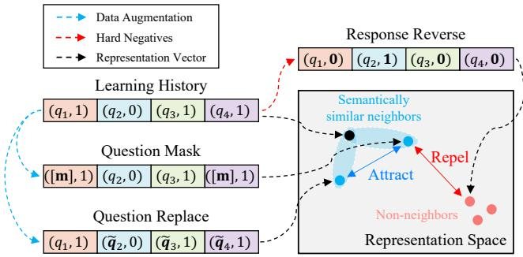
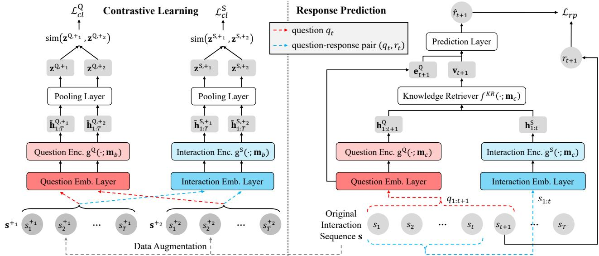
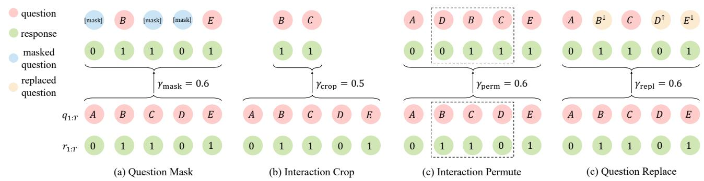
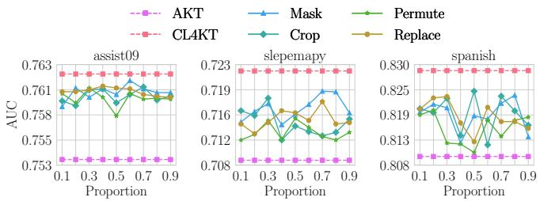
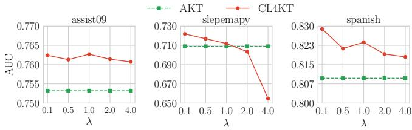
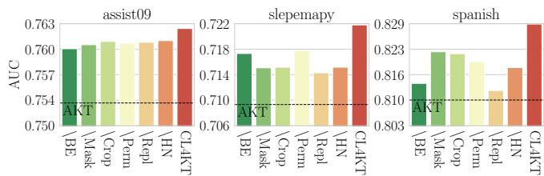
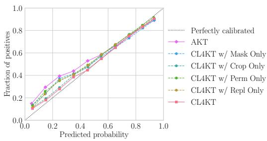

# Contrastive Learning for Knowledge Tracing

Wonsung Lee Upstage Republic of Korea wonsung.lee@upstage.ai

Jaeyoon Chun i-Scream Edu Co. Ltd Republic of Korea jaeychun@i-screamedu.co.kr

Kyoungsoo Park i-Scream Edu Co. Ltd Republic of Korea kspark0818@i-screamedu.co.kr

## ABSTRACT

Knowledge tracing is the task of understanding student’s knowl edge acquisition processes by estimating whether to solve the next question correctly or not. Most deep learning-based methods tackle this problem by identifying hidden representations of knowledge states from learning histories. However, due to the sparse interac tions between students and questions, the hidden representations can be easily over-fitted and often fail to capture student’s knowl edge states accurately. This paper introduces a contrastive learning framework for knowledge tracing that reveals semantically similar or dissimilar examples of a learning history and stimulates to learn their relationships. To deal with the complexity of knowledge ac quisition during learning, we carefully design the components of contrastive learning, such as architectures, data augmentation meth ods, and hard negatives, taking into account pedagogical rationales. Our extensive experiments on six benchmarks show statistically significant improvements from the previous methods. Further anal ysis shows how our methods contribute to improving knowledge tracing performances.

## CCS CONCEPTS

• Social and professional topics → Student assessment; • Ap plied computing → Learning management systems.

## KEYWORDS

knowledge tracing, educational data mining, intelligent tutoring system, personalized learning, contrastive learning

## ACM Reference Format:

Wonsung Lee, Jaeyoon Chun, Youngmin Lee, Kyoungsoo Park, and Sungrae Park. 2022. Contrastive Learning for Knowledge Tracing. In Proceedings of the ACM Web Conference 2022 (WWW’22), April 25–29, 2022, Virtual Event, Lyon, France. ACM, New York, NY, USA, 9 pages. https://doi.org/10.1145 3485447.3512105

Youngmin Lee KAIST Republic of Korea cacaz@kaist.ac.kr

Sungrae Park Upstage Republic of Korea sungrae.park@upstage.ai

  
Figure 1: Conceptual diagram of CL4KT. Once semantically similar or dissimilar learning histories are identified through data augmentations, CL learns their representations to be close to each other for similar samples (blue points) and to be far from dissimilar samples (red points).

## 1 INTRODUCTION

Over the past decades, the use of artificial intelligence (AI) techniques to improve educational practices has grown exponentially. The recent COVID-19 school closures have further accelerated this adoption. The introduction of AI for education demands personalized educational platforms that deliver a tailored curriculum to an individual learner. Accordingly, intelligent tutoring systems (ITS) have received significant attention in AI for education. The ability to recognize each student’s current knowledge states and provide appropriate questions to the students through the large-scale learning data obtained from the online learning environment is the key to the success of ITS.

Knowledge tracing (KT), one of the fundamental tasks of ITS, is to estimate the student’s knowledge states given the previous learning interactions consisting of responses to questions over time. Previous approaches [5, 28, 32, 45] have tried to capture an efective representation of the knowledge state, which enables predicting future responses to questions. While the existing methods of KT have had some success in ITS, they still sufer from the sparse nature of educational data. In the ITS environment, students are likely to interact with only a limited number of questions because they are apt to depend on the curriculum provided by the system. As a result, the representations learned from the sparse dataset tend to be easily biased or over-fitted, which hinders the accurate inference of latent knowledge states. To compensate for the issue, recent studies have devised various ways, e.g., pre-trained embeddings [24] and comparing predicted probabilities of original and augmented samples [21]. However, none of the previous attempts for enhancing the representations adopts an end-to-end architecture to discriminate instances based on low-dimensional latent vectors.

In this paper, we propose a contrastive learning (CL) framework for KT, named CL4KT. The main idea of CL4KT is to learn efec tive representations by pulling similar learning histories together and pushing dissimilar learning histories apart in representation space. To encode the learning histories of students, we use multiple Transformer [38] encoders: question and interaction encoders for learning histories and a knowledge retriever predicting the response on the following questions. When predicting the future response, we use unidirectional encoders to prevent future information leakage. On the other hand, when learning contrastive representations, we leverage bidirectional self-attentive encoders to summarize the entire context ofa learning history from both directions, which is in spired by [37]. Also, we design domain-specific data augmentation methods tailored to reflect the semantics of each learning history. In contrast to typical sequential prediction tasks using a single type of tokens such as words or items, KT uses a learning history consist ing of two inter-dependent tokens (questions and responses). With this in mind, we utilize four data augmentation methods and hard negatives to reveal semantically similar and dissimilar learning histories, and the contrastive loss stimulates learning their rela tionships. Figure 1 illustrates the CL in our method. By imposing semantic relations on the representation space, CL4KT can learn generalizable representations from sparse learning histories.

Our experiments extensively evaluate the proposed method on six KT benchmarks: algebra05, algebra06, assistments09, slepemapy, spanish, and statics. As a result, CL4KT shows con sistent and statistically significant performance improvements com pared to the previous KT methods in all the benchmarks. We also provide ablation studies on the components of CL4KT, including bidirectional encoders for CL, augmentation modules, and the use of hard negatives, for understanding each contribution. Further analysis demonstrates how CL4KT leads to better KT performances.

## 2 RELATED WORK

## 2.1 Knowledge Tracing

Modeling the knowledge acquisition process is challenging due to the complexity and heterogeneity of educational data [13, 14]. To address this issue, numerous attempts have been made, including probabilistic [5], logistic [1, 31], and deep learning-based models [32, 40, 45]. Recently, deep learning for KT has been studied from multiple aspects. Since the pioneering work of Piech et al. [32], various strategies have been explored: e.g., application of Transformers [3, 11, 28, 34] and the use ofside information such as textual contents [29, 36], temporal features [26, 39], and graph relations between entities [27].

Although several KT methods have been introduced, they sufer from the inherent sparsity issues on KT datasets, as mentioned in the introduction. Liu et al. [24] and Lee et al. [21] tackle the prob lem by pre-training question embeddings and data augmentation, respectively. In contrast, this paper addresses the issue with a CL framework. Our work difers from the previous studies in several respects. First, compared to Liu et al. [24], we exploit an end-to-end architecture. Therefore, our method does not require any side information or domain knowledge which are often costly to gather as well as multistage training schedules (such as pre-training then fine-tuning). Secondly, unlike Lee et al. [21] utilizing only positively augmented samples, our framework introduces negative samples that play a pivotal role in devising efective self-supervised signals. In addition, we exploit an instance discrimination approach based on the latent space, not the observational space.

## 2.2 Contrastive Learning

CL is a special branch of self-supervised learning [23] and has shown promising performances in diverse domains, including computer vision (CV) [2, 12, 42], natural language processing (NLP) [4, 9], and recommender systems (RecSys) [43, 44]. As revealed by recent studies, tailored data augmentation methods to a specific task are crucial for the success of CL. Various augmentation methods have been utilized: e.g., cropping, rotation, and color distortion of CV, and masking words or features of NLP and RecSys. In contrast to typical sequential prediction tasks using a single type of tokens such as words or items, this paper deals with student’s learning history consisting of two kinds of inter-dependent tokens: questions and responses. Due to this unique characteristic and the discrete nature of the learning histories, we carefully design our CL framework to devise meaningful self-supervised signals.

## 3 METHOD

Figure 2 provides an overview of CL4KT consisting of CL and response prediction (RP) frameworks. This section starts with a formal definition of KT tasks (§3.1). Next, we demonstrate the main components of CL4KT, including the shared model architectures (§3.2), the RP (§3.3), and the CL (§3.4). Then, we define the similar or dissimilar learning histories (§3.5 and §3.6), specialized in KT tasks. Finally, the learning objective of CL4KT (§3.7) is defined.

## 3.1 Problem Statement

The learning history of student u is defined as a sequence of interactions, $\pmb { s } _ { u } = ( s _ { u , 1 } , s _ { u , 2 } , . . . , s _ { u , T _ { u } } )$ where $T _ { u }$ is the length. For simplicity, we omit the subscript u unless specified otherwise. Each interaction consists of a tuple: $s _ { t } = ( q _ { t } , r _ { t } )$ , where $q _ { t } \in \mathbb { N } ^ { + }$ is the t-th question and $r _ { t } \in \{ 0 , 1 \}$ is the response result; 1 is correct and 0 is incorrect. Given the sequence of interactions $( s _ { 1 } , s _ { 2 } , . . . , s _ { t } )$ and the next question $q _ { t + 1 }$ , KT aims to determine the probability of answering the next question correctly:

$$
\hat {r} _ {t + 1} = p (r _ {t + 1} = 1 | s _ {1}, s _ {2}, \dots , s _ {t}, q _ {t + 1}).\tag{1}
$$

To achieve this goal, most KT methods assume two hidden representations, $\mathbf { h } _ { t } ^ { Q }$ and $\mathbf { h } _ { t } ^ { \mathsf { S } } .$ , which condense a number of questions and interactions respectively at time t. Using these representations, the KT task is reformulated as follows:

$$
\begin{array}{l} \hat {r} _ {t + 1} = f (\mathbf {h} _ {1: t + 1} ^ {\mathsf {Q}}, \mathbf {h} _ {1: t} ^ {\mathsf {S}}), \\ \text {where} \mathbf {h} _ {t + 1} ^ {\mathsf {Q}} = g ^ {\mathsf {Q}} (q _ {1: t + 1}) \text {and} \mathbf {h} _ {t} ^ {\mathsf {S}} = g ^ {\mathsf {S}} (s _ {1: t}). \end{array}\tag{2}
$$

Here, $g ^ { \mathrm { Q } } ( \cdot )$ and $g ^ { \mathsf { S } } ( \cdot )$ are functions for identifying question-level and interaction-level representations, respectively. Finally, $f ( \cdot )$ is a function providing the final prediction. It should be noted that f utilizes question representations $\mathbf { h } _ { 1 : t + 1 } ^ {  Q }$ including the next question $q _ { t + 1 }$ and interaction representations $\mathbf { h } _ { 1 : t } ^ { \mathsf { S } }$ up to the current step to provide the response result on the next question, without seeing the ground truth, $r _ { t + 1 }$

  
Figure 2: Overall architecture of CL4KT. The left side and the right side indicate the CL and RP frameworks, respectively. Note that we use shared encoders, question encoder $g ^ { 2 }$ (red) and interaction encoder $g ^ { \mathsf { S } }$ (blue).

## 3.2 Model Architecture

As shown in Figure 2, CL4KT includes two embedding layers and two encoders, for both questions and interactions.

3.2.1 Embedding Layers. In the embedding layers, we create a question embedding matrix $\mathbf { E } ^ { Q } \in \mathbb { R } ^ { M \times d }$ and an interaction embedding matrix $\mathbf { E } ^ { \mathsf { S } } \in \mathbb { R } ^ { 2 M \times d }$ , where d denotes the dimension of the embed dings and M indicates the number of questions. The two matrices project the one-hot vectors to dense representations. Following the previous studies on KT [32, 45], for a given interaction $s _ { t } = ( q _ { t } , r _ { t } ) ,$ let $\mathbf { e } _ { t } ^ { \mathsf { Q } } = \mathbf { E } _ { q _ { t } } ^ { \mathsf { Q } } \in \mathbb { R } ^ { d }$ and $\mathbf { e } _ { t } ^ { \mathsf { S } } = \mathbf { E } _ { q _ { t } + M * r _ { t } } ^ { \mathsf { S } } \in \mathbb { R } ^ { d }$ be a question and an interaction embedding vectors at each time t, respectively.

3.2.2 Encoder Architecture. To encode a series of questions and interactions, we employ two Transformer encoders [38]: a question encoder $g ^ { 2 }$ and an interaction encoder $g ^ { \mathsf { S } }$ . For a given sequence of question embeddings, $\mathbf { e } _ { 1 : t } ^ { \ Q }$ , the question encoder $g _ { t } ^ { \mathsf { Q } }$ learns the question representation; $\mathbf { h } _ { t } ^ { \boldsymbol { Q } } = g _ { t } ^ { \boldsymbol { Q } } ( \mathbf { e } _ { 1 : t } ^ { \boldsymbol { Q } } ; \mathbf { m } )$ . Similarly, the interaction encoder $g _ { t } ^ { \mathsf { S } }$ takes the interaction embeddings $\mathbf { e } _ { 1 : t } ^ { \mathsf { S } }$ to extract the interaction representation; $\mathbf { h } _ { t } ^ { \mathbb { S } } = g _ { t } ^ { \mathbb { S } } ( \mathbf { e } _ { 1 : t } ^ { \mathbb { S } } ; \mathbf { m } )$ . Here, the subscript t of $g ^ { 0 }$ and $g ^ { \mathsf { S } }$ indicates the position of the outputs identified by the parallel computations of the Transformer encoders. The m rep resents the attention mask controlling references of the attention modules. Each Transformer encoder mostly follows the original architecture consisting of the self-attention and feed-forward lay ers, but we additionally employ the modified scaled-dot product attention function proposed by Ghosh et al. [11].

## 3.3 Response Prediction Framework

The RP framework predicts the learner’s response to the next question. Therefore, the question and interaction encoders are formulated as follows:

$$
\mathbf {h} _ {t + 1} ^ {\mathrm{Q}} = g _ {t + 1} ^ {\mathrm{Q}} (\mathbf {e} _ {1: t + 1} ^ {\mathrm{Q}}; \mathbf {m} _ {c}) \quad \mathrm{and} \quad \mathbf {h} _ {t} ^ {\mathrm{S}} = g _ {t} ^ {\mathrm{S}} (\mathbf {e} _ {1: t} ^ {\mathrm{S}}; \mathbf {m} _ {c}),\tag{3}
$$

where $\mathbf { m } _ { c }$ denotes a causal mask having the efect of zeroing out the attention weights of the subsequent positions. Following Ghosh et al. [11], we also utilize an additional Transformer encoder $f ^ { \mathsf { K R } }$ named a knowledge retriever, to combine the question and interaction representations for the next response prediction.

Specifically, in the attention module of the knowledge retriever, $\mathbf { h } _ { t + 1 } ^ { 0 }$ becomes a query, $\mathbf { h } _ { 1 : t } ^ {  Q }$ are keys, and $\mathbf { h } _ { 1 : t } ^ { \mathsf { S } }$ are the corresponding values. That is, the knowledge retriever captures the related questions in the history and refers their response results to identify the next response. The formal description of the knowledge retriever is as follows:

$$
\mathbf {v} _ {t + 1} = f ^ {\mathsf {K R}} (\mathsf {q} = \mathbf {h} _ {t + 1} ^ {\mathsf {Q}}, \mathsf {k} = \mathbf {h} _ {1: t} ^ {\mathsf {Q}}, \mathsf {v} = \mathbf {h} _ {1: t} ^ {\mathsf {S}}; \mathbf {m} _ {c}),\tag{4}
$$

where $\mathbf { v } _ { t + 1 } \in \mathbb { R } ^ { d }$ is the output vector, q, k, and v represent query, key, and value, respectively. Finally, CL4KT concatenates $\mathbf { v } _ { t + 1 }$ and ${ \mathbf e } _ { t + 1 } ^ { 0 }$ , and this is fed into a two-layer fully-connected network followed by a sigmoid function to generate the predicted probability $\hat { r } _ { t + 1 } \in [ 0 , 1 ]$ . The loss function of the RP framework is defined as the binary cross-entropy between $r _ { t }$ and $\hat { r _ { t } } \mathrm { : }$

$$
\mathcal {L} _ {r p} = \sum_ {t} - (r _ {t} \log \hat {r} _ {t} + (1 - r _ {t}) \log (1 - \hat {r} _ {t})).
$$

## 3.4 Contrastive Learning Framework

CL aims to learn hidden representations that are close to each other for semantically similar (positive) samples and far from those of quite diferent (negative) samples. For successfully applying CL to KT, we define three major components: (1) data augmentation, (2) representations accounting for the learning history, and (3) a contrastive loss.

  
Figure 3: A brief illustration of augmentation methods: (a) Question mask, (b) Interaction crop, (c) Interaction permute, and (d) Question replace methods. ↓ and ↑ denote the corresponding easier and more dificult questions, respectively.

3.4.1 Data Augmentation. Stochastic data augmentation is applied to each student’s learning history s. We then obtain two correlated views of the same history, denoted as $\mathbf { s } ^ { + _ { 1 } }$ and $\mathbf { s } ^ { + _ { 2 } }$ , which we consider as a positive pair. We exploit the composition of several augmentation modules. This composition reflects diverse facets of data and makes our CL framework more robust to perturbations, resulting in significant improvement regarding performance. Our augmentation modules will be described in more detail in §3.5.

3.4.2 Representation for Learning History. The individual knowl edge acquisition process is heterogeneous due to the diferent nature of students and tutors. In ITS, a student’s learning history can be used to reflect the diferent characteristics of knowledge acquisition. To identify the representations of the entire learning history, we condense two types of multiple hidden representations, $\mathbf { h } ^ { \ell _ { s } }$ and $\mathbf { h } ^ { \mathsf { S } } \mathbf { s } ,$ , provided by the Transformer encoders, $g ^ { 0 }$ and $g ^ { \mathsf { S } }$ Especially, when encoding the history s, we employ bidirectional self-attentions by setting the mask, m, as $\mathbf { m } _ { b }$ allowing all references without zeroing out. In other words, the hidden representations of questions and interactions making progress themselves by referring the entire history. More formally, let $\tilde { \mathbf { h } } _ { 1 : T } ^ {  Q }$ and $\tilde { \mathbf { h } } _ { 1 : T } ^ { \mathsf { S } }$ denote the question and interaction representations with bidirectional selfattentions:

$$
\tilde {\mathbf {h}} _ {1: T} ^ {\mathrm{Q}} = g _ {1: T} ^ {\mathrm{Q}} (\mathbf {e} _ {1: T} ^ {\mathrm{Q}}; \mathbf {m} _ {b}) \qquad \tilde {\mathbf {h}} _ {1: T} ^ {\mathrm{S}} = g _ {1: T} ^ {\mathrm{S}} (\mathbf {e} _ {1: T} ^ {\mathrm{S}}; \mathbf {m} _ {b}).\tag{5}
$$

Finally, the representations of entire question and interaction histories are defined as follows;

$$
\mathbf {z} ^ {\mathrm{Q}} = \operatorname{pool} (\tilde {\mathbf {h}} _ {1: T} ^ {\mathrm{Q}}) \qquad \mathbf {z} ^ {\mathrm{S}} = \operatorname{pool} (\tilde {\mathbf {h}} _ {1: T} ^ {\mathrm{S}}),\tag{6}
$$

where pool(·) is an average pooling layer. The final outputs, $\mathbf { z } ^ { 0 }$ ∈ $\mathbb { R } ^ { d }$ and $\mathbf { z } ^ { \mathsf { S } } \in \mathbb { R } ^ { d }$ , are utilized as the representations for comparison in the CL framework

3.4.3 Contrastive Loss. We define a contrastive loss function to learn efective representations by pulling semantically close positive pairs together and pushing apart negative samples. For each learning history, a positive pair, $( \pmb { \mathsf { s } } ^ { + _ { 1 } }$ and $\mathbf { s } ^ { + _ { 2 } } )$ , is obtained from the data augmentation. Through the encoders, the positive pair is con verted into two pairs of representations: $( \mathbf { z } ^ { 0 , + _ { 1 } } , \mathbf { z } ^ { 0 , + _ { 2 } } )$ for question histories and $( \mathbf { z } ^ { \mathsf { S } , + _ { 1 } } , \mathbf { z } ^ { \mathsf { S } , + _ { 2 } } )$ for interaction histories. Following Chen et al. [2], we take a cross-entropy objective with in-batch negatives. Specifically, we treat the representations of augmented samples from other histories within the same mini-batch as negative representations: $\mathbf { z } ^ { 0 , - } \in \mathcal { Z } ^ { \ L ^ { 0 , - } }$ and $\mathbf { z } ^ { \mathsf { S } , - } \in \mathcal { Z } ^ { \mathsf { S } , - }$ . Finally, contrastive losses, $\mathcal { L } _ { c l } ^ { \mathrm { Q } }$ and $\mathcal { L } _ { c l } ^ { \mathsf { S } } .$ are calculated as follows;

$$
\begin{array}{r l} & {\mathcal {L} _ {c l} ^ {Q} = - \log \frac {e ^ {\mathrm{sim} (\mathbf {z} ^ {Q , + 1} , \mathbf {z} ^ {Q , + 2})}}{e ^ {\mathrm{sim} (\mathbf {z} ^ {Q , + 1} , \mathbf {z} ^ {Q , + 2})} + \sum_ {\mathbf {z} ^ {Q , -} \in \mathcal {Z} ^ {Q , -}} e ^ {\mathrm{sim} (\mathbf {z} ^ {Q , + 1} , \mathbf {z} ^ {Q , -})}},} \\ & {\mathcal {L} _ {c l} ^ {S} = - \log \frac {e ^ {\mathrm{sim} (\mathbf {z} ^ {S , + 1} , \mathbf {z} ^ {S , + 2})}}{e ^ {\mathrm{sim} (\mathbf {z} ^ {S , + 1} , \mathbf {z} ^ {S , + 2})} + \sum_ {\mathbf {z} ^ {S , -} \in \mathcal {Z} ^ {S , -}} e ^ {\mathrm{sim} (\mathbf {z} ^ {S , + 1} , \mathbf {z} ^ {S , -})}},} \end{array}\tag{7}
$$

(8)

where sim indicates a temperature-scaled cosine similarity function as in Chen et al. [2].

## 3.5 Details of Learning History Augmentation

Due to the complexity and the unique characteristics of KT tasks, it is challenging to directly utilize the existing data augmentation methods in CV and NLP. Therefore, we introduce novel data augmentation methods for KT to consider these issues. Specifically, we carefully design augmentation methods so that each student’s proficiency indicated by the learning history after data augmentation is similar to before. CL4KT uses multiple data augmentation methods to generate correlated views of the student’s learning history. Figure 3 briefly illustrates the augmentation modules.

Question mask: Inspired by the success of masked language models such as BERT [6], we introduce a question mask method that replaces some questions in the original history with a special token [mask], without changing their responses. Specifically, for each example, we randomly mask some questions with the probability ofγmask. Properly masked learning histories can be seen as noisy views of an original learning history. As learning progresses, CL4KT is trained to denoise the masked learning histories based on the context surrounding a [mask] token. Also, since this augmentation promotes estimating missing contexts, the representations can avoid being biased by sparse educational data.

Interaction crop: Random cropping is a commonly used data augmentation technique to create a random subset of original data. The cropped data can help machine learning models generalize better by providing a local view of data. Inspired by this, our interaction crop method extracts a sub-sequence from the original history. The sub-sequence can provide local views of the entire learning history. For each example, we extract a continuous sub sequence with length $L _ { \mathsf { c } } = \lfloor \gamma _ { \mathsf { c r o p } } * T \rfloor$ given a randomly selected starting point.

Interaction permute: The interaction permute method re-orders interactions in a sub-sequence of the original history. The rationale behind the permute module is that student’s knowledge states represented by an interaction sequence remain similar even if the order within the sequence is changed. Also, it is assumed that each student’s proficiency is kept consistent within an interaction sequence because a student does not access additional learning materials while solving the problems. For instance, a student who has mastered a particular knowledge concept will be able to solve the problems relevant to the concept regardless of the order in which they are given. For each example, we randomly shufle the continuous sub-sequence $( s _ { r } , s _ { r + 1 } , . . . , s _ { r + L _ { \mathsf { p } } - 1 } )$ , which starts at a random point r with length $L _ { \mathsf { p } } = \lfloor \gamma _ { \mathsf { p e r m } } * \dot { T } \rfloor$

Question replace1: The question replace method converts original questions to easier or more dificult questions based on their responses. This module aims to obtain an augmented learning his tory that exhibits similar knowledge states to the original learning history, even if some questions have been replaced. To achieve this goal, we leverage an automatically constructed relationship between questions. Inspired by the previous pedagogical literature [7], we exploit a knowledge structure capturing cognitive rela tions among the learning materials (e.g., prerequisite relations). For simplicity, we posit that the knowledge structure is a chain-type directed acyclic graph based on the question dificulty. To be spe cific, we build the question sequence that sorted in the descending order by their probability of correct answer computed in training data: $\{ q _ { ( 1 ) } , q _ { ( 2 ) } , . . . , q _ { ( M ) } \}$ , where M is the number of questions. $q _ { ( 1 ) }$ and $q ( M )$ are the easiest and most dificult questions, respectively. Note that the knowledge structure can be easily modified to more complex structures.

Along with this, we hypothesize that a student who has mastered complex higher-level concepts is more likely to answer the straight forward lower-level concepts correctly and vice versa. Intuitively speaking, a student who has mastered the concept of Trigonometric functions can easily solve Addition and subtraction questions. Con versely, a student who does not understand the concept of Addition and subtraction will not be able to solve questions of Trigonometric functions.. Therefore, for each example, we choose interactions randomly with the probability $\gamma _ { \mathsf { r e p 1 } }$ and replace their questions to easier questions if the response is correct or to more dificult questions otherwise, without changing their responses. Given the c-th question $q _ { t } = q _ { ( c ) }$ and $k \in \mathbb { N } ^ { + }$ , its easier $( q _ { ( c - k ) } )$ and more dificult $( q _ { ( c + k ) } )$ questions can be sampled based on the order of its dificulty. Note that this kind of replacement does not drastically change the student’s proficiency.

Table 1: The statistics of datasets.

<table><tr><td>Datasets</td><td>#students</td><td>#questions</td><td>#skills</td><td>#interactions</td></tr><tr><td>algebra05</td><td>571</td><td>173,113</td><td>112</td><td>607,014</td></tr><tr><td>algebra06</td><td>1,138</td><td>129,263</td><td>493</td><td>1,817,450</td></tr><tr><td>assist09</td><td>3,695</td><td>17,728</td><td>112</td><td>282,071</td></tr><tr><td>slepemapy</td><td>5,000</td><td>2,723</td><td>1,391</td><td>625,523</td></tr><tr><td>spanish</td><td>182</td><td>409</td><td>221</td><td>578,726</td></tr><tr><td>statics</td><td>333</td><td>-</td><td>1,223</td><td>189,297</td></tr></table>

## 3.6 Hard Negative Samples of Learning History

Aside from the data augmentations for positive samples, we produce hard negative samples by changing responses. It is well known that the introduction of meaningful hard negatives is crucial for learning efective representations [9, 16, 33]. In our early experiments, we observe that the changes in responses, such as masking and replacement, are not beneficial in terms of data augmentation making positive pairs. This is because these changes in binary response variables lead to a substantial semantic diference. Based on this observation, we reverse responses to produce hard negative samples. For each example, we choose interactions randomly with the probability $\gamma _ { \mathsf { n e g } }$ and reverse their responses: $\tilde { r } _ { t } = 1 - r _ { t }$ . The representations of the hard negatives are added to $\mathcal { Z } ^ { \mathrm { { S - } } } \mathrm { i n } \mathrm { E q . } \left( 7 \right)$ to facilitate better learning. Our hard negative samples can modulate the hardness of the CL task without increasing the batch size.

## 3.7 Model Learning

The overall objective function of CL4KT is defined as a linear combination of the RP loss, $\mathcal { L } _ { \boldsymbol { r p } { : } }$ and the CL loss, $\mathcal { L } _ { c l } = \mathcal { L } _ { c l } ^ { 0 } + \mathcal { L } _ { c l } ^ { \mathtt { S } } \mathrm { : }$

$$
\mathcal {L} = \mathcal {L} _ {r p} + \lambda \mathcal {L} _ {c l},\tag{9}
$$

where λ denotes the hyperparameter governs the influence of selfsupervised learning signals. During a training phase, learnable parameters are optimized by minimizing Eq. (9).

## 4 EXPERIMENTS

In this section, we conduct experiments on six real-world datasets to evaluate the proposed CL4KT framework. Specifically, we aim to answer the following research questions. (RQ1) How does the proposed CL4KT framework performs compared to the state-of-theart KT methods? (RQ2) How do diferent augmentation methods and their hyperparameters afect the performance ofCL4KT? (RQ3) How does the weight λ of the CL loss impact on the performance? Does the CL framework assist in improving existing models? (RQ4) What is the influence of various components of CL4KT, such as encoder architectures, augmentation methods, and hard negatives? (RQ5) Does our CL4KT provide useful representations?

## 4.1 Experimental Settings

4.1.1 Datasets. We use six real-world datasets to validate the effectiveness of our model.

• algebra05 and algebra06: Algebra I 2005-2006 (algebra05) and Bridge to Algebra 2006-2007 (algebra06) are provided by the KDD Cup 2010 EDM Challenge [35].

Table 2: Performance comparison of diferent models on six datasets in terms of AUC and RMSE. We conduct 5-fold cross validation and report the average value. The best performance and second best performance models are denoted in bold and underlined, respectively. ∗ and ∗∗ indicate the statistical significance with $\textstyle p < 0 . 0 5$ and $\textstyle p < 0 . 0 1$ compared to the best baseline method, respectively.

<table><tr><td>Dataset</td><td>Metric</td><td>IRT</td><td>PFA</td><td>DKT</td><td>DKVMN</td><td>SAKT</td><td>AKT</td><td>CL4KT</td></tr><tr><td rowspan="2">algebra05</td><td>AUC</td><td>0.7141</td><td>0.7481</td><td>0.7636</td><td>0.7562</td><td>0.7637</td><td> $\underline{0.7676}$ </td><td> $0.7891^{**}$ </td></tr><tr><td>RMSE</td><td>0.4005</td><td>0.3932</td><td>0.3921</td><td>0.3907</td><td> $\underline{0.3899}$ </td><td>0.3952</td><td> $0.3815^{**}$ </td></tr><tr><td rowspan="2">algebra06</td><td>AUC</td><td>0.6559</td><td>0.7460</td><td> $\underline{0.7589}$ </td><td>0.7463</td><td>0.7512</td><td>0.7474</td><td> $0.7733^{**}$ </td></tr><tr><td>RMSE</td><td>0.4025</td><td>0.3848</td><td> $\underline{0.3820}$ </td><td>0.3864</td><td>0.3862</td><td>0.3896</td><td> $0.3791^{**}$ </td></tr><tr><td rowspan="2">assist09</td><td>AUC</td><td>0.6708</td><td>0.7284</td><td>0.7504</td><td>0.7475</td><td>0.7491</td><td> $\underline{0.7532}$ </td><td> $0.7624^{**}$ </td></tr><tr><td>RMSE</td><td>0.4631</td><td>0.4444</td><td> $\underline{0.4371}$ </td><td>0.4375</td><td>0.4381</td><td>0.4372</td><td> $0.4333^{**}$ </td></tr><tr><td rowspan="2">slepemapy</td><td>AUC</td><td>0.6210</td><td>0.6583</td><td>0.6986</td><td>0.7064</td><td>0.6846</td><td> $\underline{0.7090}$ </td><td> $0.7218^{**}$ </td></tr><tr><td>RMSE</td><td>0.4068</td><td>0.4020</td><td>0.3978</td><td> $\underline{0.3962}$ </td><td>0.4062</td><td>0.3978</td><td> $0.3926^{**}$ </td></tr><tr><td rowspan="2">spanish</td><td>AUC</td><td>0.6956</td><td>0.7467</td><td>0.8066</td><td>0.8027</td><td>0.8065</td><td> $\underline{0.8097}$ </td><td> $0.8289^{*}$ </td></tr><tr><td>RMSE</td><td>0.4596</td><td>0.4428</td><td> $\underline{0.4139}$ </td><td>0.4156</td><td>0.4179</td><td>0.4177</td><td> $0.4049^{*}$ </td></tr><tr><td rowspan="2">statics</td><td>AUC</td><td>0.7404</td><td>0.7489</td><td>0.7674</td><td>0.7736</td><td>0.7492</td><td> $\underline{0.7872}$ </td><td> $0.7943^{*}$ </td></tr><tr><td>RMSE</td><td>0.4303</td><td>0.4096</td><td>0.4111</td><td>0.3975</td><td>0.4105</td><td> $\underline{0.3967}$ </td><td> $0.3945^{*}$ </td></tr></table>

• assist09 [8]: The ASSISTment 2009-2010 dataset is collected from the ASSISTment intelligent tutoring system.

• slepemapy [30]: This dataset comes from an online system, slepemapy.cz, providing adaptive practice of geography facts. We randomly sample 625 523 interactions of 5 000 students.

• spanish [22]: This dataset consists of records of middleschool students practicing spanish exercises.

• statics [20]: This dataset consists of records of a collegelevel engineering statics course.

For dataset preprocessing, we follow the standard practice in [10]. We discard students with less than five interactions and remove all interactions that are not associated with a named concept. Since questions can be tagged with multiple skills, we converted each unique combination of skills to a new skill. Table 1 illustrates the main characteristics of the datasets.

4.1.2 Evaluation Metrics. We perform 5-fold cross-validation for quantitative evaluation, in which folds are split based on the stu dents. Additionally, we set aside 10% of the training set as a valida tion set. The validation set is used to tune hyperparameters as well as to determine an early stopping point. We compare all approaches in terms of AUC (area under the receiver operating characteristic curve) and root mean squared error (RMSE).

4.1.3 Baselines. For comparison, we use the following baselines.

• IRT [17]: Item Response Theory (IRT) takes a form oflogistic regression with student’s ability and question’s dificulty.

• PFA [31]: Performance Factor Analysis (PFA) is also a logistic regression model with question’s dificulty, prior successes, and prior failures.

• DKT [32]: Deep Knowledge Tracing (DKT) is a seminal KT method that uses a single layer LSTM.

• DKVMN [45]: Dynamic Key-Value Memory Network (DKVMN) is a memory augmented neural network modeling individual concepts.

• SAKT [28]: Self-Attentive model for Knowledge Tracing (SAKT) exploits a Transformer architecture to capture longterm dependencies between student’s learning interactions.

• AKT [11]: Context-Aware Attentive Knowledge Tracing (AKT), a state-of-the-art method in KT, exploits contextaware embeddings based on additional question-skill relations and a modified Transformer architecture with adaptive attention weights computed by a distance-aware exponential decay.

4.1.4 Implementation Details. We implement CL4KT in PyTorch and the code is publicly available2. The embedding and hidden sizes are fixed to d = 64 for all models. We consider the last 100 interactions for each student because we focus on the recent information essential for predicting the future. For the CL framework, we set λ as 0.1 and tune the augmentation parameters, γmask, γcrop, γperm, and $\gamma _ { \mathsf { r e p l } }$ , within the range of {0 3 0 5 0 7}. For hard negative samples, we tune $\gamma _ { \mathsf { n e g } }$ within the range of {0 1 0 5 1 0}. The models are optimized by Adam [18] with a batch size of 512 and an initial learning rate of 0 001. Early stopping strategy is applied if AUC on the validation set does not increase for 10 epochs.

## 4.2 Overall Performance (RQ1)

Table 2 illustrates the overall evaluation results. In contrast to most existing work using only AUC, our experiments use both AUC and RMSE for a more comprehensive comparison. From the results, we have the following observations. First, in most cases, DKT outperforms logistic regression models (IRT and PFA). This seems to be due to the fact that, unlike logistic regression having limited access to the precise temporal order of interactions, LSTM-based DKT can naturally utilize the temporal information of students’ learning history. In some cases, DKT is superior to SAKT, DKVMN, and AKT, which is consistent with previous studies [11, 25, 39]. Next, a superior baseline difers depending on datasets and evaluation metrics. In terms of AUC, AKT shows the second-best AUC value in most datasets except algebra06. However, in terms of RMSE, the best baseline varies across datasets. For example, DKT is superior to other baselines in terms of RMSE in algebra05, assist09, and spanish, but not in other datasets. When it comes to comparing the performance of AKT and SAKT, additional question-skill rela tions in AKT appear to play an important role in a Transformer architecture to capture students’ knowledge states. Finally, CL4KT performs consistently better than all the baselines in terms of both AUC and RMSE. Compared to other baselines, CL4KT adopts the CL framework with domain-specific data augmentations and hard negatives to introduce efective self-supervised signals for KT. Our experimental results verify that the self-supervised signals play a pivotal role in enhancing the representations of knowledge states, resulting in better performance, even without additional inputs.

  
Figure 4: Impact of the diferent augmentation methods with diferent proportions on AUC.

## 4.3 Comparison on Augmentations (RQ2)

We study how diferent data augmentation methods and their hy perparameters afect the KT performance. To analyze the efect of each augmentation method, we use only one augmentation method in the CL framework with varying proportion parameters, γmask, γcrop, γperm, and $\gamma _ { \mathsf { r e p 1 } }$ , from 0 1 to 0 9. In the following, we report AUC values on assist09, slepepmapy, and spanish because these datasets represent the knowledge acquisition in diferent sub jects such as mathematics, geography, and language, respectively. Figure 4 reveals three interesting facts.

First, we observe that CL4KT equipped with a single augmen tation method can outperform AKT on all datasets for all choices of proportion parameters. This verifies that the efectiveness of an individual augmentation method generating useful learning sig nals. Also, CL4KT is superior to the other cases using an individual augmentation method on all datasets, indicating the efectiveness of the composition of multiple augmentation methods. Second, the most efective augmentation method difers depending on the datasets. For example, in assist09 and slepemapy, the question mask method is, on average, superior to other methods, while in spanish the interaction crop method is better than others. This result implies that the most efective augmentation varies across datasets because each augmentation focuses on diferent character istics of learning histories. Finally, extreme values of the proportion parameter appear to be detrimental to performance. In most cases, the performance peaks at a particular proportion parameter and then degrades as we increase or decrease the parameter.

  
Figure 5: Performance comparison with respect to λ.

Table 3: Performance of DKT, SAKT, $\mathbf { D K T _ { c l : } }$ $\mathbf { s A K T _ { c l } } ,$ and CL4KT with an individual data augmentation. The best performance is denoted in bold.

<table><tr><td>Aug.</td><td>Method</td><td>assist09</td><td>slepemapy</td><td>spanish</td></tr><tr><td rowspan="2">None</td><td>DKT</td><td>0.7504</td><td>0.6986</td><td>0.8066</td></tr><tr><td>SAKT</td><td>0.7491</td><td>0.6846</td><td>0.8065</td></tr><tr><td rowspan="3">Mask</td><td> $DKT_{cl}$ </td><td>0.7574</td><td>0.7051</td><td>0.8108</td></tr><tr><td> $SAKT_{cl}$ </td><td>0.7505</td><td>0.6904</td><td>0.8123</td></tr><tr><td>CL4KT</td><td>0.7617</td><td>0.7189</td><td>0.8234</td></tr><tr><td rowspan="3">Crop</td><td> $DKT_{cl}$ </td><td>0.7571</td><td>0.7047</td><td>0.8135</td></tr><tr><td> $SAKT_{cl}$ </td><td>0.7512</td><td>0.6879</td><td>0.8126</td></tr><tr><td>CL4KT</td><td>0.7610</td><td>0.7179</td><td>0.8243</td></tr><tr><td rowspan="3">Permute</td><td> $DKT_{cl}$ </td><td>0.7575</td><td>0.7042</td><td>0.8122</td></tr><tr><td> $SAKT_{cl}$ </td><td>0.7510</td><td>0.6884</td><td>0.8141</td></tr><tr><td>CL4KT</td><td>0.7609</td><td>0.7150</td><td>0.8201</td></tr><tr><td rowspan="3">Replace</td><td> $DKT_{cl}$ </td><td>0.7572</td><td>0.7049</td><td>0.8135</td></tr><tr><td> $SAKT_{cl}$ </td><td>0.7507</td><td>0.6875</td><td>0.8113</td></tr><tr><td>CL4KT</td><td>0.7611</td><td>0.7174</td><td>0.8231</td></tr></table>

## 4.4 Impact of Contrastive Loss (RQ3)

To analyze the impact of the CL Loss, we first examine the influence of the CL loss by varying λ in Eq. (9). As shown in Figure 5, we observe a significant decrease in KT performance when λ increased above a certain threshold in some cases. This seems to be because $\mathcal { L } _ { c l }$ overwhelms $\mathcal { L } _ { \boldsymbol { r } \boldsymbol { p } }$ in Eq. (9). Since our goal is to identify hidden representations of the knowledge states that help predict learner performance, it is required to balance between the RP and CL frameworks.

Next, to further verify the efectiveness of the CL loss, we apply the CL framework to the existing baselines, DKT and SAKT. We enhance DKT and SAKT by applying the CL framework with a single augmentation method. As shown in Table 3, we report AUC values of three kinds of methods: 1) DKT and SAKT without the CL loss; 2) the enhanced baselines with the CL loss $\mathrm { ( D K T _ { c l } }$ and ${ \mathrm { S A K T } } _ { \mathrm { c l } } ) ;$ and 3) CL4KT with an individual augmentation method. We observe that, regardless of the type of augmentation, the enhanced baselines are consistently better than their counterpart in all datasets. This result indicates that our CL framework has the versatility that can be applied to existing methods. On the other hand, CL4KT with an individual augmentation outperforms the enhanced baselines, showing that our RP framework is more efective in capturing useful self-supervised signals.

  
Figure 6: Performance comparison between CL4KT and its variants: without bidirectional encoders (\BE), without each augmentation method (\Mask, \Crop, \Perm, \Repl), and without hard negative samples (\HN).

  
Figure 7: Calibration binned by predictions on assist09.

## 4.5 Ablation Study (RQ4)

To verify the efectiveness of each component, we compare CL4KT with six variants in terms of AUC: \BE replacing mb with mc in Eq. (5) (without bidirectional encoders); \Mask, \Crop, \Perm, and \Repl removing the corresponding augmentation; and \HN indi cating without hard negatives. Figure 6 shows the results revealing the following interesting observations.

First, regarding the augmentation methods, removing each aug mentation method results in a performance loss. The \Repl shows the largest performance loss on average, which shows the efective ness of the question replace method in discovering representations of knowledge states. Also, we observe empirical evidence for the efectiveness of the composition of multiple augmentations, which is consistent with prior work [2].

Second, \BE sufers from performance deterioration, which means that considering bidirectional contexts of knowledge states can be useful in capturing the self-supervised signals from raw data. It is well known that, even in sequential prediction tasks, the bidi rectional representations can play a pivotal role in improving the performance without information leakage [37].

Lastly, hard negative samples result in an additional benefit in performance. The CL4KT variant without hard negatives, \HN, sufers a moderate loss. This implies that our reverse response method can generate meaningful negative samples modulating the hardness of the CL framework.

## 4.6 Quality of Representations (RQ5)

As KT has been applied in various scenarios, it has become criti cal to measure the quality of representations from KT models. To analyze the quality of representations, we provide the following results: 1) the calibration of KT models, which is crucial for downstream applications such as learning resource recommendation and adaptive learning [10]; and 2) comparison between AKT and CL4KT in terms of uniformity [41] that is proposed to measure the quality of representations. First, we visualize the calibration plots to detect systematic biases of KT models by measuring the diference between predicted probabilities and observed frequencies. Figure 7 shows the diferent calibration results of AKT and CL4KT. Although AKT underestimates learners when the probability of correct answers is low, CL4KT is well-calibrated and does not reveal any severe biases. This diference shows that CL4KT can alleviate the sparsity issue, resulting in better representations and better predictions. Also, we observe that the composition of multiple augmentation methods is efective for calibration. Next, we compare AKT and CL4KT in terms of uniformity measuring how well the embeddings are uniformly distributed. Since random instances are required to be scattered on a hypersphere, a lower uniformity value indicates better quality. We report the uniformity values of representations of questions and interactions, $\mathbf { h } _ { 1 : T } ^ {  Q }$ and $\mathbf { h } _ { 1 : T } ^ { \mathsf { S } } ,$ respectively. Table 4 demonstrates that CL4KT outperforms AKT on all datasets, showing that our CL framework can contribute to learning efective representations of knowledge acquisition.

Table 4: Uniformity values of learned representations from AKT and CL4KT. Lower numbers are beter.

<table><tr><td>Uniformity</td><td>Method</td><td>assist09</td><td>slepemapy</td><td>spanish</td></tr><tr><td rowspan="2">Question</td><td>AKT</td><td>-2.920</td><td>-3.210</td><td>-1.337</td></tr><tr><td>CL4KT</td><td>-2.954</td><td>-3.226</td><td>-1.382</td></tr><tr><td rowspan="2">Interaction</td><td>AKT</td><td>-3.143</td><td>-3.444</td><td>-1.977</td></tr><tr><td>CL4KT</td><td>-3.185</td><td>-3.468</td><td>-2.097</td></tr></table>

## 5 CONCLUSION

In this work, we present a general CL framework for KT. To construct useful self-supervised signals reflecting the characteristics of the learning histories, we carefully devise bidirectional encoders for CL, data augmentation modules, and the use of hard negatives. Our framework can capture more efective representations of knowledge states, improving learner’s performance prediction. Extensive experiments on real-world datasets show that our model can outperform the state-of-the-art methods in terms of both prediction performance and representation quality. We also provide ablation studies to analyze the contribution of each component.

As ITS are increasingly being deployed in educational institutions around the world, a vast amount of learning data is being collected and analyzed for adaptive and personalized education [15]. Therefore, we believe that self-supervised learning approaches such as CL4KT, which finds useful information from inherent patterns of data itself, can have a broader impact on technologies to innovate teaching and learning practices.

## ACKNOWLEDGMENTS

The authors would like to thank the anonymous reviewers for their valuable comments and helpful suggestions.

## REFERENCES

[1] Hao Cen, Kenneth Koedinger, and Brian Junker. 2006. Learning factors analysis–a general method for cognitive model evaluation and improvement. In International Conference on Intelligent Tutoring Systems. Springer, 164–175.

[2] Ting Chen, Simon Kornblith, Mohammad Norouzi, and Geofrey Hinton. 2020. A simple framework for contrastive learning of visual representations. In International conference on machine learning. PMLR, 1597–1607.

[3] Youngduck Choi, Youngnam Lee, Junghyun Cho, Jineon Baek, Byungsoo Kim, Yeongmin Cha, Dongmin Shin, Chan Bae, and Jaewe Heo. 2020. Towards an ap propriate query, key, and value computation for knowledge tracing. In Proceedings ofthe Seventh ACM Conference on Learning@ Scale. 341–344

[4] Kevin Clark, Minh-Thang Luong, Quoc V Le, and Christopher D Manning. 2020. Electra: Pre-training text encoders as discriminators rather than generators. arXiv preprint arXiv:2003.10555 (2020).

[5] Albert T Corbett and John R Anderson. 1994. Knowledge tracing: Modeling the acquisition of procedural knowledge. User modeling and user-adapted interaction 4, 4 (1994), 253–278.

[6] Jacob Devlin, Ming-Wei Chang, Kenton Lee, and Kristina Toutanova. 2018. Bert: Pre-training ofdeep bidirectional transformers for language understanding. arXiv preprint arXiv:1810.04805 (2018).

[7] Jean-Paul Doignon and Jean-Claude Falmagne. 2012. Knowledge spaces. Springer Science & Business Media

[8] Mingyu Feng, Neil Hefernan, and Kenneth Koedinger. 2009. Addressing the assessment challenge with an online system that tutors as it assesses. User modeling and user-adapted interaction 19, 3 (2009), 243–266.

[9] Tianyu Gao, Xingcheng Yao, and Danqi Chen. 2021. SimCSE: Simple Contrastive Learning of Sentence Embeddings. arXiv preprint arXiv:2104.08821 (2021).

[10] Theophile Gervet, Ken Koedinger, Jef Schneider, Tom Mitchell, et al. 2020. When is Deep Learning the Best Approach to Knowledge Tracing? JEDM| Journal of Educational Data Mining 12, 3 (2020), 31–54.

[11] Aritra Ghosh, Neil Hefernan, and Andrew S Lan. 2020. Context-aware atten tive knowledge tracing. In Proceedings ofthe 26th ACM SIGKDD International Conference on Knowledge Discovery & Data Mining. 2330–2339.

[12] Kaiming He, Haoqi Fan, Yuxin Wu, Saining Xie, and Ross Girshick. 2020. Momen tum contrast for unsupervised visual representation learning. In Proceedings of the IEEE/CVF Conference on Computer Vision and Pattern Recognition. 9729–9738.

[13] Sumyea Helal, Jiuyong Li, Lin Liu, Esmaeil Ebrahimie, Shane Dawson, Duncan J Murray, and Qi Long. 2018. Predicting academic performance by considering student heterogeneity. Knowledge-Based Systems 161 (2018), 134–146.

[14] Ángel Hernández-García and Miguel Ángel Conde. 2014. Dealing with complex ity: educational data and tools for learning analytics. In Proceedings ofthe Second International Conference on Technological Ecosystems for Enhancing Multiculturality. 263–268.

[15] Wayne Holmes, Maya Bialik, and Charles Fadel. 2019. Artificial intelligence in education. Boston: Center for Curriculum Redesign (2019).

[16] Yannis Kalantidis, Mert Bülent Sariyildiz, Noé Pion, Philippe Weinzaepfel, and Diane Larlus. 2020. Hard Negative Mixing for Contrastive Learning. In Advances in Neural Information Processing Systems 33: Annual Conference on Neural Information Processing Systems 2020, NeurIPS 2020, December 6-12, 2020, virtual, Hugo Larochelle, Marc’Aurelio Ranzato, Raia Hadsell, Maria-Florina Balcan, and Hsuan-Tien Lin (Eds.).

[17] Mohammad M Khajah, Yun Huang, José P González-Brenes, Michael C Mozer, and Peter Brusilovsky. 2014. Integrating knowledge tracing and item response theory: A tale of two frameworks. In CEUR Workshop proceedings, Vol. 1181. University of Pittsburgh, 7–15.

[18] Diederik P. Kingma and Jimmy Ba. 2015. Adam: A Method for Stochastic Opti mization. In 3rd International Conference on Learning Representations, ICLR 2015, San Diego, CA, USA, May 7-9, 2015, Conference Track Proceedings, Yoshua Bengio and Yann LeCun (Eds.). http://arxiv.org/abs/1412.6980

[19] Sosuke Kobayashi. 2018. Contextual augmentation: Data augmentation by words with paradigmatic relations. arXiv preprint arXiv:1805.06201 (2018).

[20] Kenneth R Koedinger, Ryan SJd Baker, Kyle Cunningham, Alida Skogsholm, Brett Leber, and John Stamper. 2010. A data repository for the EDM community: The PSLC DataShop. Handbook of educational data mining 43 (2010), 43–56.

[21] Seewoo Lee, Youngduck Choi, Juneyoung Park, Byungsoo Kim, and Jinwoo Shin. 2021. Consistency and Monotonicity Regularization for Neural Knowledge Tracing. arXiv preprint arXiv:2105.00607 (2021).

[22] Robert V Lindsey, Mohammad Khajah, and Michael C Mozer. 2014. Automatic discovery of cognitive skills to improve the prediction of student learning. In Advances in neural information processing systems. 1386–1394.

[23] Xiao Liu, Fanjin Zhang, Zhenyu Hou, Li Mian, Zhaoyu Wang, Jing Zhang, and Jie Tang. 2021. Self-supervised learning: Generative or contrastive. IEEE Transactions on Knowledge and Data Engineering (2021).

[24] Yunfei Liu, Yang Yang, Xianyu Chen, Jian Shen, Haifeng Zhang, and Yong Yu. 2020. Improving Knowledge Tracing via Pre-training Question Embeddings. In Proceedings of the Twenty-Ninth International Joint Conference on Artificial Intelligence, IJCAI 2020, Christian Bessiere (Ed.). ijcai.org, 1577–1583. https:

//doi.org/10.24963/ijcai.2020/219

[25] Ting Long, Yunfei Liu, Jian Shen, Weinan Zhang, and Yong Yu. 2021. Tracing Knowledge State with Individual Cognition and Acquisition Estimation. In Proceedings of the 44th International ACM SIGIR Conference on Research and Development in Information Retrieval. 173–182.

[26] Koki Nagatani, Qian Zhang, Masahiro Sato, Yan-Ying Chen, Francine Chen, and Tomoko Ohkuma. 2019. Augmenting knowledge tracing by considering forgetting behavior. In The world wide web conference. 3101–3107.

[27] Hiromi Nakagawa, Yusuke Iwasawa, and Yutaka Matsuo. 2019. Graph-based knowledge tracing: modeling student proficiency using graph neural network. In 2019 IEEE/WIC/ACM International Conference on Web Intelligence (WI). IEEE, 156–163.

[28] Shalini Pandey and George Karypis. 2019. A self-attentive model for knowledge tracing. arXiv preprint arXiv:1907.06837 (2019).

[29] Shalini Pandey and Jaideep Srivastava. 2020. Rkt: Relation-aware self-attention for knowledge tracing. In Proceedings ofthe 29th ACM International Conference on Information & Knowledge Management. 1205–1214.

[30] Jan Papoušek, Radek Pelánek, and Vít Stanislav. 2016. Adaptive geography practice data set. Journal ofLearning Analytics 3, 2 (2016), 317–321.

[31] Philip I Pavlik Jr, Hao Cen, and Kenneth R Koedinger. 2009. Performance Factors Analysis–A New Alternative to Knowledge Tracing. Online Submission (2009).

[32] Chris Piech, Jonathan Bassen, Jonathan Huang, Surya Ganguli, Mehran Sahami, Leonidas J Guibas, and Jascha Sohl-Dickstein. 2015. Deep Knowledge Tracing. Advances in Neural Information Processing Systems 28 (2015), 505–513.

[33] Joshua David Robinson, Ching-Yao Chuang, Suvrit Sra, and Stefanie Jegelka. 2021. Contrastive Learning with Hard Negative Samples. In 9th International Conference on Learning Representations, ICLR 2021, Virtual Event, Austria, May 3-7, 2021. OpenReview.net. https://openreview.net/forum?id=CR1XOQ0UTh-

[34] Dongmin Shin, Yugeun Shim, Hangyeol Yu, Seewoo Lee, Byungsoo Kim, and Youngduck Choi. 2021. Saint+: Integrating temporal features for ednet correct ness prediction. In LAK21: 11th International Learning Analytics and Knowledge Conference. 490–496.

[35] J Stamper, A Niculescu-Mizil, S Ritter, G Gordon, and K Koedinger. 2010. Algebra I 2005-2006 and Bridge to Algebra 2006-2007. Development data sets from KDD Cup 2010 Educational Data Mining Challenge.

[36] Yu Su, Qingwen Liu, Qi Liu, Zhenya Huang, Yu Yin, Enhong Chen, Chris Ding, Si Wei, and Guoping Hu. 2018. Exercise-enhanced sequential modeling for student performance prediction. In Proceedings of the AAAI Conference on Artificial Intelligence, Vol. 32.

[37] Fei Sun, Jun Liu, Jian Wu, Changhua Pei, Xiao Lin, Wenwu Ou, and Peng Jiang. 2019. BERT4Rec: Sequential recommendation with bidirectional encoder rep resentations from transformer. In Proceedings of the 28th ACM international conference on information and knowledge management. 1441–1450.

[38] Ashish Vaswani, Noam Shazeer, Niki Parmar, Jakob Uszkoreit, Llion Jones, Aidan N Gomez, Łukasz Kaiser, and Illia Polosukhin. 2017. Attention is all you need. In Advances in neural information processing systems. 5998–6008.

[39] Chenyang Wang, Weizhi Ma, Min Zhang, Chuancheng Lv, Fengyuan Wan, Huijie Lin, Taoran Tang, Yiqun Liu, and Shaoping Ma. 2021. Temporal Cross-Efects in Knowledge Tracing. In Proceedings of the 14th ACM International Conference on Web Search and Data Mining. 517–525

[40] Fei Wang, Qi Liu, Enhong Chen, Zhenya Huang, Yuying Chen, Yu Yin, Zai Huang, and Shijin Wang. 2020. Neural cognitive diagnosis for intelligent education systems. In Proceedings of the AAAI Conference on Artificial Intelligence, Vol. 34. 6153–6161.

[41] Tongzhou Wang and Phillip Isola. 2020. Understanding contrastive representation learning through alignment and uniformity on the hypersphere. In International Conference on Machine Learning. PMLR, 9929–9939.

[42] Zhirong Wu, Yuanjun Xiong, Stella X. Yu, and Dahua Lin. 2018. Unsupervised Feature Learning via Non-Parametric Instance Discrimination. In Proceedings of the IEEE Conference on Computer Vision and Pattern Recognition (CVPR).

[43] Xu Xie, Fei Sun, Zhaoyang Liu, Shiwen Wu, Jinyang Gao, Bolin Ding, and Bin Cui. 2020. Contrastive Learning for Sequential Recommendation. arXiv preprint arXiv:2010.14395 (2020).

[44] Tiansheng Yao, Xinyang Yi, Derek Zhiyuan Cheng, Felix Yu, Ting Chen, Aditya Menon, Lichan Hong, Ed H Chi, Steve Tjoa, Jieqi Kang, et al. 2020. Self-supervised Learning for Large-scale Item Recommendations. arXiv preprint arXiv:2007.12865 (2020).

[45] Jiani Zhang, Xingjian Shi, Irwin King, and Dit-Yan Yeung. 2017. Dynamic keyvalue memory networks for knowledge tracing. In Proceedings of the 26th international conference on World Wide Web. 765–774.

[46] Xiang Zhang, Junbo Zhao, and Yann LeCun. 2015. Character-level convolutional networks for text classification. Advances in neural information processing systems 28 (2015), 649–657.